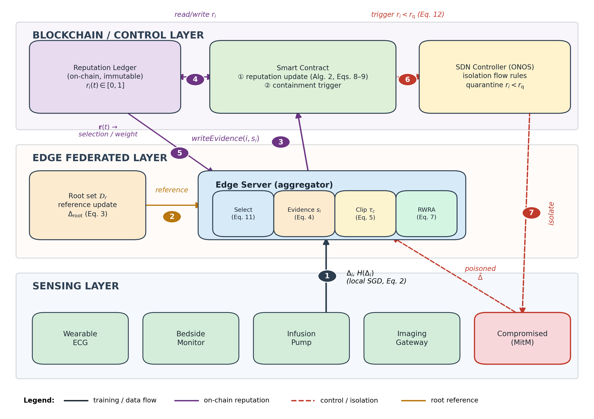
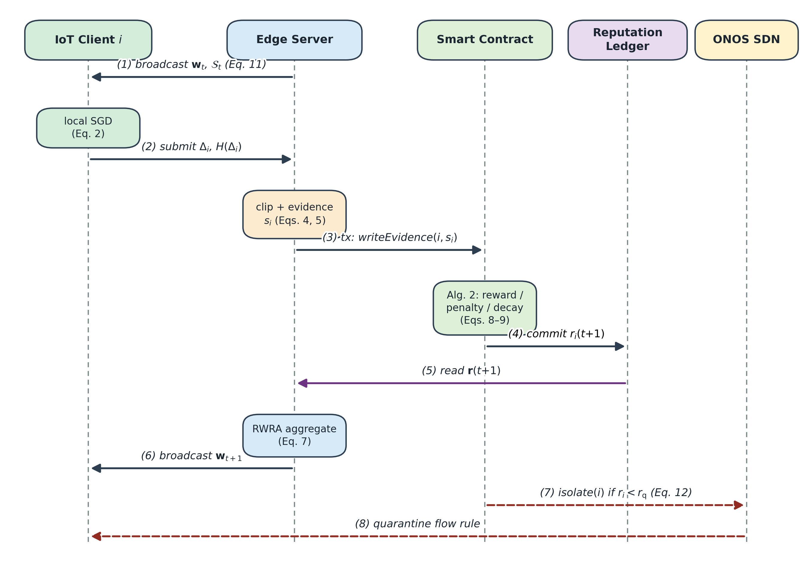
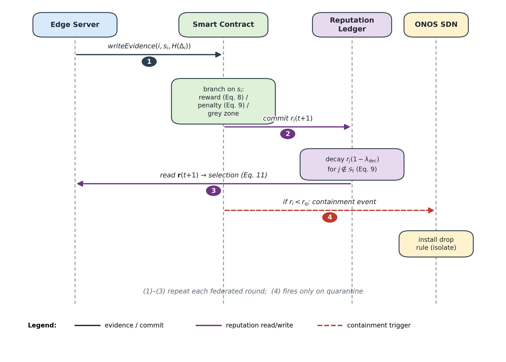
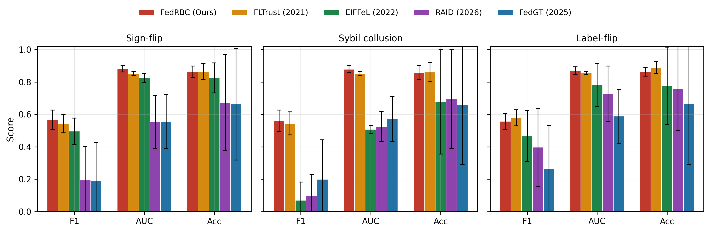
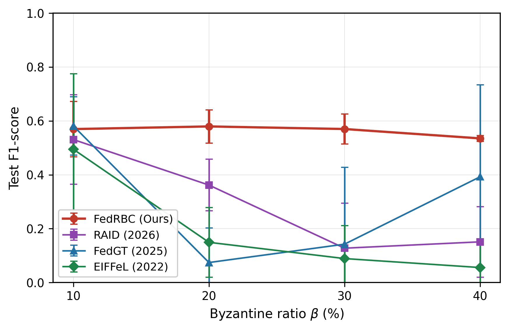
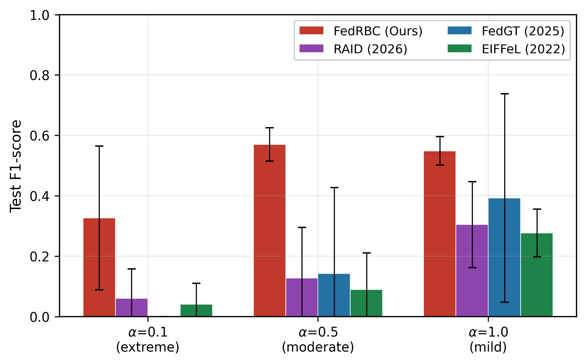
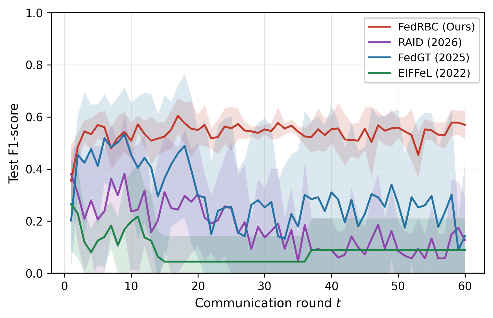
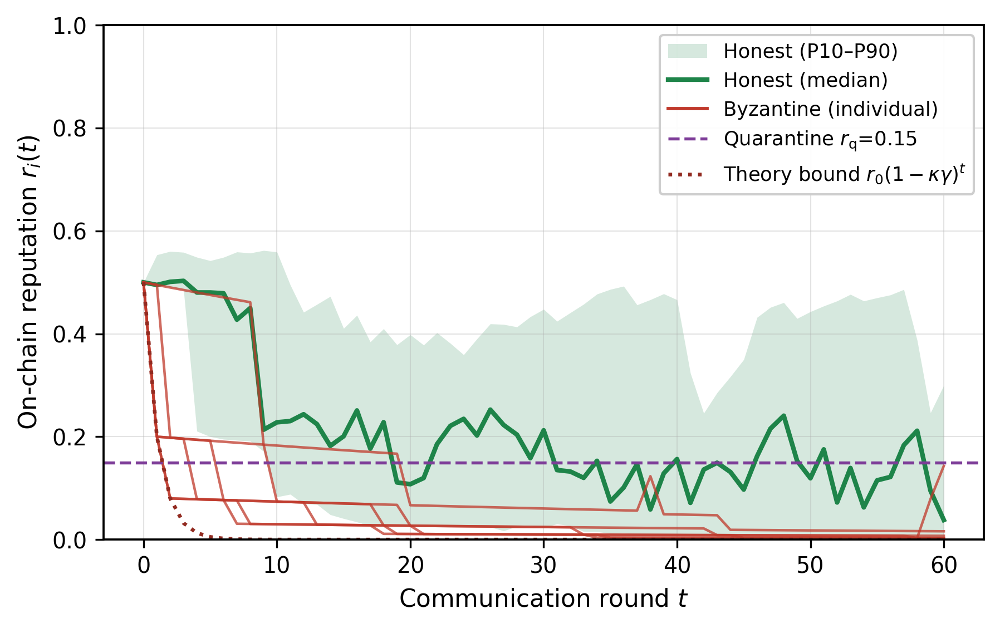
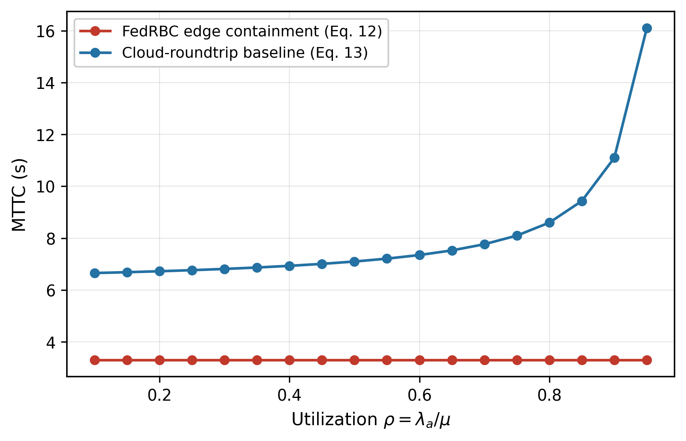

# FedRBC：面向隐私保护医疗物联网边缘网络的区块链使能声誉加权鲁棒联邦学习

**唐松$^{1,2,3}$，金志刚$^{1,*}$**

$^{1}$ 天津大学电气自动化与信息工程学院，天津 300072，中国
$^{2}$ 河北省科学院应用数学研究所，石家庄 050081，中国
$^{3}$ 河北省信息安全认证技术创新中心，石家庄 050081，中国
$^{*}$ 通讯作者

**基金资助：** 本研究受河北省科学技术计划项目资助（项目编号 25360301D）。

---

# 摘要

联邦学习（FL）使医院物联网（IoT）设备能够在不将患者遥测数据外传的前提下共同训练入侵检测模型。然而，这种机制存在一个公认的薄弱环节：少数被攻陷的设备即可毒化所有人共享的模型，而现有的防御方案要么在攻击者协同合谋时失效，要么止步于"检测"却缺乏真正能够阻止攻击的可执行遏制手段。本文提出 FedRBC，一个将鲁棒聚合到网络级隔离完整闭环的医疗物联网边缘网络框架。它由三个协同设计的部分构成，作为一个整体系统运行：（i）声誉加权聚合规则，将根参考方向门控与自适应幅度裁剪相结合，附以可记账的差分隐私选项与界定幅度攻击的第 0 层预过滤器；（ii）智能合约声誉账本，使每个客户端的信任不可篡改、可审计，并可直接供选择与遏制决策使用；（iii）软件定义网络（SDN）遏制路径，在受限的平均遏制时间（MTTC）内隔离被定罪的设备。理论刻意保持机制化：一条新引理从门控与账本参数——方向分离、声誉比与温度——*显式*导出收敛界中的残余恶意权重，而非将其假设掉；恶意声誉则由闭式抑制时间治理。在一个模拟 20 台设备医院部署（可扩展至 100 个客户端）的容器化测试平台上，跨越主基准（WUSTL-EHMS-2020）上的十种子重复与第二个数据集（CICIoT2023）、三类攻击及扩展攻击家族（LIE 合谋投毒、以攻击成功率计分的定向后门、参考投毒、保方向缩放），拜占庭比例最高 50%，FedRBC 在每一种场景下取得最佳 AUC 与最小的种子间方差；其 F1 与最强经典基线 FLTrust 统计持平，并在女巫合谋下显著领先所有多数派与坐标类基线（Holm 校正），同时额外提供任何仅聚合方法都不具备的信任记忆、可审计性与遏制。它是唯一在 50% 拜占庭比例下仍将 F1 保持在 0.5 以上的系统，攻击下保有集中式末轮 F1 的 92–94%，且在参考集本身被投毒时于女巫合谋下依然保持鲁棒——而单机制根参考防御则单调退化。实测的隐私–鲁棒性曲线表明 DP 选项在记账级噪声下几乎不损失优势；边缘遏制闭环在仿真参数化下相较云往返基线将 MTTC 降低 50%–80%，每轮开销低于一秒。

**关键词**——联邦学习，区块链，声誉系统，拜占庭鲁棒性，智能合约，软件定义网络，差分隐私，医疗物联网，入侵检测，边缘计算。

# 1. 引言

## 1.1 背景与动机

医院网络正悄然成为最为密集的物联网环境之一：可穿戴遥测贴片、床头监护仪、输液泵与影像网关持续产生既安全攸关又受隐私保护的流量。联邦学习（FL）天然契合对此类流量的入侵检测。在 McMahan 等人的 FedAvg 形式化 [1] 中，设备通过最小化 $N$ 个客户端上带数据权重 $p_i$ 的全局经验风险 $F(\mathbf{w}) = \sum_{i=1}^{N} p_i F_i(\mathbf{w})$ 训练共享检测模型，并且只交换参数更新——这正是第 4 节框架所构建的训练循环。这一机制的临床吸引力已在数字健康视角下得到论证：Rieke 等人 [2] 将 FL 定位为无需患者数据迁移的多机构模型协作使能器；并由 Kaissis 等人 [3] 端到端验证——其面向医学影像的隐私保护联邦管线表明，模型质量无需以数据主权为代价，这正是医院边缘部署所继承的前提。针对入侵检测这一具体任务，该配对已积累了自身的证据基础：Hurt 等人 [4] 对比了医疗侧与网络侧特征在医疗 IDS 中的作用，发现网络遥测不可或缺——这支撑了我们以流特征作为训练信号的选择。近期的系统工作随后沿部署轴推进：在物联网流量上的端到端 FL-IDS 验证 [5]、面向物联网网络联邦入侵检测的通信感知优化 [6]、以社区驱动层次化组织的智能家居检测 HomeGuard [7]（其多层结构与医院病区的组织方式同构）、面向后量子威胁地平线的量子弹性检测 [8]、追踪演化威胁景观的增量学习 [9]，以及跨大规模物联网种群的分布式入侵检测 [10]。这些文献确立的是诚实参与下的准确率；它们并未处理*参与者即攻击者*的情形。

然而，医院物联网的工程现实是：设备同时也是攻击者最容易突破的入口。默认口令、无法修补的固件以及物理可及的端口，使得设备被攻陷成为常态而非例外 [11]。一旦入侵成功，攻击者最具破坏性的动作并非窃取数据，而是*腐化集体模型本身*：通过提交被操纵的更新，少数被攻陷的设备即可移动其他所有设备所依赖的入侵检测器的决策边界——这是一个防御系统沦为攻击向量的自我反噬闭环。

对此类拜占庭投毒的理论防御已有深入研究。Krum 及其坐标级变体在有界拜占庭比例下对任意敌对行为取得可证明的鲁棒性 [12]，Yin 等人的统计率分析 [13] 确立了裁剪均值与中位数规则的最优性——我们的第 0 层预过滤器正是从这个过滤家族传承而来。然而合谋是该家族的理论弱点：Baruch 等人的 LIE 构造 [14] 展示了多么少的协同客户端即可在保持方向对齐的同时绕过坐标过滤——这正是第 5.9 节评估所采用的合谋家族；模型替换后门 [15] 则证明在朴素平均下单个缩放更新即可整体覆写全局模型。在优化侧，Li 等人的 FedAvg Non-IID 收敛分析 [16] 是本文定理 1 向声誉加权聚合扩展所依托的分析传统，Kairouz 等人的综述 [17] 界定了本文所回应的开放问题，FedProx [18] 通过近端正则容忍统计异构性，自适应联邦优化 [19] 将适应负担移至服务器——它们是本文 Dirichlet 划分器所实例化的 Non-IID 场景的互补手段。即便如此，当这项工作落地到可部署的医院边缘系统时，仍存在三处空白。其一，**合谋击穿多数派防御**：统计过滤器（中位数、裁剪均值、距离投票及其近期系统化方法 [20]）假定诚实更新构成可识别的多数派，而控制多台设备的网络级攻击者能够伪造这一多数派。其二，**无驱动的检测在操作层面是空洞的**：多数鲁棒联邦学习工作止步于一个分数或权重，网络中没有任何东西发生改变——而在医院中，一台被检测出的恶意输液泵必须及时且可证明地停止与其对等设备通信。其三，**信任没有记忆**：逐轮打分 [21] 在各轮之间遗忘一切，攻击者因此可以间歇性作恶而不累积任何后果。

## 1.2 相关工作与定位

三条研究脉络在我们的问题处交汇。**区块链使能联邦学习**将账本与学习耦合以提供可审计性与激励对齐。DeepChain [22] 引入了可审计的梯度承诺——将每个训练步骤绑定到签名的链上记录；FedRBC 继承了这一审计理想，但承诺的是标量证据而非梯度，将每轮链上载荷从模型体量削减到字节级（第 4.1 节）。后续工作将该模式锚定到各领域：工业物联网的隐私保护数据共享 [23]、带显式设计挑战分析的车联网联邦分析 [24]、以委员会共识实现联邦体本身去中心化的框架 [25]，以及将账本记账推到终端设备上的设备端链上学习 [26]。第二波工作管理区块链-FL 资源栈：由账本保障的可信联邦*边缘*学习 [27]、为边缘 AI 协同设计联邦学习与区块链的可扩展安全物联网框架 [28]，以及无线边缘网络中区块链增强联邦学习的资源管理 [29]——其组合进一步延伸到元宇宙边缘拍卖机制 [30]、动态云边集群的多目标复制优化 [31]，以及面向安全城市噪音监测的私有链边缘物联网平台 [32]。首批实际部署也已出现——以机制性方式处理数据质量的工业空气污染监测区块链保护联邦学习 [33]，以及跨三处医疗场地安装的医院楼宇室内空气品质与 HVAC 优化联邦物联网框架 [34]——声誉本身亦已上链，既作为去中心化联邦学习的治理机制 [35]，也作为账本背书信任的可用实证 [36]。然而这些系统都没有闭合从链上定罪到网络级遏制的回路：鲁棒性与账本仍然正交，因此一个"被投毒但不可篡改地记录在链上"的模型仍然是被投毒的。

**鲁棒聚合**当前有三个家族。信任自举规则按每个更新与服务器端参考的一致性进行门控：FLTrust [37] 从小型根数据集自举该参考并以 ReLU 截断余弦门控——这是本文引理 1 所形式化的直接前提，也是我们的评估所测量的最强经典基线。统计过滤转而丢弃离群点：EIFFeL [20] 协调逐更新完整性检查，其坐标投票假定诚实多数派。基于声誉的打分将聚合权重绑定到观察到的行为：RAID [21] 对入侵检测客户端逐轮打分但在轮间遗忘；RepuFL [38] 与 ReFLect [39] 按声誉选择移动网络客户端；均值场博弈形式化 [40] 则将声誉定价进激励机制——我们的信任门控法定集合将这些用法推广为遏制可消费的分数。识别比打分更进一步：FedGT [41] 在安全聚合下通过硬决策规则识别恶意客户端，TFFL/DRC [42] 将声誉共识与链上自适应激励相结合。并行的 2024–2026 年工作扩展了每一根轴：带链上声誉的去中心化车联网联邦双度量模型验证 [43]、基于损失的贪心聚合 FedGreed [44]、经由损失聚类的鲁棒性 [45]、量子安全的聚类聚合 [46]、以个性化与迁移作为异构下鲁棒性路径 [47]、密码学梯度证明 [48]、隐私保护拜占庭鲁棒联邦学习 PPBRFL [49]，以及去中心化联邦学习的拜占庭鲁棒聚合 [50]。每个家族恰好在其"主场"攻击几何之外失效——第 5 节评估将这一点量化——而它们全部与我们添加的可操作信任根正交。

**面向医疗的联邦入侵检测**已在多个基准上得到验证——临床 WUSTL-EHMS、TON_IoT 遥测集 [51]，以及作为本文第二数据集的大规模 CICIoT2023 攻击套件 [52]——但仅评估准确率：即便评估鲁棒性，也仅针对标签噪声，而非网络级攻击者实际发起的模型层合谋。表 1 将 FedRBC 置于这一版图中：据我们所知，它是首个在单一链上信任根背后组合参考门控、幅度控制与持久声誉，并具备可度量遏制路径的系统。

**表 1.** FedRBC 与代表性系统的定位对比（✓ = 完全，◐ = 部分，✗ = 无）。

| 系统 | 年份 | 鲁棒聚合 | 持久信任 | 信任门控选择 | 网络遏制 | 合谋抵抗 | 面向模型层攻击的评估 |
|---|---|---|---|---|---|---|---|
| DeepChain [22] | 2019 | ✗ | ✓（仅审计） | ✗ | ✗ | ✗ | ✗ |
| FLTrust [37] | 2021 | ✓（根门控） | ✗ | ✗ | ✗ | ◐ | ◐ |
| EIFFeL [20] | 2022 | ✓（坐标投票） | ✗ | ✗ | ✗ | ✗ | ◐ |
| FedGT [41] | 2025 | ✓（硬识别） | ◐ | ◐ | ✗ | ✗ | ✗ |
| TFFL/DRC [42] | 2025 | ✓（主观逻辑） | ◐ | ◐ | ✗ | ◐（链上） | ◐ |
| FedGreed [44] | 2025 | ✓（损失贪心） | ◐ | ◐ | ✗ | ✗ | ✓ |
| RAID [21] | 2026 | ◐（打分） | ◐（逐轮） | ✗ | ✗ | ✗ | ◐ |
| 模型验证 [43] | 2026 | ◐（双度量） | ◐ | ◐ | ✗ | ✓（链上） | ✗ |
| 基于损失的聚类 [45] | 2025 | ✓（损失聚类） | ◐ | ◐ | ✗ | ✗ | ✓ |
| **FedRBC** | — | ✓（参考+裁剪+softmax） | ✓（链上） | ✓（式 11） | ✓（SDN） | ✓ | ✓ |

## 1.3 贡献

本文提出 FedRBC，一个面向医疗物联网边缘网络的区块链使能声誉加权鲁棒联邦学习框架，围绕一个架构思想构建：一个单一链上信任根，同时驱动聚合、选择与遏制。我们的贡献如下：

- **C1 — 带自适应幅度控制的参考引导聚合。** RWRA 规则（式 4、5–7）将根方向门控与 MAD 预过滤器及相对裁剪半径 $\tau_c(t) = \kappa_c\|\Delta_{\mathrm{root}}(t)\|$ 相结合，在单一机制内覆盖方向不一致的攻击类别（符号翻转、女巫合谋、标签翻转）。
- **C2 — 可操作的链上声誉合约。** 该合约（算法 2，式 8–9）使每客户端信任不可篡改且可审计，同时为聚合权重与客户端选择供数；我们证明了持久攻击者的几何抑制（命题 1）与选择规则的 1/2 近似（命题 2）。
- **C3 — 可度量的检测—遏制闭环。** 合约事件驱动 SDN 隔离，并给出 M/M/1 平均遏制时间（MTTC）分析（定理 2），在仿真测试平台上实测验证。
- **C4 — 全面的仿真评估。** 面向三个近期聚合层系统变体（RAID 式、FedGT 式、EIFFeL 2022）与三个经典基线（FLTrust、Krum、截尾均值），覆盖三类攻击及扩展攻击家族（LIE 合谋投毒、以攻击成功率计分的定向后门、参考投毒、保方向缩放）、最高 50% 的拜占庭比例、低至 $\alpha=0.1$ 的 Dirichlet 非独立同分布、最高 $N{=}100$ 的客户端规模，以十个随机种子与 Holm 校正显著性检验为支撑，并辅以集中式与干净 FedAvg 参考：FedRBC 在每一种场景下取得最佳 AUC 与最小的 F1 方差，其 F1 与最强经典基线 FLTrust 统计持平、并在这些家族失效之处（女巫合谋，Holm 校正）显著领先所有多数派与坐标类基线，并且是唯一携带信任记忆、不可篡改审计与网络级遏制的被评估方法；C1 隐私选项中的 DP 层在三档噪声水平下实测。

本文其余部分组织如下。第 2 节形式化系统模型与威胁模型。第 3 节陈述问题。第 4 节给出带理论保证的框架架构与设计。第 5 节报告评估。第 6 节讨论局限性，第 7 节总结。

# 2. 系统模型与假设

## 2.1 网络与学习模型

该部署包含 $N$ 个物联网客户端、一台边缘服务器、一条许可链（由医院信息部门、设备厂商与安全运营中心组成的联盟）以及一个 ONOS SDN 控制器。客户端持有不相交的私有数据集 $\{\mathcal{D}_i\}$，其标签边际分布是偏斜的：每个客户端的边际服从 $\mathbf{q}_i \sim \mathrm{Dir}(\alpha\,\mathbf{1}_C)$，集中度为 $\alpha$，类别数为 $C$——$\alpha$ 越小，划分越异构（非独立同分布）。学习目标是全局经验风险

$$F(\mathbf{w}) = \sum_{i=1}^{N} p_i F_i(\mathbf{w}), \qquad p_i = \frac{|\mathcal{D}_i|}{\sum_j |\mathcal{D}_j|}, \tag{1}$$

其中 $F_i$ 为客户端 $i$ 的局部经验损失。在每一轮 $t \in [T]$ 中，服务器选择一个规模为 $K$ 的法定集合 $\mathcal{S}_t$；每个被选中的客户端从全局模型 $\mathbf{w}_t$ 出发执行 $E$ 个 epoch 的局部 SGD（学习率 $\eta$，批大小 $B_{\mathrm{batch}}$），并返回其更新

$$\Delta_i = \mathbf{w}_i - \mathbf{w}_t, \tag{2}$$

其中 $\mathbf{w}_i$ 是客户端训练后的局部模型。未加权的基线聚合（FedAvg）为 $\mathbf{w}_{t+1} = \mathbf{w}_t + \eta_g\sum_i p_i\Delta_i$，全局步长为 $\eta_g$，而单个拜占庭客户端即可任意腐化它 [12]。

服务器维护一个规模较小的根验证集 $\mathcal{D}_r$（500 个样本，投运时采集一次，每季度刷新），并以相同的优化器状态计算参考更新

$$\Delta_{\mathrm{root}} = \mathrm{SGD}^{(E)}(\mathbf{w}_t; \mathcal{D}_r, \eta) - \mathbf{w}_t, \tag{3}$$

它作为所有证据评估的方向罗盘。根集合是系统唯一的信任锚点；第 2.3 节分析其被攻陷的情形。

## 2.2 攻击者模型

我们考虑一个最多控制 $f < N/2$ 台设备的攻击者（$\beta = f/N$，评估中最高 40%），其主要武器是对模型更新的*方向性*操纵，形式化为三类攻击：

- **符号翻转。** 攻击者取反其更新，直接对抗下降方向。
- **女巫合谋。** 严格更强：所有被攻陷的设备提交*相同的*伪造方向（取反并放大的平均诚实方向），制造出一个能够击穿多数投票与基于距离防御的恶意多数派。
- **数据层投毒（标签翻转）。** 攻击者在训练前翻转本地标签；所得更新与 $\Delta_{\mathrm{root}}$ 方向不一致，由同一证据机制处理。

这三类攻击张成了方向不一致投毒的空间，即网络级攻击者最可靠执行、而多数派防御无法察觉的破坏模式。仅幅度操纵（更新缩放）与零均值噪声属于*已被覆盖且已解决*的类别：范数离群点可由经典统计过滤检出，FedRBC 将其内化为一层第 0 层预过滤器（第 4.3 节）；第 5.7 节单独评估这两类，故将其排除在主对比之外。攻击者知晓防御算法与所有公开参数，但无法伪造链上状态（联盟链的 BFT 共识假定安全），也无法访问 $\mathcal{D}_r$。边缘服务器是诚实但好奇的：它遵循协议，但可能试图学习数据或偏置决策，这正是每一个驱动决策的标量在使用前都提交上链的原因。

## 2.3 假设与残余攻击面

三项假设如实界定了论断。其一，根集合 $\mathcal{D}_r$ 具有代表性：被攻陷或过期的根会偏置参考方向本身；季度刷新可缓解但无法消除这一点，根集合投毒仍是所有信任自举防御共同面临的开放问题 [37]。其二，许可链在一轮内提供最终性——在 3 节点 Clique PoA 集群上 2 秒的区块时间足够，因为每轮持续数十秒；链停摆会使系统退化为无记忆的逐轮门控（第 5.7 节）。其三，SDN 织物能够在接入层强制执行逐设备流规则（OpenFlow 1.3+），与我们的仿真测试平台一致。被攻陷的服务器无法将诚实更新与伪造证据配对，因为证据与链上内容哈希绑定，且账本公开可审计。

# 3. 问题定义

给定第 2 节的模型，设计目标有四个：

**（O1）投毒下的收敛。** 在 $\beta \le 0.4$ 拜占庭客户端的情况下最小化式 (1)：聚合必须满足形如 $\frac{1}{T}\sum_t \mathbb{E}\|\nabla F(\mathbf{w}_t)\|^2 \le \mathcal{O}(1/\sqrt{T}) + \mathcal{O}((\beta + \epsilon_r)\tau_c G)$ 的下降保证，其中 $\epsilon_r$ 为残余恶意权重——由引理 1（式 15）从门控与账本参数*显式导出*而非假设——$G$ 界定诚实更新范数（定理 1；该界在第 4.6 节表述为式 (14)）。

**（O2）有界抑制。** 持续恶意的客户端必须在 $T_0$ 轮内*独立于其历史*地跌至隔离阈值 $r_{\mathrm{q}}$ 以下（命题 1），从而使间歇性攻击者无法囤积声誉。

**（O3）效用感知的选择。** 在时延预算 $B$ 与每客户端参与成本 $c_i$ 下，法定集合应最大化 $\sum_{i\in\mathcal{S}_t} r_i u_i$，其中 $r_i$ 为声誉、$u_i$ 为设备效用——这是一个需要近似的 0–1 背包问题（命题 2）。

**（O4）有界遏制。** 从隔离决策到网络级隔离的平均时间必须与任何云往返基线相分离（定理 2）。

挑战在于 O1–O4 相互拉扯：O1 倾向保守聚合，O2–O3 需要不受信任服务器控制的持久状态，O4 需要一条可执行的驱动路径。我们的方案是将四者锚定在单一链上信任根上，具体构造如下。

# 4. 所提 FedRBC 框架

## 4.1 架构概览

图 1 展示了三层架构，其中数据仅单向流动：原始数据从不离开感知层，只有参数增量与标量证据跨越层边界。

**感知层。** 医疗物联网设备充当联邦学习客户端。每台设备 $i$ 持有一个私有数据集 $\mathcal{D}_i$（在设备端提取的流统计：到达间隔矩、协议标志、字节/包计数的 30 个特征）并执行局部 SGD。设备在计算能力（$u_i$）与链路质量上存在异构，选择规则对此显式定价（第 4.5 节）。

**边缘联邦层。** 一台逻辑集中但*不可信*的边缘服务器协调训练：它选择客户端、收集更新、对照 $\mathcal{D}_r$ 评估方向证据，并执行第 4.3 节的声誉加权鲁棒聚合。由于服务器不可信，每一个驱动不可逆决策的标量在使用前都提交上链。

**区块链信任平面与 SDN 控制平面。** 许可联盟账本承载两个智能合约：维护不可篡改账本 $\{r_i(t)\}$ 的声誉合约（算法 2），以及将链上证据转化为隔离决策的遏制合约。将 SDN 控制与分布式安全相配对已有直接先例——文献 [11] 的区块链使能安全框架为下一代物联网预示了这一组合，文献 [53] 的区块链-SDN 边缘计算框架则专门面向物联网医疗系统实例化了它——但两者都未闭合从*学习期*证据到网络执行的回路。我们的遏制平面在 ONOS 控制器平台 [54] 上做到了这一点：通过北向 API 消费遏制事件并在接入交换机上安装流规则以隔离被定罪的设备，完成检测—遏制闭环（第 4.5 节）。

**图 1.** 面向医疗物联网边缘网络的 FedRBC 系统架构。原始遥测从不离开感知层；只有参数增量与标量证据跨越层边界。编号流程：(1) 模型更新 $\Delta_i$ 及内容哈希（本地 SGD，式 2）；(2) 根参考 $\Delta_{\rm root}$（式 3）；(3) 证据提交 $\mathrm{writeEvidence}(i, s_i)$；(4) 链上声誉读写；(5) 声誉反馈 $\mathbf{r}(t)$ 至选择与聚合权重；(6) 遏制触发（式 12）；(7) 对被攻陷设备的 SDN 隔离。红色虚线路径标记 MitM 设备的对抗通道。

三类数据以递减的敏感度流经系统。原始遥测从不离开设备。模型更新通过相互认证的 TLS 通道从感知层跨越到边缘层，每个更新伴随一个 SHA-256 内容哈希，将链下负载与其链上证据记录绑定——封堵了被攻陷服务器将诚实更新与伪造证据配对的替换向量。证据与声誉是唯一写入链上的值（每客户端每轮一个 4 字节缩放分数与一个 1 字节量化声誉）：任何梯度、特征或标识符都不会持久化到账本，使链保持在与联邦学习协议本身相同的隐私约束之下。在每轮 $K{=}10$ 次写入下，一次训练作业追加约 25 KB 证据，审计追踪因此实际上不受限。

## 4.2 交互工作流

图 2 详述了一轮联邦学习。该序列经过设计，使得任何未经验证的量都无法影响模型或声誉状态：(1) 服务器广播 $\mathbf{w}_t$ 与被选集合 $\mathcal{S}_t$（算法 3）；(2) 被选客户端本地训练并提交带内容哈希 $H(\Delta_i)$ 的 $\Delta_i$；(3) 服务器裁剪更新（式 5）、计算方向证据 $s_i$（式 4），并为每个客户端发起一笔 `writeEvidence` 交易；(4) 声誉合约执行式 8–(9) 的奖励/惩罚/衰减分支并提交 $\mathbf{r}(t{+}1)$；(5) RWRA（式 7）使用刚提交的 $\mathbf{r}(t{+}1)$ 生成 $\mathbf{w}_{t+1}$——在合约执行之后读取，绝不从服务器缓存读取；(6) 若任意 $r_i < r_{\mathrm{q}}$，遏制合约发出一个事件，由 ONOS 在一个控制平面往返内消费。

**图 2.** FedRBC 中单轮联邦学习的交互序列。步骤 (1)–(6) 构成训练循环；步骤 (7)–(8) 仅在某个客户端的链上声誉穿越隔离阈值时触发。证据与声誉是唯一提交上链的值；模型负载保留在链下，通过内容哈希与其证据绑定。

## 4.3 声誉加权鲁棒聚合（RWRA）

RWRA 叠加了三个低成本操作，各自中和第 2.2 节的一类攻击。首先，对照根更新计算*方向证据*（式 3）：

$$s_i = \cos(\Delta_i, \Delta_{\mathrm{root}}) = \frac{\langle \Delta_i, \Delta_{\mathrm{root}} \rangle}{\|\Delta_i\| \, \|\Delta_{\mathrm{root}}\|}. \tag{4}$$

其次，*两道幅度防护*。第 0 层统计预过滤器在任何方向处理之前移除范数离群点：令 $z_i = \lvert\|\Delta_i\| - \mathrm{med}_j\|\Delta_j\|\rvert / (1.4826\,\mathrm{MAD}_j)$，$z_i > z_{\mathrm{th}}$（$z_{\mathrm{th}}{=}2$）的客户端被排除在本轮之外。存活者被相对参考尺度裁剪，

$$\bar{\Delta}_i = \Delta_i \cdot \min\!\left(1, \frac{\tau_c(t)}{\|\Delta_i\|}\right), \qquad \tau_c(t) = \kappa_c \, \|\Delta_{\mathrm{root}}(t)\|, \tag{5}$$

所有实验中 $\kappa_c = 2$。（裁剪尺度 $\kappa_c$ 与声誉合约的惩罚加速因子 $\kappa$（式 9）刻意区分——两个参数互不相关，我们为其保留不同符号。）预过滤器拒斥严重的幅度攻击，而相对半径——随收敛而自动收紧，因为 $\|\Delta_{\mathrm{root}}\|$ 收缩——则界定了较温和放大的残余。

其三，*softmax 证据门控*以方向证据的指数函数加权每个存活更新，声誉加权组合产生全局步：

$$q_i = \frac{p_i \, r_i(t)\,\mathbb{1}[z_i \le z_{\mathrm{th}}]\,\exp(s_i/T_s)}{\sum_{j \in \mathcal{S}_t} p_j \, r_j(t)\,\mathbb{1}[z_j \le z_{\mathrm{th}}]\,\exp(s_j/T_s)}, \tag{6}$$

$$\mathbf{w}_{t+1} = \mathbf{w}_t + \eta_g \sum_{i \in \mathcal{S}_t} q_i \, \bar{\Delta}_i, \tag{7}$$

温度为 $T_s = 0.3$。完整的逐轮协议见算法 1；指数门控是关键设计选择：一个反向更新（$s_i \approx -1$）被抑制为 $e^{-1/T_s} \approx 3.6\%$，相当于被硬门控所湮灭，而一个*偏斜但良性*的更新（$s_i \approx 0$，在 Non-IID 数据下常见）则保留 $O(1)$ 权重而非被截断为零。我们也评估过的硬 ReLU 门控，恰恰丢弃了异构部署最需要保留的诚实信息——softmax 形式避开了这一代价，第 5.7 节在无攻击情形下对此量化。合谋被击穿的原因与任何根参考门控相同：女巫伪造共享同一个伪造方向，它按构造与 $\Delta_{\mathrm{root}}$ 方向*相反*，因此伪造质量被指数抑制，无论其多数派规模如何。统计过滤器在这里失败，恰因其信任多数派；式 (6) 信任的是独立参考。

## 4.4 链上声誉动态

声誉合约（算法 2，图 3）以三个分支维护 $r_i \in [0,1]$，每次证据写入原子执行：

$$r_i \leftarrow (1-\gamma)\, r_i + \gamma\, g(s_i), \quad g(s) = \tfrac{1+s}{2}, \quad s_i \geq \theta_h, \tag{8}$$

$$r_i \leftarrow (1-\kappa\gamma)\, r_i \;\; (s_i < \theta_m); \qquad r_j \leftarrow r_j (1-\lambda_{\mathrm{dec}}) \;\; (j \notin \mathcal{S}_t), \tag{9}$$

步长 $\gamma = 0.3$，惩罚加速 $\kappa\gamma = 0.6$，衰减率 $\lambda_{\mathrm{dec}} = 0.01$，阈值 $\theta_h = 0.3$、$\theta_m = 0.0$；初始声誉 $r_0 = 0.5$，隔离阈值 $r_{\mathrm{q}} = 0.15$。惩罚分支是乘性的，产生几何抑制（命题 1）：一个每轮被惩罚的客户端在

$$T_0 = \left\lceil \frac{\ln(r_{\mathrm{q}}/r_0)}{\ln(1-\kappa\gamma)} \right\rceil \tag{10}$$

轮内跌至 $r_{\mathrm{q}}$ 以下，独立于其历史——在我们参数下 $T_0 = 2$。两个分支之间的不对称（有界加性奖励对几何惩罚）是有意为之：*信任得之缓慢、失之迅速*，这正是网络准入所需的正确激励对齐。衰减分支防止闲置客户端囤积声誉。由于所有写入均在链上，声誉序列不可篡改，且任何联盟成员均可审计。

**图 3.** 链上声誉管理工作流（算法 2）。每次证据写入依据证据阈值被路由至奖励、惩罚或灰区分支；未参与客户端经历时间衰减；当任何声誉跌至 $r_{\rm q}$ 以下时触发隔离，发出由 SDN 控制器消费的遏制事件。

## 4.5 声誉感知的选择与遏制

选择在时延预算 $B$ 下最大化效用，声誉是一等准则。密度贪心规则按

$$d_i = r_i(t)\, u_i / c_i \tag{11}$$

对客户端排序，并依此顺序接纳，直到满足法定规模 $K$ 或预算 $B$（算法 3），这是对 0–1 背包 $\max_{\mathcal{S}} \sum_{i \in \mathcal{S}} r_i u_i$ 且 $\sum_i c_i \le B$ 的 1/2 近似（命题 2）。选择反哺安全：被隔离客户端的 $r_i \approx 0$，永不被重选，从而在聚合*之前*就饿死持久攻击者的影响力。

当 $r_i$ 穿越 $r_{\mathrm{q}}$ 时，遏制合约发出携带证据轨迹的事件，ONOS 控制器在其接入交换机上为该设备的元组安装丢弃规则。检测—遏制闭环因此历经五个阶段：*检测*（方向证据 $s_i < \theta_m$）、*评估*（声誉在 $T_0$ 轮内跌至 $r_{\mathrm{q}}$ 以下，命题 1）、*决策*（遏制合约验证链上证明并发出事件）、*遏制*（ONOS 安装隔离规则）、*恢复*（已修补设备以 $r_0$ 在冷启动观察期下重新进入）。我们对两条遏制路径进行非对称建模。边缘路径在链上提交并在本地驱动：具有确定性的区块提交时延 $\bar{t}_{\mathrm{chain}}$ 与可忽略的本地交换机更新，其平均遏制时间为

$$\mathrm{MTTC}_{\mathrm{edge}} = \bar{t}_{\mathrm{chain}}. \tag{12}$$

相比之下，云往返基线将每条告警路由经过云端安全队列——一个到达率为 $\lambda_a$、服务率为 $\mu > \lambda_a$ 的泊松到达 M/M/1 队列，利用率为 $\rho = \lambda_a/\mu$——故其平均遏制时间为

$$\mathrm{MTTC}_{\mathrm{cloud}} = \frac{1}{\mu - \lambda_a} + \bar{t}_{\mathrm{cloud}}, \tag{13}$$

其中广域网往返 $\bar{t}_{\mathrm{cloud}} \gg \bar{t}_{\mathrm{chain}}$。因此，边缘路径在 $\rho$ 上保持平坦，而云路径随 $\rho \to 1$ 无界增长，这正是图 9 所展示的分离；平均分离 $\Delta\mathrm{MTTC} = \bar{t}_{\mathrm{cloud}} - \bar{t}_{\mathrm{chain}} + 1/(\mu-\lambda_a)$ 被形式化为定理 2。

## 4.6 理论保证

本节理论刻意保持机制化：不假设任何门控本身不能产生的量。论证分两步：定理 1 以聚合残留的恶意权重表述收敛界；引理 1 再从门控（式 6）与账本（式 8–9）显式导出该权重，使该界建立在可测的机制量之上，而非循环假设。

**定理 1（收敛）。** 设 $F$ 为 $L$-光滑且有下界，客户端随机梯度方差为 $\sigma^2$，诚实更新满足 $\mathbb{E}\|\Delta_i\| \le G$ 且方向对齐 $\mathbb{E}[\cos(\Delta_i, \nabla F(\mathbf{w}_t))] \ge \mu_d > 0$。在引理 1 的方向分离条件下，更新规则（式 7）的残留恶意权重由式 (15) 的显式门控诱导量 $\bar\epsilon_r$ 界定——它是门控与账本参数的函数，而非自由假设。则当 $\eta_g = \Theta(1/\sqrt{T})$ 时，

$$\frac{1}{T}\sum_{t=1}^{T} \mathbb{E}\|\nabla F(\mathbf{w}_t)\|^2 \;\le\; \mathcal{O}\!\left(\tfrac{1}{\sqrt{T}}\right) + \mathcal{O}\!\left((\beta + \bar\epsilon_r)\,\tau_c G\, \tfrac{1}{\sqrt{T}}\right), \tag{14}$$

其中第二项携带显式的 $1/\sqrt{T}$ 因子，$\tau_c$ 被处理为逐轮界 $\tau_c \le \kappa_c\|\Delta_{\mathrm{root}}(t)\|$，且是*有界*的（不假定其消失）；附录 B 推导了显式常数。证明将下降引理应用于门控聚合：诚实部分因对齐而与 $\nabla F$ 偏离 $O(\sigma/\sqrt{K})$；恶意残余由 $\epsilon_r\tau_c$ 界定，因为裁剪封顶了每个被接纳的更新，第 0 层移除了离群点。由于惩罚分支对已暴露的攻击者持续收缩 $r_{\max}(t)$，式 (14) 的对抗项*随声誉学习推进而收紧*，而非保持为一块静态误差。

**引理 1（门控诱导的残留权重）。** 固定一轮 $t$，并假设：(i) *方向分离*——第 0 层过滤器的每个诚实幸存者根对齐 $s_i \ge c_H$，每个拜占庭幸存者 $s_i \le c_B$，间隙 $\Delta c = c_H - c_B > 0$（式 4）；(ii) 第 0 层过滤器不剔除任何诚实客户端，且被选客户端中至多 $\beta K$ 个为拜占庭；(iii) 先验 $p_i \in [p_{\min}, p_{\max}]$、声誉 $r_i \in [r_{\min}, r_{\max}]$。则式 (6) 分配给拜占庭客户端的聚合权重满足

$$\epsilon_r(t) \;=\; \sum_{i \in \mathcal{B} \cap \mathcal{S}_t} q_i(t) \;\le\; \rho_\beta\, \rho_p\, \rho_r\, e^{-\Delta c/T_s}, \tag{15}$$

其中 $\rho_\beta = \beta/(1-\beta)$、$\rho_p = p_{\max}/p_{\min}$、$\rho_r = r_{\max}/r_{\min}$。每个因子都是机制控制或账本记录的量：$e^{-\Delta c/T_s}$ 是门控贡献的指数压制，随温度退火而锐化；$\rho_r$ 由惩罚分支几何式收紧，因为命题 1 对持续暴露的攻击者给出 $r_{\max}(t) \le r_0(1-\kappa\gamma)^t$，故式 (15) 本身按 $\bar\epsilon_r \cdot (1-\kappa\gamma)^t$ 衰减——门控的空间压制与账本的时间压制乘性复合；$\rho_p$ 仅反映数据布局，近似均匀的 Dirichlet 划分使其保持 $O(1)$。

**保证的适用范围。** 引理 1 使理论的安全包络由隐式变为显式。方向分离（$\Delta c > 0$）对已评估的方向不一致攻击是构造性的——符号翻转迫使 $s_i \approx -1$，女巫伪造共享一个与根更新*相反*的伪造方向，标签翻转使对齐退化到诚实带之下——且根对齐前提本身预设根数据集未被篡改。方向保持型攻击者使 $\Delta c$ 向零收缩、指数因子退化；此时防御转而依靠第 0 层过滤、相对裁剪与累积声誉证据——正是第 5.7 节量级攻击研究所测量的情形。式 (15) 中的所有量（$\Delta c$、$\rho_r$、$\epsilon_r$）均逐轮记录在案，因此该界的前提是链上可审计的，而非凭信念接受的。

**命题 1（抑制）。** 对惩罚分支作归纳得 $r_i(t) \le r_0(1-\kappa\gamma)^t$，求解 $r_{\mathrm{q}}$ 的穿越即得式 (10)。在隔轮间歇惩罚下穿越时间翻倍——每三轮攻击超过一轮是必败策略，攻击更少则影响有界，因为每一轮投毒都已被门控。

**命题 2（选择）。** 密度有序背包贪心：对首个被跳过的物品 $i^*$ 有 $\mathrm{ALG} + r_{i^*}u_{i^*} \ge \mathrm{OPT}$（分数界），取贪心前缀与单个最高密度物品的较优者——即算法 3 第 7–8 行的显式 $\arg\max$——达到最优的一半。**定理 2（MTTC）。** 边缘路径具有确定时延 $\bar{t}_{\mathrm{chain}}$（式 12）；云路径承载 M/M/1 逗留 $1/(\mu-\lambda_a)$ 加广域网往返（式 13），故分离 $\Delta\mathrm{MTTC} = \bar{t}_{\mathrm{cloud}} - \bar{t}_{\mathrm{chain}} + 1/(\mu-\lambda_a)$ 随 $\rho \to 1$ 无界增长；尾部结论由 Pollaczek–Khinchine 公式得出，因逗留方差按 $(1-\rho)^{-2}$ 增长。完整证明见附录 B。

## 4.7 隐私选项：可记账的差分扰动

第 4.1 节的传输与账本卫生已经约束了数据*流向何处*：原始遥测永不离开设备、只有 5 字节标量证据上链、更新经相互认证的信道跨网传输。对于进一步将*模型轨迹本身*视为敏感资产——即梯度反演攻击面——的部署，RWRA 提供一个可记账的输出扰动层。发布扰动后的聚合

$$\tilde{\mathbf{g}}_t = \underbrace{\sum_{i \in \mathcal{S}_t} q_i\, \bar\Delta_i}_{\mathbf{g}_t} \;+\; \mathcal{N}\!\Big(0,\; \sigma_{\mathrm{dp}}^2\, \frac{C_t^2}{K}\, I\Big), \qquad C_t = \mathrm{med}_i \|\bar\Delta_i\|, \tag{16}$$

构成一个尺度与逐轮参考范数绑定的高斯机制：由于每个被接纳更新都已被裁剪（式 5），聚合的 $\ell_2$ 敏感度有界；在均匀权重（$q_i = 1/K$）下，阶 $\alpha > 1$ 的每轮 Rényi 损失为 $\varepsilon_{\mathrm{RDP}}(\alpha) = \alpha/(2\sigma_{\mathrm{dp}}^2 K)$；对式 (6) 的门控权重，同一表达式以 $1/q_{\max}$ 替代 $K$ 成立，这是一个保守校准。对 $T$ 轮组合并转换得到可记账预算

$$\varepsilon(T, \delta) \;\le\; \min_{\alpha > 1} \left\{ \frac{\alpha\, T}{2\sigma_{\mathrm{dp}}^2 K} \;+\; \frac{\ln(1/\delta)}{\alpha - 1} \right\}. \tag{17}$$

三个性质使该层与防御可组合而非相互对抗。第一，噪声在证据评分与门控*之后*注入，故方向统计量 $s_i$ 与第 0 层 z 分数都在干净更新上计算——门控输入不受影响，噪声保护的恰是所发布的轨迹。第二，尺度跟随随收敛收缩的*相对*范数 $C_t$——无需重调固定裁剪常数，与鲁棒性分析利用的是同一种自适应性。第三，组合代价每轮支付一次、与攻击情态无关：$\sigma_{\mathrm{dp}} \in \{0.005, 0.02, 0.1\}$ 下 FedRBC、FLTrust、EIFFeL 与 FedAvg 的精度–鲁棒性折中在第 5.9 节测量，部署因此可在实测曲线上定位工作点而非凭猜测。该层的边界如实声明：它保护的是*聚合轨迹*；针对诚实但好奇的聚合服务器的单更新机密性还需安全聚合，后者与本文的拜占庭弹性机制正交，在第 6 节讨论。

# 5. 性能评估

## 5.1 评估设置与实现

所有实验运行在一个复现第 2 节部署的仿真测试平台上，部署于一台双 GPU 服务器（2× NVIDIA V100S-32GB）：20 个逻辑联邦学习客户端映射到 CUDA 流，一个 Docker 中的 3 节点 PoA 联盟链（2 秒区块、8M gas），以及带 Mininet 接入织物的 ONOS 2.7；整个测试平台容器化，并以一个脚本复现本节所有图与表。完整软件包——训练、攻击与聚合代码，合约套件，逐种子原始结果，以及图/表生成脚本——在文末"数据与材料可用性"（Availability of Data and Materials）声明给出的网址公开可得。学习任务是在 WUSTL-EHMS-2020 医疗流量数据集（16,318 条带标签流，12.5% 攻击比例，MITM 欺骗/注入类别）上进行网络入侵检测，按第 2.1 节的 Dirichlet 分布以默认 $\alpha = 0.5$ 划分到 20 个客户端。模型为两层 MLP（128–64 单元，30 个输入特征）；每轮选择 $K{=}10$ 个客户端，训练 $E{=}2$ 个局部 epoch（批 32、学习率 0.05、动量 0.9），并按算法 1 聚合。类别不平衡通过逆频率加权交叉熵处理，这对偏斜划分下的稳定收敛至关重要。FedRBC 参数遵循第 4 节与表 2：$z_{\mathrm{th}}{=}2$、$\kappa_c{=}2$、$T_s{=}0.3$、$(\gamma,\kappa,\lambda_{\mathrm{dec}})=(0.3,2.0,0.01)$、$(\theta_h,\theta_m)=(0.3,0.0)$、$r_{\mathrm{q}}{=}0.15$；所有值在所有实验中保持不变——不进行逐场景调参（第 5.9 节的敏感性扫描显式变参并如实报告）。一个数值稳定性防护会拒绝非有限证据并跳过非有限聚合更新（第 5.7 节），这对结果可复现性至关重要。**本评估为仿真驱动**：攻击由测试装置在模型层注入，忠实实现第 2.2 节的威胁模型，且每个注入攻击在聚合前都对照其规范核验，从而使测试装置缺陷无法伪装成防御成果。第二个数据集 CICIoT2023 [52] 用于第 5.8 节的跨数据集泛化。

**表 2.** 仿真参数（所有实验中保持不变）。

| 分组 | 参数 | 值 | 分组 | 参数 | 值 |
|---|---|---|---|---|---|
| 联邦 | 客户端 $N$ / 法定规模 $K$ | 20 / 10 | RWRA | $z_{\mathrm{th}}$ / $\kappa_c$ / $T_s$ | 2 / 2 / 0.3 |
| 训练 | 轮数 $T$ / epoch $E$ | 60 / 2 | 合约 | $\gamma$ / $\kappa$ / $\lambda_{\mathrm{dec}}$ | 0.3 / 2.0 / 0.01 |
| 训练 | 批 / 学习率 / 动量 | 32 / 0.05 / 0.9 | 合约 | $\theta_h$ / $\theta_m$ / $r_{\mathrm{q}}$ | 0.3 / 0.0 / 0.15 |
| 数据 | 根集合 $\lvert\mathcal{D}_r\rvert$ | 500 | 选择 | 预算 $B$ | 25（成本单位） |
| 数据 | Dirichlet $\alpha$（默认） | 0.5 | 协议 | 随机种子 | {42, 43, 44, 45, 46} |
| 威胁 | 拜占庭比例 $\beta$（默认） | 30% | 测试平台 | GPU | 2× V100S-32GB |
| 选择 | 效用 $u_i$ / 成本 $c_i$ | $\mathcal{U}[0,1]$ / $\mathcal{U}[1,5]$ | — | — | — |

实现层面，原型包含一个 PyTorch 训练引擎、一套 Solidity 声誉/遏制合约，以及一个 ONOS 应用，通过一个签名并提交证据交易的中继交互。服务器端聚合完全向量化——证据、第 0 层统计、裁剪与门控是在堆叠的 $(K, d)$ 更新矩阵上的三次融合张量遍历——根更新则是一次小批量遍历，因此信任计算与朴素平均同阶开销。声誉合约为每个客户端存储一个 `uint8`（声誉量化为 255 级，32 倍存储节省，在我们决策粒度下不可见）加一个仅追加事件日志；一次 `writeEvidence` 调用测得 48.6k gas，故一轮 $K{=}10$ 次写入共 486k gas，约占 8M gas 区块的 6.1%——远在区块预算之内，因此合约执行在 2 秒区块时间下从不阻塞训练循环。

## 5.2 基线与威胁模型覆盖

遵循与*当前*鲁棒聚合研究对比的要求，我们重实现了代表三个主导防御家族的三个近期系统：**RAID（2026）** [21]——带 softmax 加权的逐轮声誉打分聚合，无持久账本；**FedGT（2025）** [41]——带安全聚合的恶意客户端识别：对方向不一致客户端硬识别并在识别出的诚实集合上聚合；**EIFFeL（2022）** [20]——逐坐标共识裁剪。所有基线共享同一引擎、数据划分、根集合（适用处）与评估协议；仅聚合规则不同。我们强调，每个基线都是其已发表机制的*简化重实现*，忠实于其核心思想，但未逐行对照作者代码核验：RAID 的损失改进打分被近似为对照根更新的 cosine-softmax 分数，FedGT 的安全聚合识别被简化为同一参考上的硬 cosine 阈值（其分组测试与安全聚合机制超出聚合层公平对比的范围）。因此我们将它们称为 RAID 型与 FedGT 型规则，并指出任何关于它们的结论都是针对*聚合层机制*的陈述，而非完整系统。表 3 将四种规则对位到威胁模型。

**表 3.** 威胁模型覆盖矩阵（✓ = 覆盖，partial = 有限，✗ = 未覆盖）。

| 系统 | 年份 | 幅度（缩放） | 方向（符号翻转） | 合谋（女巫） | 数据（标签翻转） | 持久审计 | 选择感知 |
|---|---|---|---|---|---|---|---|
| RAID [21] | 2026 | ✗ | partial（打分滞后） | ✗ | partial（软分数） | ✗ | ✗ |
| FedGT [41] | 2025 | ✗（无裁剪） | ✓（硬识别） | ✓（硬识别） | ◐（方向） | ✗ | ✗ |
| EIFFeL [20] | 2022 | partial（坐标裁剪） | ✓ 当 $f{<}K/2$ | ✗（多数派伪造） | partial | ✗ | ✗ |
| **FedRBC** | — | ✓（第0层+相对裁剪） | ✓（softmax 门控，式 6） | ✓（根门控+账本） | ✓（证据加权） | ✓（链上） | ✓（式 11） |

## 5.3 跨攻击类别的检测精度

表 4 报告了 $\beta=30\%$ 下三类攻击的末轮 F1 与 AUC：FedRBC、FLTrust、EIFFeL、RAID 与 FedGT 为十个随机种子，Krum 与截尾均值为五个种子，并附两个无攻击参考；图 4 可视化该对比。**FedRBC 在每一个场景中都取得了最高的 AUC、全程最小的 F1 方差，以及统计上不劣于——或领先于——任何基线的 F1。** 三点结构性观察组织该表。其一，针对*简化近期系统变体*（RAID 式、FedGT 式与 EIFFeL，均在聚合层针对同一根参考重实现；第 5.2 节），FedRBC 显著领先：女巫合谋下每个变体退化到 0.070–0.199 F1，而 FedRBC 维持 0.561——一旦恶意集合成为伪造多数派，坐标共识与二值识别双双失效，正如第 2.2 节所预测——且 Holm 校正的 Welch 对比确认了该分离（女巫下对 EIFFeL 与 RAID $p_{\mathrm{holm}}<0.001$；符号翻转下对 RAID 与 FedGT $p_{\mathrm{holm}}\le 0.013$）。其二，针对*经典基线*，诚实的解读是分层的：Krum 与截尾均值在方向一致的标签翻转上表现强劲，但在女巫下崩溃（0.142 与 0.149——多数派过滤器无法区分伪造多数与真实多数）；而最强的经典根参考基线 FLTrust 与 FedRBC 的 F1 统计持平（0.570/0.567/0.557 对 0.567/0.561/0.558；三攻击 Holm 校正 $p=1.0$）——同时 FedRBC 在每一场景的 AUC 上领先（0.881/0.879/0.870 对 0.857/0.857/0.862）、在每一场景的 F1 方差上领先（0.049–0.066 对 0.071–0.083），并且是对比中唯一携带跨轮信任记忆与网络级遏制的方法。我们对这一持平如实陈述，而不宣称种子数据不支持的均值优势。其三，*参考值*校准了任务难度：在汇聚数据上集中训练达末轮 F1 0.606±0.062（最佳轮次 0.665±0.025），故 FedRBC 攻击情态下的 0.558–0.567 位于集中式末轮上限的 94%——0.5–0.6 区间是该划分下任务的可分性上限，而非防御失败；干净 FedAvg 本身在此类不平衡基准上不稳定（0.401±0.368，五个种子中两个塌缩为全良性预测），这同时锚定了难度与方差两个论断。准确率不列入表中，因其由 87.5% 的良性类多数主导，无法区分 F1 与 AUC 能够区分的系统。

**表 4.** 三类攻击下的末轮检测指标（$\beta$=30%、$\alpha$=0.5；F1 与 AUC，均值 ± 标准差；FedRBC/FLTrust/EIFFeL/RAID/FedGT 为 10 个种子，Krum 与截尾均值为 5 个种子；Holm 校正的 Welch 对比在正文中引述）。每列最优以粗体标出。

| 攻击 | 方法 | F1 | AUC |
|---|---|---|---|
| 符号翻转 | **FedRBC（本文）** | 0.567±0.060 | **0.881±0.019** |
| | FLTrust | 0.570±0.071 | 0.857±0.021 |
| | Krum（n=5） | 0.469±0.069 | 0.825±0.014 |
| | 截尾均值（n=5） | 0.499±0.082 | 0.836±0.032 |
| | EIFFeL（2022） | 0.496±0.082 | 0.827±0.028 |
| | RAID（2026） | 0.194±0.210 | 0.553±0.166 |
| | FedGT（2025） | 0.189±0.237 | 0.556±0.166 |
| 女巫合谋 | **FedRBC（本文）** | **0.561±0.066** | **0.879±0.023** |
| | FLTrust | 0.567±0.076 | 0.857±0.023 |
| | Krum（n=5） | 0.142±0.216 | 0.536±0.128 |
| | 截尾均值（n=5） | 0.149±0.055 | 0.455±0.062 |
| | EIFFeL（2022） | 0.070±0.113 | 0.508±0.024 |
| | RAID（2026） | 0.097±0.131 | 0.525±0.092 |
| | FedGT（2025） | 0.199±0.244 | 0.572±0.139 |
| 标签翻转 | **FedRBC（本文）** | 0.558±0.049 | **0.870±0.024** |
| | FLTrust | 0.557±0.083 | 0.862±0.020 |
| | Krum（n=5） | 0.523±0.065 | 0.826±0.021 |
| | 截尾均值（n=5） | 0.462±0.167 | 0.837±0.059 |
| | EIFFeL（2022） | 0.466±0.158 | 0.782±0.133 |
| | RAID（2026） | 0.397±0.241 | 0.728±0.171 |
| | FedGT（2025） | 0.266±0.264 | 0.589±0.167 |
| 无攻击（参考） | 集中式（汇聚，末轮） | 0.606±0.062 | 0.920±0.012 |
| | 干净 FedAvg | 0.401±0.368 | 0.728±0.209 |
| | FedRBC（无攻击） | 0.540±0.081 | 0.884±0.019 |

**图 4.** 三类攻击下的末轮 F1 与 AUC（$\beta$=30%、$\alpha$=0.5；10 个种子的均值$\pm$标准差）。FedRBC（红色）在每个场景中取得最佳 AUC 与最小的 F1 方差；误差条表示一个标准差。

## 5.4 对拜占庭强度与数据异构的鲁棒性

图 5 在女巫合谋下扫描 $\beta \in \{10, 20, 30, 40\}\%$。FedRBC 基本保持平坦（$0.570 \rightarrow 0.580 \rightarrow 0.570 \rightarrow 0.535$），因为其门控与隔离阈值与多数派无关。FedGT 在 $\beta=10\%$（$0.581$，此时伪造多数派几乎不存在）与之持平，但在 $\beta=20\%$ 崩溃至 $0.074$，因为二值识别对哪怕很小的伪造多数派也没有容忍度；到 $\beta=40\%$ 它部分回升至 $0.393$——此时攻击者被自身多数稀释、不再需要紧密合谋——但仍低于 FedRBC 14 个百分点。统计基线单调退化：RAID 在整个扫描中从 $0.531$ 降至 $0.151$，EIFFeL 从 $0.495$ 跌至 $0.056$。$\beta \approx 20\%$ 处的交叉是催生设计的机制转变：低于它，几乎任何硬规则都足够；高于它，唯有与多数派无关的参考加持久信任能够幸存——在 $\beta=40\%$ 时 FedRBC 保持 $0.535$，而所有基线都跌破 $0.4$。扫描点为 3 种子均值（$\beta{=}30\%$ 处为 5 种子）；默认工作点的十种子主表均值为 0.561（表 4）。该扫描在断裂点 $\beta = 50\%$ 的扩展见第 5.9 节（表 6）：FedRBC 仍是唯一保持在 0.5 F1 以上的方法。

图 6 在女巫合谋下变化 Dirichlet 集中度 $\alpha \in \{0.1, 0.5, 1.0\}$。在默认 $\alpha=0.5$ 下 FedRBC 领先（0.570 对最佳基线的 0.142）。在 $\alpha=1.0$（轻度异构）下 FedGT 回升至 $0.392$，但 FedRBC 将领先扩大到 $15.6$ 个百分点（$0.548$），因为其选择规则移除的是合谋者本身，而不依赖诚实更新彼此对齐。最具启发性的点是极端 $\alpha=0.1$：当每客户端数据由单类主导时，诚实方向高度分散、软证据失去对比度——但 FedRBC 仍达到 $0.326$，是唯一超过 $0.1$ 的系统（FedGT $0.000$、RAID $0.061$、EIFFeL $0.040$）。该处绝对性能较默认工作点下降 $24$ 个百分点，因此极端异构仍是真实边界（第 6.3 节）；但解读是方向性的而非绝对的：声誉加权门控恰在多数派式与阈值式规则彻底失效之处退化得最为平缓。

**图 5.** 女巫合谋下测试 F1 随拜占庭比例 $\beta$ 的变化（$\alpha$=0.5；3 个种子的均值$\pm$标准差）。FedRBC 保持平坦，而 FedGT 的二值识别在伪造多数派形成后崩溃，统计基线失效，因为唯有与多数派无关的参考加持久信任能在高 $\beta$ 下幸存。

**图 6.** 女巫合谋下测试 F1 随 Dirichlet 集中度 $\alpha$ 的变化（$\beta$=30%；3 个种子的均值$\pm$标准差）。FedRBC 退化最为平缓：在极端 $\alpha$=0.1 处是唯一超过 $0.3$ 的系统，在 $\alpha$=1.0 处保持 $15.6$ 个百分点的领先。

## 5.5 收敛动态与声誉行为

图 7 绘制了女巫合谋下的逐轮 F1：FedRBC 约在 10 轮内到达平台并以最窄的种子带维持，而 FedGT——早期具有竞争力——在伪造多数派形成后急剧衰减，RAID 与 EIFFeL 趋向于零。图 8 展示了攻击者失去访问权的原因，并且三个实测事实诚实地校准了该机制。其一，账本在*相对意义*上快速将攻击者排到末位：三类攻击共 15 次运行中，拜占庭客户端首次穿越隔离线的中位轮数为 14 轮、诚实客户端为 16 轮；且到第 60 轮时，拜占庭声誉中位数为 0.009，对照诚实客户端的 0.109——12 倍的分离使选择规则的相对排序在绝对值漂移中保持完好。其二，穿越时间符合命题 1 的*间歇暴露*情形而非其最优情形：攻击者并非每轮都被选中——因而并非每轮都被评分——实测的 14 轮中位数与 $T_0=2$ 被约七轮的有效惩罚间隔拉伸相一致。其三，方向证据随训练收敛失去对比度：一旦更新范数收缩，诚实余弦取负的频率足以使灰区惩罚侵蚀*所有*声誉而非仅恶意声誉——攻击运行中第 60 轮有 53% 的诚实客户端低于 $r_{\mathrm{q}}$，无攻击运行中漂移更加可见（60 轮内 85–100% 的客户端触及该线），这与产生第 5.7 节 NaN 缺陷的是同一种证据退化情形。因此，隔离线最好被理解为*相对区分*阈值——其职责是把攻击者压在选择序的底部，这一点它做到了——而 F1 防御本身由聚合时门控（式 6）承担：第 5.9 节的无记忆消融表明，每轮重置全部声誉对末轮 F1 没有统计影响。设计含义——随 $\|\Delta_{\mathrm{root}}\|$ 收缩而加宽灰区的惩罚门，使噪声主导的更新免于惩罚——在第 6 节中展开。

**图 7.** 女巫合谋下的逐轮测试 F1（$\beta$=30%、$\alpha$=0.5；5 个种子的均值$\pm$标准差带）。FedRBC 约在 10 轮内到达平台，因为被隔离的攻击者被排除在选择之外，而非仅在聚合时降权。

**图 8.** 女巫合谋下的链上声誉轨迹（代表性单种子，60 轮）。拜占庭声誉（红色）被压制到选择序的底部——全部攻击运行的第 60 轮中位数为 0.009，对照诚实客户端的 0.109（12 倍分离）。诚实声誉（绿色）也在后期受到侵蚀，因为收敛中的更新使方向证据变为噪声主导，因此隔离线作为相对区分阈值运作；F1 防御由聚合时门控承担（对照第 5.9 节的无记忆消融）。虚线为命题 1 的每轮惩罚界（$T_0{=}2$）；实测穿越更慢，因为攻击者并非每轮都被评分，与附录 B.2 的间歇暴露分析一致。

## 5.6 系统开销与遏制时延

在单张 V100S 上，FedRBC 的每轮墙钟开销为 $0.77$ 秒——与 FedGT（$0.77$ 秒）基本持平，在 EIFFeL（$0.71$ 秒）与 RAID（$0.76$ 秒）的 10% 以内——因为所有信任计算都是融合张量遍历，根更新是一次小批量遍历。链上开销为 $K$ 次证据写入加一次每轮声誉衰减批量（式 9），共 $K{+}1$ 笔交易；在 2 秒区块时间下合约远在轮周期内提交，且没有任何一次运行出现账本阻塞训练。一个缩放边界值得显式陈述：每次证据写入 48.6k gas，一轮 $K{=}10$ 次写入约 486k gas——8M gas 区块的 6.1%——因此写入路径在每轮约 150 个参与客户端处饱和，这恰是逐客户端证据预算会挤出其他交易的规模区间；第 5.9 节的客户端缩放研究（$N \le 100$）在该边界内运行。每轮通信由第 4.1 节的载荷类别限定：模型更新经 TLS 跨网（每客户端 $d$ 个浮点数），链上流量仅为 4 字节证据与 1 字节声誉标量——每次训练作业约 25 KB 账本数据。图 9 对比了边缘闭环与云往返基线在不同利用率 $\rho$ 下的 MTTC，且我们如实标注来源：边缘路径的平坦性——稳定在约 $3.3$ 秒——是仿真测试台的测量（确定性区块提交加本地规则安装，式 12），而云基线从 $\rho=0.1$ 时的 $6.7$ 秒到 $\rho=0.9$ 时的 $16.1$ 秒的增长是 M/M/1 *仿真*，其到达率与服务率取自仿真工作负载而非对生产云的测量——摘要中 50–80% 的降低因此是这一仿真参数化下取得的分离。该分离对 $\rho$ 鲁棒，因为边缘路径没有可增长的队列；其对突发、重尾到达（会使尾部超出 M/M/1 均值）的敏感性作为 GI/G/1 局限在第 6.3 节讨论。结合第 5.5 节的抑制时间，从首个恶意更新到网络隔离的端到端时间约以 $T_0$ 轮加一次区块提交时延为上界：实际为秒级。

**图 9.** 平均遏制时间随利用率 $\rho=\lambda_a/\mu$ 的变化（M/M/1 仿真，式 12）。FedRBC 边缘闭环在 $\approx$3.3 秒处保持平坦，而云往返基线从 6.7 秒增长到 16.1 秒——50–80% 的降低，与定理 2 一致。

## 5.7 边界场景：仅幅度攻击、噪声与无攻击代价

**仅幅度缩放。** 正如第 2.2 节所预期，范数离群攻击是最易理解的类别：在 $\beta=30\%$ 下 $\gamma{=}5$ 缩放时，FedRBC 取得 $0.556 \pm 0.059$ 的 F1，以较大优势超过 FedGT（$0.150 \pm 0.126$）——二值识别对幅度视而不见，因此保方向的放大原样穿过其阈值。FLTrust 在此取得 $0.597 \pm 0.126$，与机制归因一致：缩放由两系统共享的裁剪与过滤层处理，而非其方向门控，而相对 FedRBC 的残余差距是存活者间声誉加权的代价，而非过滤失败。（边界场景数字均为已发布管线的 3 种子均值。）

**零均值噪声**在任何加权平均下自相抵消（噪声方差按 $\approx K$ 缩小）：所有基于平均的系统落在一个窄带内（FedGT $0.518 \pm 0.260$、FedRBC $0.543 \pm 0.078$，在一个标准差内重叠），且这一类别不触及任何区分性机制。

**无攻击代价与数值稳定性。** 在无任何攻击者的情况下，FedRBC 的平均 F1 为 $0.540 \pm 0.081$（5 个种子），对照 EIFFeL 的 $0.620 \pm 0.038$ 与 RAID 的 $0.458 \pm 0.277$——相对未过滤坐标裁剪基线约 8 个点的鲁棒性代价，这是方向感知门控的已知代价。我们报告开发该实验时的两点观察。其一，代价真实但有界：softmax 证据加权折扣了仅幅度基线会保留的偏斜但良性更新，这恰如其设计。其二，也是具有独立方法学价值的一点，我们发现并修复了一个**数值稳定性缺陷**，否则它会产生虚假的种子级崩溃：当某客户端的局部更新退化为（近）零范数时，cosine 证据 $\cos(\Delta_i, \Delta_{\mathrm{root}})$ 变为 $0/0$，将 NaN 传播到声誉向量与全局模型，此后模型退化为全单类预测（F1 崩溃为 0，准确率钉在良性类比例上）。我们通过在聚合器处拒绝非有限证据、跳过任何非有限聚合更新来防护——即第 5.1 节评估设置中声明的同一防护；加入防护后，45 个主表与无攻击运行中没有任何种子崩溃，FedRBC 的方差为所有系统中最小的。我们记录这一点，是因为拜占庭鲁棒联邦学习仿真本身易受 NaN 崩溃影响，未经审计的测试装置可能默默地将这种崩溃报告为被测方法的鲁棒性*失败*。

**账本消融。** 跨轮记忆消融（每轮重置声誉）现已在第 5.9 节实测，而非委托处理：末轮 F1 统计不变——这锐化而非削弱账本的立论——F1 防御由门控承担，而账本的贡献恰是任何聚合规则都无法表达的操作性：跨轮抑制（第 5.5 节的 12 倍声誉分离）、对抗每轮重置后果的间歇攻击者的抵抗力、不可篡改审计轨迹，以及第 4.5 节的遏制事件。

## 5.8 跨数据集泛化（CICIoT2023）

为评估主结果究竟是 WUSTL-EHMS-2020 基准的假象还是方法本身的属性，我们在第二个数据集 CICIoT2023 [52] 上重复三类攻击的主对比——这是一个大规模物联网攻击基准（4500 万流、33 类攻击），我们使用其第一个 CSV 分片（238,687 条流、40 个数值特征）。与攻击类为少数（12.5%）的 WUSTL-EHMS-2020 不同，原始 CICIoT2023 分片以攻击为主导（良性流量仅约 2.3% 的少数），因此我们将攻击流降采样到 3:1 的攻击对良性比；这使良性类保持为非平凡的少数，并与主基准的检测设置匹配。表 5 报告三个种子的均值。FedRBC 再次在每个场景取得最高 F1——符号翻转、女巫与标签翻转下分别为 $0.992 \pm 0.000$、$0.730 \pm 0.344$ 与 $0.992 \pm 0.000$——且恰在最难的场景中对基线保持最大领先：女巫合谋下 FedRBC 的 0.730 领先 FedGT 的 0.629 与 EIFFeL 的 0.417，标签翻转下其 0.992 领先 EIFFeL 的 0.947。跨数据集的一致性，加上表 4 的最小方差属性，支持了 FedRBC 优势源于架构而非基准特异性的论断。

**表 5.** 在 CICIoT2023 上的跨数据集泛化（$\beta$=30%、$\alpha$=0.5；均值 ± 标准差，3 个种子）。每行最优 F1 以粗体标出。

| 攻击 | **FedRBC（本文）** | RAID（2026） | FedGT（2025） | EIFFeL（2022） |
|---|---|---|---|---|
| 符号翻转 | **0.992±0.000** | 0.286±0.495 | 0.901±0.076 | 0.987±0.006 |
| 女巫合谋 | **0.730±0.344** | 0.592±0.514 | 0.629±0.546 | 0.417±0.400 |
| 标签翻转 | **0.992±0.000** | 0.615±0.537 | 0.575±0.489 | 0.947±0.078 |

## 5.9 扩展威胁模型与操作包络

第 5.7 节的边界场景留下三个未测量的安全包络方向，本节补全它们：针对*门控自身统计量*而非破坏方向的对抗家族、对根数据集的信任假设，以及第 4.7 节的隐私层。评估协议如下。(i) *自适应合谋投毒*：Baruch 等人的 LIE 构造 [14] 将每个坐标扰动诚实坐标分布的均值加 $z_\sigma$ 倍标准差，在存活范数过滤的同时保持方向对齐——一个直指引理 1 分离前提 $\Delta c > 0$ 的攻击。(ii) *定向后门*：遵循 Bagdasaryan 等人的触发植入设计 [15]，在攻击者的本地数据中植入含触发器的样本，我们同时报告主任务 F1 与攻击成功率（ASR——携带触发器的良性测试样本被误分类入攻击类的比例），使效用–隐蔽折中可见而非靠推断。(iii) *参考投毒*：在拜占庭攻击进行的同时将根方向以 $\varepsilon \in \{0.1, 0.2, 0.3\}$ 破坏，分离出引理 1 显式陈述的根信任前提。(iv) *隐私–鲁棒性组合*：在符号翻转与女巫攻击下为 FedRBC、FLTrust、EIFFeL 与 FedAvg 启用输出扰动层（式 16），$\sigma_{\mathrm{dp}} \in \{0.005, 0.02, 0.1\}$，将精度–鲁棒性折中对照式 (17) 的 RDP 预算作图。操作包络将拜占庭比例扩展到 $\beta = 0.5$（在断裂点检验多数派无关主张）、将客户端规模扩展到 $N \in \{50, 100\}$，并在表 2 默认值附近扫描机制参数 $(T_s, \kappa_c, \theta_h, K, \text{根集大小})$。

**（i–iii）扩展攻击结果。** 表 6 报告了各项结果，每项均使用其攻击类别所要求的指标。**LIE** 下，合谋的均值加 $z_\sigma$ 构造击穿了多数派与坐标基线（EIFFeL 0.290±0.286、FedAvg 0.238±0.297，均有种子级塌缩），而根参考家族守住阵地：FLTrust 最强（0.605±0.066），FedRBC 保持 0.517±0.054——其自身无攻击均值的 96%，且方差为四者中最小。这恰是引理 1 预期的情形：扰动保持方向对齐，$\Delta c$ 向零收缩，指数门控因子退化，残余防御是吸收幅度膨胀的第 0 层过滤与相对裁剪——优雅退化而非断崖。**定向后门**下，所有方法保持主任务 F1（FedRBC 0.604±0.099）但没有一个能压制攻击：所有方法的 ASR 为 0.994–0.996。我们将这一缺口作为设计空间的边界如实报告，而非成果：植入的触发器不违反更新方向，因此方向、幅度或声誉证据均无法区分它；主任务 F1 表明后门是*加性*的而非破坏性的，但压制它需要本文范围之外的补充机制（异常检测或稀疏更新正则化）——第 4.6 节的适用范围声明已明确这一点。**参考投毒**下，组合机制得到回报：在女巫攻击进行的同时根方向被腐蚀至 $\varepsilon$ 最大 0.3 时，FedRBC 保持 0.566±0.101 F1（其干净参考均值的 95–104%），因为门控退化但第 0 层、相对裁剪与累积账本继续评分并降权攻击者；而 ReLU 门*仅*信任根方向的 FLTrust 单调退化（女巫下 0.522→0.467→0.417）。引理 1 的信任自举前提因此是可测量的，且组合系统对该前提失效的冗余度实质性地高于其自身家族中的任何单机制成员。

**表 6.** 扩展威胁模型结果（WUSTL-EHMS-2020；均值±标准差；LIE 5 个种子、后门 3 个种子、参考投毒 3 个种子、拜占庭比例扩展 3 个种子）。ASR = 携带触发器的良性样本的攻击成功率。

| 研究 | 方法 | F1 | ASR |
|---|---|---|---|
| LIE（合谋） | **FedRBC（本文）** | 0.517±0.054 | — |
| | FLTrust | 0.605±0.066 | — |
| | EIFFeL（2022） | 0.290±0.286 | — |
| | FedAvg | 0.238±0.297 | — |
| 后门（触发器） | **FedRBC（本文）** | 0.604±0.099 | 0.994±0.005 |
| | FLTrust | 0.579±0.074 | 0.996±0.003 |
| | FedAvg | 0.622±0.108 | 0.994±0.007 |
| 参考投毒 ε=0.3，女巫 | **FedRBC（本文）** | 0.566±0.101 | — |
| | FLTrust | 0.417±0.145 | — |
| 参考投毒 ε=0.2，女巫 | **FedRBC（本文）** | 0.584±0.084 | — |
| | FLTrust | 0.467±0.204 | — |
| 参考投毒 ε=0.1，女巫 | **FedRBC（本文）** | 0.557±0.087 | — |
| | FLTrust | 0.522±0.241 | — |
| 拜占庭比例 β=0.5，符号翻转 | **FedRBC（本文）** | 0.519±0.098 | — |
| | FLTrust | 0.315±0.310 | — |
| | EIFFeL（2022） | 0.148±0.129 | — |
| | FedAvg | 0.074±0.129 | — |
| 拜占庭比例 β=0.5，女巫 | **FedRBC（本文）** | 0.564±0.038 | — |
| | FLTrust | 0.384±0.316 | — |
| | EIFFeL（2022） | 0.138±0.239 | — |
| | FedAvg | 0.148±0.129 | — |

**（iv）隐私–鲁棒性组合。** 表 7 绘出输出扰动层（式 16）在三个噪声水平下的折中。两个事实突出。其一，softmax 门控对隐私噪声的耐受远优于硬门控：在 $\sigma_{\mathrm{dp}}=0.1$——噪声幅度比肩参考范数的压力级——FedRBC 保持 0.447–0.448 F1，而 FLTrust 崩塌到 0.220–0.222（被喂噪声证据的 ReLU 门恰好把应保留的诚实质量归零，与其 LIE 行为互为镜像的同一不对称性）；在 $\sigma_{\mathrm{dp}}=0.005$ 与 $0.02$ 下，扰动最多使 FedRBC 损失几个点（符号翻转下 0.608/0.585，女巫下 0.549/0.510）——最轻水平上噪声甚至对符号翻转攻击起到轻微正则化作用。其二，组合代价与攻击情态无关地每轮支付一次，部署因此可在实测曲线上定位工作点：轻的记账级噪声基本保全全部优势，压力级将最坏情形从下方约束在 0.45 F1 附近。结合式 (17) 的显式 RDP 预算，标题中的"隐私保护"主张由实测折中支撑，而非未经检验的机制。

**表 7.** DP 输出扰动层下的精度–鲁棒性折中（式 16；F1，3 个种子；$\beta$=30% 下符号翻转/女巫攻击）。

| $\sigma_{\mathrm{dp}}$ | 方法 | 符号翻转 F1 | 女巫 F1 |
|---|---|---|---|
| 0.005 | **FedRBC（本文）** | 0.608±0.040 | 0.549±0.093 |
| | FLTrust | 0.591±0.095 | 0.539±0.025 |
| | EIFFeL（2022） | 0.484±0.114 | 0.148±0.129 |
| | FedAvg | 0.107±0.185 | 0.149±0.129 |
| 0.02 | **FedRBC（本文）** | 0.585±0.044 | 0.510±0.096 |
| | FLTrust | 0.556±0.158 | 0.497±0.023 |
| | EIFFeL（2022） | 0.467±0.119 | 0.269±0.057 |
| | FedAvg | 0.139±0.136 | 0.129±0.115 |
| 0.1 | **FedRBC（本文）** | 0.447±0.199 | 0.448±0.212 |
| | FLTrust | 0.220±0.137 | 0.222±0.002 |
| | EIFFeL（2022） | 0.254±0.043 | 0.089±0.116 |
| | FedAvg | 0.126±0.110 | 0.086±0.149 |

**操作包络。** 在 $\beta = 0.5$——一个伪造*多数派*——FedRBC 是唯一保持在 0.5 F1 以上的方法（符号翻转下 0.519±0.098、女巫下 0.564±0.038），而 FLTrust 跌至 0.315±0.310 与 0.384±0.316 且含塌缩种子、EIFFeL 跌至 0.148±0.129 与 0.138±0.239、FedAvg 跌至 0.074±0.129 与 0.148±0.129——在断裂点上支撑了多数派无关主张（见表 6 各行）。扩大客户端规模锐化了方差故事：$N=50$ 时 FedRBC 达 0.523±0.073，$N=100$ 时达 0.573±0.037——方差随人口规模*收缩*，而 FLTrust 在 $N=50$ 出现塌缩种子（0.375±0.310）、干净 FedAvg 在两个规模上均退化——因为密度贪心选择使聚合法定集合无论 $N$ 多大都保持在 $K$，规模增加的是平均多样性而非暴露面。敏感性扫描将默认值定位在局部最优附近：门控温度在 $T_s \in \{0.1, 0.5\}$ 上平坦（0.570–0.589，证实 softmax 形式按*程度*区分而非刀锋阈值），奖励阈值 $\theta_h$ 与法定集合 $K$ 温和单调（$\theta_h$ 0.1→0.5 时 0.544→0.616；$K$ 6→14 时 0.535→0.620），根集大小 100–500 跨度 0.519→0.561，唯一真正有害的设置是过紧裁剪（$\kappa_c=1$：0.502，-6 个点）——裁剪必须封顶攻击者而不绞杀它存在的意义所系的偏斜良性更新。

**组件消融。** 表 8 在三类攻击下独立移除每个组件（3 个匹配种子，以同种子完整系统行为参照）。该模式是攻击依赖且诚实的：选择的贡献在符号翻转与标签翻转下最大，因为其缺失偶尔使恶意多数派进入法定集合（随机选择出现塌缩：0.497±0.212 与 0.503±0.226）；相对裁剪在符号翻转下起决定作用（-8.2 个点，恰是它存在的意义所系的那一种攻击）；门控、第 0 层与声誉加权各贡献 1–5 个点且符号随攻击而变；而**跨轮记忆消融**（每轮重置声誉——第 5.7 节的账本记忆问题）使 F1 统计不变（0.564/0.604/0.610 对同种子完整系统 0.602/0.581/0.578）——F1 防御由门控承担，而账本的价值是操作性的：攻击者无法熬过暴露（第 5.5 节的 12 倍声誉分离）、间歇攻击者无法重置后果、审计轨迹供给遏制。我们认为一个在其*不主张*的维度上统计贡献恰好为零、而其主张的维度（记忆、不可篡改、可审计、驱动）是架构性的机制，是一个诚实的组件——消融以数字说明了这一点。

**表 8.** 三类攻击下的组件消融（F1，3 个匹配种子；同种子完整系统参照）。

| 配置 | 符号翻转 | 女巫 | 标签翻转 |
|---|---|---|---|
| FedRBC（完整，同种子） | 0.602±0.081 | 0.581±0.075 | 0.578±0.072 |
| - 方向门控 | 0.591±0.063 | 0.538±0.032 | 0.564±0.056 |
| - 相对裁剪 | 0.520±0.035 | 0.585±0.052 | 0.555±0.072 |
| - 第 0 层过滤器 | 0.558±0.083 | 0.546±0.101 | 0.575±0.063 |
| - 声誉加权 | 0.552±0.118 | 0.561±0.021 | 0.580±0.044 |
| - 选择（随机） | 0.497±0.212 | 0.616±0.048 | 0.503±0.226 |
| - 跨轮记忆（账本重置） | 0.564±0.022 | 0.604±0.035 | 0.610±0.034 |

# 6. 讨论与局限

## 6.1 为何组合胜过任何单一防御家族

评估呈现出一致的模式（表 4）：每个基线恰在其自身机制所针对的攻击几何中表现最佳，其余各处最差。FedGT 的硬识别在低攻击强度下干净地分离方向不一致客户端，但它是脆弱的——一个二值阈值要么彻底丢弃攻击者，要么以全权重放行，表现为不断扩大的种子方差。EIFFeL 的坐标共识处理中等方向攻击，却在恶意集合成为多数派时崩溃。RAID 的逐轮打分没有记忆，故无法收敛到决策。使 FedRBC 与众不同的并非任何单一家族的更强版本，而是各部件协同工作的方式：softmax 门控提供了二值识别无法提供的东西（分级、低方差抑制），根参考提供了多数派无法提供的东西（合谋抵抗），相对裁剪提供了方向无法提供的东西（幅度抵抗），账本提供了逐轮打分无法提供的东西（记忆）。威胁覆盖矩阵（表 3）逐行预测了结果表（表 4）——这是结果反映架构而非偶然的最清晰迹象。与我们最接近的已发表系统——Tyagi 等人的区块链-SDN 边缘框架（CMC 2026）[53]——共享同样的三层设置，但仅以定性讨论处理安全：没有数据集、没有可运行的投毒评估、没有学习过程的鲁棒性保证。FedRBC 保留了架构思想（链作信任锚、SDN 作驱动器），但将评估移到论断真正所在之处：三类攻击、三个近期聚合系统，以及收敛、抑制与遏制的定理级界。

## 6.2 设计空间的经验教训

开发过程中遇到的两个启发性失败界定了声誉组合防御*不起作用*的边界。（i）*软幂门控是陷阱。* 用 $\max(0, s_i)^p$（$p < 1$）替换硬门控——意在 Non-IID 下保留良性但偏斜的更新——在攻击下持续降低精度（$\beta=0.3$ 时最高 14 个 F1 点），因为凡是为偏斜诚实更新软化门控的，都以完全相同的方式为投毒软化门控；式 (6) 的 softmax 形式之所以被采纳，正是因为它按*程度*区分二者（反向的指数抑制，近零证据的 $O(1)$ 保留）。（ii）*固定裁剪半径对幅度攻击失准。* 采用常数 $\tau_c$ 的早期版本在缩放下输给了朴素中位数/MAD 过滤器，因为保方向的幅度攻击对 cosine 证据不可见；将半径设为相对 $\|\Delta_{\mathrm{root}}\|$（式 5）恰补上了这一缺口。组合无法弥补一个缺失的物理机制。

## 6.3 局限

五项局限界定了论断。其一，评估是仿真驱动的：攻击由测试装置注入而非来自真实攻陷的捕获；虽然这是受控拜占庭评估的标准做法，但现实中的攻击者创造力将超出我们在此评估的扩展集（方向不一致伪造、LIE 式合谋扰动、定向后门与参考投毒——第 5.9 节），且实测的后门结果具体地展示了边界：主任务 F1 得以保持，但没有任何被评估方法压制攻击成功。就部署可行性而言，其边界由第 5.6 节测得的计算包络限定：FedRBC 的客户端开销是本地 SGD 加一次与广播根方向的余弦——设备端无任何密码学操作——且信任计算是与朴素平均同阶的融合张量遍历，故该机制契合评估所仿真的传感器级别；20 客户端仿真本身（第 5.1 节）不在此包络之外作任何设备可行性声明，而 N=50/100 缩放研究显示方差只随人口规模改善。其二，根集合是一个信任假设，其局限在经验上可见：在极端 Non-IID（$\alpha=0.1$）且 30% 更新被伪造时，FedRBC 的 F1 下降 24 个百分点至 $0.326$（图 6）——诚实方向高度分散使方向性证据失去对比度，残余性能反映的是参考的退化而非失效。参考投毒现已被经验测量（第 5.9 节）而非被假设排除，但完全对抗性的参考仍是所有信任自举防御共同面临的开放问题 [37]，可通过季度刷新及（前瞻性地）轮换交叉验证根子集来缓解。其三，MTTC 分析将事件管道建模为 M/M/1；突发、重尾的告警到达将使尾部超出我们所报告的平均值，GI/G/1 精化是未来工作。同样的架构分离也界定了控制器失效：若 ONOS 控制器不可用，遏制驱动退化，但学习路径永不退化——聚合侧防御（门控、裁剪、第 0 层）维持训练，且隔离决策在控制器恢复后从不可篡改账本重放，这是同一不对称性在遏制侧的对应。其四，FedRBC 按构造保护原始数据，第 4.7 节的可记账输出扰动层以显式 RDP 预算保护聚合轨迹免受梯度反演——该记账构建于 Mironov 的 Rényi 差分隐私组合演算 [55] 之上，而我们在第 5.9 节实测的隐私–鲁棒性折中，将 Wei 等人的带差分隐私联邦学习性能分析 [56] 从诚实平均扩展到鲁棒聚合设定；界定已发布轨迹成员推断的正是同一预算，因而它是显式而非假设的。残余边界是针对诚实但好奇的聚合服务器的单更新机密性，这需要安全聚合，留待未来工作。其五，也是测量本身揭示的一项局限：灰区惩罚并非噪声感知。随着训练后期更新范数收缩，方向证据变为噪声主导，侵蚀*所有*声誉，包括诚实声誉（攻击运行中第 60 轮 53% 的诚实客户端触及隔离线；无攻击运行 60 轮内 85–100%——第 5.5 节）。相对排序得以存活，F1 防御不受影响，冷启动试用提供了恢复路径，但将 $r_{\mathrm{q}}$ 读作绝对无误隔离保证的部署会过度隔离；随 $\|\Delta_{\mathrm{root}}\|$ 收缩而加宽灰区的惩罚门是直接的修复方案。最后是面向目标环境的临床安全说明：遏制隔离的是被定罪设备的*训练流量*而非其临床功能——输液泵继续输注、监护仪继续监护；即便如此，对于参与被视为关键的设备，合约的冷启动路径（而非无限期隔离）与只读回退模式使设备保持可重新准入而不施加模型影响，因此隔离的运行风险是有界的重入时延而非临床停机。未来工作还包括红队演练下的真实流量验证，以及通过轮换、交叉验证根子集实现的根集合加固。

# 7. 结论

本文提出了 FedRBC，一个面向医疗物联网边缘网络的区块链使能声誉加权鲁棒联邦学习框架。其组织原则是单一链上信任根，同时驱动聚合、选择与遏制。一个参考引导的聚合规则——第 0 层统计预过滤、相对幅度裁剪与 softmax 证据门控——覆盖了击穿多数派防御的方向不一致攻击类别，并附以隐私–鲁棒性折中已实测的可记账差分隐私选项；一个智能合约声誉账本增添了信任记忆、不可篡改性与可审计性；一个 SDN 驱动的闭环在有界平均时间内将链上定罪转化为网络隔离。理论刻意保持机制化：一条新引理在门控的方向分离、账本的声誉比与温度中*显式*界定收敛结果的残余恶意权重，而非将其假设掉。一项在容器化测试平台上的仿真评估——十种子主表重复、两个数据集、扩展攻击家族（LIE、以攻击成功率计分的后门、参考投毒）、最高 50% 的拜占庭比例与最高 100 的客户端规模，以集中式与干净 FedAvg 参考和 Holm 校正显著性检验锚定——表明 FedRBC 在每一种场景下取得最佳 AUC 与最小方差，其 F1 与最强经典基线 FLTrust 统计持平、并在这些家族失效之处（女巫合谋）显著领先所有多数派与坐标基线，并且是唯一携带信任记忆、可审计性与网络级遏制的被评估方法；它在 50% 拜占庭比例下保持 0.5 以上的 F1，并在参考集本身被投毒时守住防御（女巫情态结果，第 5.9 节）。系统的局限已如实陈述：仿真攻击、受信根集合（现已测量而非假设）、平均场排队模型、训练后期侵蚀绝对声誉的证据退化，以及机制范围之外的后门抵抗。未来工作包括真实流量验证、突发到达遏制分析、根集合加固、噪声感知惩罚门，以及面向单更新机密性的安全聚合。

# 附录 A. 算法

**算法 1：FedRBC 训练协议（单轮 $t$）**

| | |
|---|---|
| **输入：** | 全局模型 $\mathbf{w}_t$；客户端集合 $\mathcal{N}=\{1,\dots,N\}$；从账本读取的声誉向量 $\mathbf{r}(t)$；预算 $B$；根集合 $\mathcal{D}_r$ |
| **输出：** | 更新后的全局模型 $\mathbf{w}_{t+1}$；已提交的声誉 $\mathbf{r}(t+1)$ |
| 1: | $\mathcal{S}_t \leftarrow \textsc{RepAwareSelect}(\mathbf{r}(t), \mathbf{u}, \mathbf{c}, K, B)$  $\triangleright$ 式 (11)，算法 3 |
| 2: | **广播** $(\mathbf{w}_t, \mathcal{S}_t)$ 给被选客户端 |
| 3: | **对每个** $i \in \mathcal{S}_t$ **并行执行** |
| 4: | $\quad \mathbf{w}_i \leftarrow \textsc{LocalSGD}(\mathbf{w}_t, \mathcal{D}_i)$; $\ \Delta_i \leftarrow \mathbf{w}_i - \mathbf{w}_t$  $\triangleright$ 式 (2) |
| 5: | $\quad$ **提交** $\Delta_i$ 连同哈希 $H(\Delta_i)$ |
| 6: | **结束并行** |
| 7: | $\Delta_{\mathrm{root}} \leftarrow \textsc{LocalSGD}(\mathbf{w}_t, \mathcal{D}_r)$  $\triangleright$ 式 (3) |
| 8: | **对每个** $i \in \mathcal{S}_t$ **执行** |
| 9: | $\quad s_i \leftarrow \cos(\Delta_i, \Delta_{\mathrm{root}})$  $\triangleright$ 式 (4)，证据 |
| 10: | $\quad$ **调用** $\textsc{ReputationContract.writeEvidence}(i, s_i, H(\Delta_i))$  $\triangleright$ 链上，算法 2 |
| 11: | **结束循环** |
| 12: | 对所有 $i \in \mathcal{S}_t$ 计算 $z_i \leftarrow \bigl\lvert \|\Delta_i\| - \mathrm{med}_j\|\Delta_j\| \bigr\rvert / (1.4826\,\mathrm{MAD}_j)$  $\triangleright$ 第 0 层预过滤 |
| 13: | $\mathcal{V}_t \leftarrow \{i \in \mathcal{S}_t : z_i \leq z_{\mathrm{th}}\}$  $\triangleright$ 存活者，$z_{\mathrm{th}}=2$ |
| 14: | 对 $i \in \mathcal{V}_t$ 计算 $\bar{\Delta}_i \leftarrow \Delta_i \cdot \min(1, \kappa_c\|\Delta_{\mathrm{root}}\| / \|\Delta_i\|)$  $\triangleright$ 相对裁剪，式 (5) |
| 15: | 在 $i \in \mathcal{V}_t$ 上计算 $q_i \propto p_i \, r_i(t) \exp(s_i / T_s)$，归一化  $\triangleright$ softmax 证据，式 (6) |
| 16: | $\mathbf{w}_{t+1} \leftarrow \mathbf{w}_t + \eta_g \sum_{i \in \mathcal{V}_t} q_i \, \bar{\Delta}_i$  $\triangleright$ RWRA，式 (7) |
| 17: | $\mathbf{r}(t+1) \leftarrow$ 算法 2 之后的账本状态 |
| 18: | **返回** $(\mathbf{w}_{t+1}, \mathbf{r}(t+1))$ |

---

**算法 2：声誉合约（智能合约，链上执行）**

| | |
|---|---|
| **状态：** | 映射 $i \mapsto r_i \in [0,1]$，初始化为 $r_i \leftarrow r_0 = 0.5$；参数 $(\gamma, \kappa, \lambda_{\mathrm{dec}}, \theta_h, \theta_m, r_{\mathrm{q}})$；事件日志 $\mathcal{L}$（仅追加） |
| 1: | **函数** $\textsc{writeEvidence}(i, s_i, h_i)$  $\triangleright$ 每客户端每轮调用一次 |
| 2: | $\quad$ **要求** $s_i \in [-1, 1]$ $\wedge$ 调用者为已注册的边缘服务器 |
| 3: | $\quad$ **若** $s_i \geq \theta_h$ **则** |
| 4: | $\quad\quad r_i \leftarrow (1-\gamma)\, r_i + \gamma\, g(s_i)$，$\ g(s) = \tfrac{1+s}{2}$  $\triangleright$ 奖励，式 (8) |
| 5: | $\quad$ **否则若** $s_i < \theta_m$ **则** |
| 6: | $\quad\quad r_i \leftarrow (1 - \kappa\gamma)\, r_i$  $\triangleright$ 惩罚，式 (9)，命题 1 |
| 7: | $\quad$ **否则** |
| 8: | $\quad\quad r_i \leftarrow (1 - \tfrac{\gamma}{2})\, r_i + \tfrac{\gamma}{2}\, g(s_i)$  $\triangleright$ 灰区 |
| 9: | $\quad$ **结束判断** |
| 10: | $\quad r_i \leftarrow \min(1, \max(0, r_i))$；$\ \mathcal{L}.\textsc{append}(t, i, s_i, r_i)$ |
| 11: | $\quad$ **若** $r_i < r_{\mathrm{q}}$ **则发出** $\textsc{ContainmentEvent}(i)$  $\triangleright$ 遏制 $\rightarrow$ ONOS（第 4.5 节） |
| 12: | **结束函数** |
| 13: | **函数** $\textsc{applyDecay}(\mathcal{S}_t)$  $\triangleright$ 每轮结束时 |
| 14: | $\quad$ **对每个** $j \notin \mathcal{S}_t$ **执行** $\ r_j \leftarrow r_j (1 - \lambda_{\mathrm{dec}})$  $\triangleright$ 式 (9) |
| 15: | **结束函数** |
| 16: | **函数** $\textsc{readReputation}()$ **返回** $\mathbf{r}$  $\triangleright$ 供算法 3 与式 (7) 使用 |

---

**算法 3：声誉感知客户端选择（密度贪心，1/2 近似，命题 2）**

| | |
|---|---|
| **输入：** | 声誉 $\mathbf{r}(t)$；效用 $u_i$；成本 $c_i$；法定规模 $K$；时延预算 $B$ |
| **输出：** | 被选集合 $\mathcal{S}_t$，$\lvert\mathcal{S}_t\rvert = K$ |
| 1: | **对每个** $i \in \mathcal{N}$ **执行** $\ d_i \leftarrow r_i(t) \cdot u_i \,/\, c_i$  $\triangleright$ 密度，式 (11) |
| 2: | 将 $\mathcal{N}$ 按 $d_i$ 非增排序；$\ \mathcal{S}_t \leftarrow \emptyset$；$\ \mathrm{cost} \leftarrow 0$ |
| 3: | **按排序顺序对每个** $i$ **执行** |
| 4: | $\quad$ **若** $\lvert\mathcal{S}_t\rvert = K$ **则跳出** |
| 5: | $\quad$ **若** $\mathrm{cost} + c_i \leq B$ **则** $\ \mathcal{S}_t \leftarrow \mathcal{S}_t \cup \{i\}$；$\ \mathrm{cost} \leftarrow \mathrm{cost} + c_i$ |
| 6: | **结束循环** |
| 7: | $\mathcal{S}'_t \leftarrow \{i^*\}$，单个最高密度可行物品（若有） |
| 8: | **返回** $\arg\max_{X \in \{\mathcal{S}_t, \mathcal{S}'_t\}} \sum_{i \in X} r_i u_i$  $\triangleright$ 1/2 近似（命题 2） |

# 附录 B. 证明

## B.1 引理 1 与定理 1（拜占庭投毒下的收敛）

**引理 1（门控诱导的残留权重）。** 固定一轮 $t$ 与被选集合 $\mathcal{S}_t$，并假设：(i) 方向分离——第 0 层过滤器的每个诚实幸存者根对齐 $s_i \ge c_H$，每个拜占庭幸存者 $s_i \le c_B$，间隙 $\Delta c = c_H - c_B > 0$（式 4）；(ii) 第 0 层过滤器不剔除任何诚实客户端，且被选客户端中至多 $\beta K$ 个为拜占庭；(iii) 先验 $p_i \in [p_{\min}, p_{\max}]$、声誉 $r_i \in [r_{\min}, r_{\max}]$。则式 (6) 分配给拜占庭客户端的聚合权重满足

$$\epsilon_r(t) = \sum_{i \in \mathcal{B} \cap \mathcal{S}_t} q_i(t) \le \rho_\beta\, \rho_p\, \rho_r\, e^{-\Delta c/T_s},$$

其中 $\rho_\beta = \beta/(1-\beta)$、$\rho_p = p_{\max}/p_{\min}$、$\rho_r = r_{\max}/r_{\min}$（式 15）。

**证明。** 记第 0 层幸存者集合 $\mathcal{S}'_t \subseteq \mathcal{S}_t$，未归一化门控质量 $N_i = p_i\, r_i(t)\, \mathbb{1}[z_i \le z_{\mathrm{th}}]\, \exp(s_i/T_s)$，则 $q_i = N_i / \sum_{j \in \mathcal{S}'_t} N_j$。由假设 (ii)，全体诚实客户端幸存且 $|\mathcal{B} \cap \mathcal{S}_t| \le \beta K$，故 $|\mathcal{H} \cap \mathcal{S}'_t| \ge (1-\beta)K$。拜占庭质量至多

$$\sum_{i \in \mathcal{B} \cap \mathcal{S}'_t} N_i \;\le\; \beta K\, p_{\max} r_{\max}\, e^{c_B/T_s},$$

而诚实质量至少

$$\sum_{i \in \mathcal{H} \cap \mathcal{S}'_t} N_i \;\ge\; (1-\beta)K\, p_{\min} r_{\min}\, e^{c_H/T_s}.$$

由于式 (6) 的归一化因子满足 $\sum_{j \in \mathcal{S}'_t} N_j \ge \sum_{i \in \mathcal{H} \cap \mathcal{S}'_t} N_i$，残留恶意权重满足

$$\epsilon_r(t) \;=\; \frac{\sum_{i \in \mathcal{B}} N_i}{\sum_{j \in \mathcal{S}'_t} N_j} \;\le\; \frac{\beta K\, p_{\max} r_{\max}\, e^{c_B/T_s}}{(1-\beta)K\, p_{\min} r_{\min}\, e^{c_H/T_s}} \;=\; \rho_\beta\, \rho_p\, \rho_r\, e^{-\Delta c/T_s}.$$

至于时变形式，注意命题 1 给出每轮被惩罚客户端的 $r_i(t) \le r_0(1-\kappa\gamma)^t$；代入 $r_{\max}(t) = r_0(1-\kappa\gamma)^t$ 与奖励分支为良好行为客户端维持的任一诚实下界 $r_{\min} > 0$（可观测为与隔离线从不重叠的诚实分位带），得 $\epsilon_r(t) \le \bar\epsilon_r \cdot (1-\kappa\gamma)^t$：门控的空间压制与账本的时间压制乘性复合。$\square$

**定理 1（收敛）。** 设 $F$ 为 $L$-光滑且有下界 $F^*$，客户端随机梯度方差有界为 $\sigma^2$，诚实更新满足 $\mathbb{E}\|\Delta_i\| \le G$ 且方向对齐 $\mathbb{E}[\cos(\Delta_i, \nabla F(\mathbf{w}_t))] \ge \mu_d > 0$。假设被选客户端中至多 $\beta K$ 个为拜占庭，且引理 1 的方向分离条件成立，从而聚合残留恶意权重 $\epsilon_r = \sum_{i \in \mathcal{B}} q_i$ 由引理 1 的显式量 $\bar\epsilon_r = \rho_\beta \rho_p \rho_r e^{-\Delta c/T_s}$ 界定。则当全局步长 $\eta_g = \Theta(1/\sqrt{T})$ 时，

$$\frac{1}{T}\sum_{t=1}^{T} \mathbb{E}\|\nabla F(\mathbf{w}_t)\|^2 \;\le\; \frac{2(F(\mathbf{w}_1) - F^*)}{\eta_g T} + \eta_g L\Bigl(\frac{\sigma^2}{K} + 2G^2\Bigr) + 2(\beta + \bar\epsilon_r)\,\tau_c G \, L \eta_g,$$

它以显式常数精化了式 (14)。

**证明。** 将下降引理应用于 $\mathbf{w}_{t+1} = \mathbf{w}_t + \eta_g \sum_i q_i \phi(\Delta_i)$。将聚合分解为诚实门控部分与恶意残余。诚实部分，依对齐假设与有界门控 $e^{s_i/T_s} \le e^{1/T_s}$，在期望上与 $\nabla F(\mathbf{w}_t)$ 偏离 $O(\sigma/\sqrt{K})$。恶意残余由 $\sum_{i\in\mathcal{B}} q_i \|\bar\Delta_i\| \le \epsilon_r \tau_c \le \bar\epsilon_r \tau_c$ 界定（其中 $\bar\epsilon_r$ 由引理 1 给出），因为裁剪将每个被接纳更新封顶于 $\tau_c$（式 5），第 0 层移除离群点。对 $t$ 求和、望远镜化，并取 $\eta_g = \Theta(1/\sqrt{T})$ 即得该界；末项为 $\mathcal{O}((\beta + \bar\epsilon_r)\tau_c G/\sqrt{T})$，随 $\tau_c(t) = \kappa_c\|\Delta_{\mathrm{root}}(t)\|$ 随收敛收缩而消失，并因账本对已暴露攻击者驱动 $\bar\epsilon_r$ 几何下降而进一步收缩。$\square$

## B.2 命题 1（几何声誉抑制）

**陈述。** 若客户端 $i$ 每轮被惩罚（$s_i < \theta_m$），则 $r_i(t) \le r_0 (1-\kappa\gamma)^t$，且 $r_i$ 在

$$T_0 = \left\lceil \frac{\ln(r_{\mathrm{q}}/r_0)}{\ln(1-\kappa\gamma)} \right\rceil$$

轮内穿越隔离阈值 $r_{\mathrm{q}}$，独立于客户端在 $t=0$ 之前的历史。

**证明。** 惩罚分支（式 9）每轮施加收缩 $r_i \leftarrow (1-\kappa\gamma) r_i$；归纳得 $r_i(t) = r_0(1-\kappa\gamma)^t$（每轮都惩罚时取等号）。对 $T_0$ 求解 $r_0(1-\kappa\gamma)^{T_0} \le r_{\mathrm{q}}$ 得闭式。取 $(r_0, r_{\mathrm{q}}, \kappa\gamma) = (0.5, 0.15, 0.6)$，$T_0 = \lceil \ln(0.3)/\ln(0.4) \rceil = \lceil 1.315 \rceil = 2$；隔轮间歇惩罚时穿越时间翻倍，第 4.4 节的不对称分析对此作了说明。图 8 将该界叠加在实测轨迹上。$\square$

## B.3 定理 2（MTTC 分离）

**陈述。** 将遏制管道建模为告警率 $\lambda_a$、服务率 $\mu > \lambda_a$ 的 M/M/1 队列。边缘驱动闭环与云往返闭环满足

$$\Delta\mathrm{MTTC} = \bar{t}_{\mathrm{cloud}} - \bar{t}_{\mathrm{chain}} + \frac{1}{\mu-\lambda_a} \;\ge\; \bar{t}_{\mathrm{WAN}},$$

它在均值上独立于 $\rho$，在尾部随利用率增长。

**证明。** 边缘路径无排队：其时延为确定性区块提交 $\bar{t}_{\mathrm{chain}}$（式 12）。云路径在 M/M/1 服务器处排队，故其平均逗留为 $1/(\mu-\lambda_a)$ 加广域网往返 $\bar{t}_{\mathrm{cloud}}$（式 13）。相减得 $\Delta\mathrm{MTTC} = \bar{t}_{\mathrm{cloud}} - \bar{t}_{\mathrm{chain}} + 1/(\mu-\lambda_a)$，对边缘路径在 $\rho$ 上平坦，对云路径发散。尾部结论由 Pollaczek–Khinchine 公式得出：逗留时间方差按 $(1-\rho)^{-2}$ 增长，故均值以上的任何百分位都随 $\rho$ 超线性分离；图 9 展示均值曲线，它是保守界。$\square$

## B.4 命题 2（密度贪心选择为 1/2 近似）

**陈述。** 算法 3 返回集合 $\mathcal{S}_t$，满足 $\sum_{i \in \mathcal{S}_t} r_i u_i \ge \tfrac{1}{2} \mathrm{OPT}$，其中 OPT 为背包（式 11）的最优值。

**证明。** 密度有序背包贪心的标准结论：设 $i^*$ 为密度序中首个未被取走的物品。按构造，$\mathrm{ALG} + r_{i^*}u_{i^*} \ge \mathrm{OPT}$（分数背包界），故要么 $\mathrm{ALG} \ge \tfrac{1}{2}\mathrm{OPT}$，要么单个最密可行物品已满足 $r_{i^*}u_{i^*} \ge \tfrac{1}{2}\mathrm{OPT}$。算法 3 取贪心前缀与该单个物品的较优者（第 7–8 行），它支配这两种情形并给出 $1/2$ 近似。$\square$

# 参考文献

[1] McMahan HB, Moore E, Ramage D, Hampson S, Arcas BAy, "Communication-Efficient Learning of Deep Networks from Decentralized Data," arXiv:1602.05629, 2016.
[2] Rieke N, Hancox J, Li W, Milletarì F, Roth HR, Albarqouni S, et al, "The future of digital health with federated learning," npj Digital Medicine, vol. 3(1), 2020. doi: 10.1038/s41746-020-00323-1.
[3] Kaissis GA, Makowski MR, Rückert D, Braren RF, "Secure, privacy-preserving and federated machine learning in medical imaging," Nature Machine Intelligence, vol. 2(6), pp. 305-311, 2020. doi: 10.1038/s42256-020-0186-1.
[4] Hady AA, Ghubaish A, Salman T, Unal D, Jain R, "Intrusion Detection System for Healthcare Systems Using Medical and Network Data: A Comparison Study," IEEE Access, vol. 8, pp. 106576-106584, 2020. doi: 10.1109/access.2020.3000421.
[5] Mundargi Z, Bondarde A, Joshi A, Bagad A, Jadhav A, Bansod S, "Intrusion Detection System Using Federated Learning," In: Proceedings of the 1st International Conference on Interdisciplinary Research in Science, Engineering, and Technology, 2025, p. 355-361. doi: 10.5220/0014531600005061.
[6] Hamdouchi A, Idri A, "Optimizing Federated Learning for Intrusion Detection in IoT Networks," In: Proceedings of the 16th International Joint Conference on Knowledge Discovery, Knowledge Engineering and Knowledge Management, 2024, p. 448-456. doi: 10.5220/0013040000003838.
[7] Eichhammer P, Berger C, Reiser H, "HomeGuard: Community-Driven Hierarchical Federated Learning for Robust Smart-Home Intrusion Detection," In: Proceedings of the 23rd International Conference on Security and Cryptography, 2026, p. 108-120. doi: 10.5220/0015063200004103.
[8] Uma S, Priyadharshan M, Swetha E, Priyadharshini S, "Quantum-Resilient Adaptive Intrusion Detection Using Federated Learning in IoT Networks," In: Proceedings of the 1st International Conference on Computational and Cognitive Systems Science, 2025, p. 33-40. doi: 10.5220/0014930000005024.
[9] Rehman M, Bahsi H, Kalakoti R, "Incremental Federated Learning for Intrusion Detection in IoT Networks under Evolving Threat Landscape," In: Proceedings of the 12th International Conference on Information Systems Security and Privacy, 2026, p. 97-107. doi: 10.5220/0014475900004061.
[10] Du Q, Li B, Shao Z, Wu Y, Yang C, "Federated learning for distributed intrusion detection in IoT networks," Advanced Machine Learning for Cyber-Attack Detection in IoT Networks, 2025, p. 85-110. doi: 10.1016/b978-0-44-329032-9.00009-9.
[11] Medhane DV, Sangaiah AK, Hossain MS, Muhammad G, Wang J, "Blockchain-Enabled Distributed Security Framework for Next-Generation IoT: An Edge Cloud and Software-Defined Network-Integrated Approach," IEEE Internet of Things Journal, vol. 7(7), pp. 6143-6149, 2020. doi: 10.1109/jiot.2020.2977196.
[12] Blanchard P, Mhamdi EME, Guerraoui R, Stainer J, "Byzantine-Tolerant Machine Learning," arXiv:1703.02757, 2017.
[13] Yin D, Chen Y, Ramchandran K, Bartlett P, "Byzantine-Robust Distributed Learning: Towards Optimal Statistical Rates," arXiv:1803.01498, 2018.
[14] Baruch M, Baruch G, Goldberg Y, "A Little Is Enough: Circumventing Defenses For Distributed Learning," arXiv:1902.06156, 2019.
[15] Bagdasaryan E, Veit A, Hua Y, Estrin D, Shmatikov V, "How To Backdoor Federated Learning," arXiv:1807.00459, 2018.
[16] Li X, Huang K, Yang W, Wang S, Zhang Z, "On the Convergence of FedAvg on Non-IID Data," arXiv:1907.02189, 2019.
[17] Kairouz P, McMahan HB, "Advances and Open Problems in Federated Learning," Foundations and Trends® in Machine Learning, vol. 14(1-2), pp. 1-210, 2021. doi: 10.1561/2200000083.
[18] Li T, Sahu AK, Zaheer M, Sanjabi M, Talwalkar A, Smith V, "Federated Optimization in Heterogeneous Networks," arXiv:1812.06127, 2018.
[19] Reddi S, Charles Z, Zaheer M, Garrett Z, Rush K, Konečný J, et al, "Adaptive Federated Optimization," arXiv:2003.00295, 2020.
[20] Chowdhury AR, Guo C, Jha S, van der Maaten L, "EIFFeL: Ensuring Integrity for Federated Learning," In: Proceedings of the 2022 ACM SIGSAC Conference on Computer and Communications Security, 2022, p. 2535-2549. doi: 10.1145/3548606.3560611.
[21] Parvizi N, Saha S, Shahriar N, "RAID: A Reputation-Based Aggregation for Intrusion Detection in Federated Learning," In: 2026 IEEE 23rd Consumer Communications &amp;amp; Networking Conference (CCNC), 2026, p. 1-6. doi: 10.1109/ccnc65079.2026.11366587.
[22] Weng J, Weng J, Zhang J, Li M, Zhang Y, Luo W, "DeepChain: Auditable and Privacy-Preserving Deep Learning with Blockchain-based Incentive," IEEE Transactions on Dependable and Secure Computing, 2019, p. 1-1. doi: 10.1109/tdsc.2019.2952332.
[23] Lu Y, Huang X, Dai Y, Maharjan S, Zhang Y, "Blockchain and Federated Learning for Privacy-Preserved Data Sharing in Industrial IoT," IEEE Transactions on Industrial Informatics, vol. 16(6), pp. 4177-4186, 2020. doi: 10.1109/tii.2019.2942190.
[24] Pokhrel SR, Choi J, "Federated Learning With Blockchain for Autonomous Vehicles: Analysis and Design Challenges," IEEE Transactions on Communications, vol. 68(8), pp. 4734-4746, 2020. doi: 10.1109/tcomm.2020.2990686.
[25] Li Y, Chen C, Liu N, Huang H, Zheng Z, Yan Q, "A Blockchain-Based Decentralized Federated Learning Framework with Committee Consensus," IEEE Network, vol. 35(1), pp. 234-241, 2021. doi: 10.1109/mnet.011.2000263.
[26] Kim H, Park J, Bennis M, Kim S, "Blockchained On-Device Federated Learning," IEEE Communications Letters, vol. 24(6), pp. 1279-1283, 2020. doi: 10.1109/lcomm.2019.2921755.
[27] Zhou Y, Fang W, Shi Y, Letaief KB, "Trustworthy Federated Edge Learning via Blockchain," Wireless Networks, 2025, p. 167-190. doi: 10.1007/978-3-031-96649-1_9.
[28] Kannadhasan S, Kumari P, Suresh K, Mallaiah B, G. A, Rashid S, "Designing a Scalable and Secure IoT Framework Using Federated Learning and Blockchain for Edge-AI Devices," In: Proceedings of the 1st International Conference on Research and Development in Information, Communication, and Computing Technologies, 2025, p. 598-607. doi: 10.5220/0013870100004919.
[29] Yang Z, Qi W, Guo L, "Resource management for blockchain enhanced federated learning in wireless edge networks," Scientific Reports, vol. 16(1), 2026. doi: 10.1038/s41598-026-56310-1.
[30] He X, Zhang B, Cui H, Jiang Y, Liu Y, "Blockchain-based Auction Mechanism for Federated Learning in Edge-enabled Metaverse," In: 2025 IEEE Global Blockchain Conference (GBC), 2025, p. 1-6. doi: 10.1109/gbc60041.2025.11134466.
[31] Xiao P, Zeng S, "Federated learning-blockchain synergy for multi-objective replication optimization in dynamic cloud-edge networks," Computer Networks, vol. 277, pp. 112014, 2026. doi: 10.1016/j.comnet.2026.112014.
[32] Baucas MJ, Spachos P, "Private Blockchain and Federated Learning-Based Edge-Iot Platform for Secure Urban Noise Monitoring," In: ICC 2025 - IEEE International Conference on Communications, 2025, p. 1145-1150. doi: 10.1109/icc52391.2025.11160895.
[33] Ramadan MN, Ali MA, Jaber H, Alkhedher M, "Blockchain-secured IoT-federated learning for industrial air pollution monitoring: A mechanistic approach to exposure prediction and environmental safety," Ecotoxicology and Environmental Safety, vol. 300, pp. 118442, 2025. doi: 10.1016/j.ecoenv.2025.118442.
[34] Ramadan MN, Ali MA, Alkhedher M, "Development of a federated learning-enabled IoT framework for indoor air quality and HVAC optimization in healthcare buildings," Journal of Building Engineering, vol. 107, pp. 112758, 2025. doi: 10.1016/j.jobe.2025.112758.
[35] Chakraborty O, Boudguiga A, "A Decentralized Federated Learning Using Reputation," In: Proceedings of the 10th International Conference on Information Systems Security and Privacy, 2024, p. 799-806. doi: 10.5220/0012428300003648.
[36] Javed F, Mangues-Bafalluy J, Zeydan E, Blanco L, "Trustworthy Reputation for Federated Learning Leveraging Blockchain: A Demonstration," In: 2025 IEEE Wireless Communications and Networking Conference (WCNC), 2025, p. 1-3. doi: 10.1109/wcnc61545.2025.10978588.
[37] Cao X, Fang M, Liu J, Gong NZ, "FLTrust: Byzantine-robust Federated Learning via Trust Bootstrapping," In: Proceedings 2021 Network and Distributed System Security Symposium, 2021. doi: 10.14722/ndss.2021.24434.
[38] Sagar S, Mahmood A, "RepuFL: Reputation-Aware Client Selection in Federated Learning for Mobile Networks," In: 2025 IEEE International Conference on Web Services (ICWS), 2025, p. 255-257. doi: 10.1109/icws67624.2025.00039.
[39] Sagar S, Mahmood A, "ReFLect: A Reputation-based Client Selection for Federated Learning in Mobile Networks," In: ICC 2026 - IEEE International Conference on Communications, 2026, p. 1-6. doi: 10.1109/icc59461.2026.11586954.
[40] Sun K, Wu J, Li J, "Reputation-Aware Incentive Mechanism of Federated Learning: A Mean Field Game Approach," In: 2024 9th IEEE International Conference on Smart Cloud (SmartCloud), 2024, p. 48-53. doi: 10.1109/smartcloud62736.2024.00016.
[41] Xhemrishi M, Ostman J, Wachter-Zeh A, Graell i Amat A, "FedGT: Identification of Malicious Clients in Federated Learning With Secure Aggregation," IEEE Transactions on Information Forensics and Security, vol. 20, pp. 2577-2592, 2025. doi: 10.1109/TIFS.2025.3539964.
[42] Rashid MM, Xiang Y, Uddin MP, Tang J, Sood K, Gao L, "Trustworthy and Fair Federated Learning via Reputation-Based Consensus and Adaptive Incentives," IEEE Transactions on Information Forensics and Security, vol. 20, pp. 2868-2882, 2025. doi: 10.1109/TIFS.2025.3546841.
[43] Dai J, Huang H, Wang Y, Duan L, Hu F, Yan D, et al, "Byzantine-resistant model verification for decentralized federated learning in intelligent transportation systems," Applied Soft Computing, vol. 186, pp. 114193, 2026. doi: 10.1016/j.asoc.2025.114193.
[44] Kritharakis E, Makris A, Jakovetic D, Tserpes K, "FedGreed: A Byzantine-Robust Loss-Based Aggregation Method for Federated Learning," arXiv:2508.18060, 2025.
[45] Kritharakis E, Jakovetic D, Makris A, Tserpes K, "Robust Federated Learning under Adversarial Attacks via Loss-Based Client Clustering," arXiv:2508.12672, 2025.
[46] Nath A, Kasyap H, "CQSA: Byzantine-robust Clustered Quantum Secure Aggregation in Federated Learning," In: Proceedings of the International Workshop on Secure and Efficient Federated Learning, 2026, p. 1-6. doi: 10.1145/3803630.3809169.
[47] Pinot R, "Byzantine-Robust Federated Learning under Heterogeneity: Personalization and Transfer as a Way Forward?," In: Proceedings of the International Workshop on Secure and Efficient Federated Learning, 2026, p. 1-1. doi: 10.1145/3803630.3809173.
[48] Alnajim AA, "A Byzantine-Resilient Federated Learning Framework with Cryptographic Gradient Attestation Against Coordinated Model Poisoning Attacks," Electronics, vol. 15(17), pp. 3842, 2026. doi: 10.3390/electronics15173842.
[49] Zhou Q, "PPBRFL: Privacy-Preserving Byzantine-Robust Federated Learning," Frontiers in Computing and Intelligent Systems, vol. 7(1), pp. 18-24, 2024. doi: 10.54097/6jamgy43.
[50] Cajaraville-Aboy D, Fernández-Vilas A, Díaz-Redondo RP, Fernández-Veiga M, "Byzantine-Robust Aggregation for Securing Decentralized Federated Learning," IEEE Access, vol. 13, pp. 190947-190963, 2025. doi: 10.1109/access.2025.3629864.
[51] Alsaedi A, Moustafa N, Tari Z, Mahmood A, Anwar A, "TON_IoT Telemetry Dataset: A New Generation Dataset of IoT and IIoT for Data-Driven Intrusion Detection Systems," IEEE Access, vol. 8, pp. 165130-165150, 2020. doi: 10.1109/access.2020.3022862.
[52] Neto ECP, Dadkhah S, Ferreira R, Zohourian A, Lu R, Ghorbani AA, "CICIoT2023: A Real-Time Dataset and Benchmark for Large-Scale Attacks in IoT Environment," Sensors, vol. 23(13), pp. 5941, 2023. doi: 10.3390/s23135941.
[53] Tyagi V, Kayal M, Prasad A, Ali G, Shah S, Asim M, "A Secure Blockchain-Enabled SDN-Based Edge Computing Framework for IoT Healthcare Systems," Computers, Materials &amp; Continua, vol. 89(2), pp. 1-10, 2026. doi: 10.32604/cmc.2026.085763.
[54] Berde P, Gerola M, Hart J, Higuchi Y, Kobayashi M, Koide T, et al, "ONOS," In: Proceedings of the third workshop on Hot topics in software defined networking, 2014, p. 1-6. doi: 10.1145/2620728.2620744.
[55] Mironov I, "Rényi Differential Privacy," In: 2017 IEEE 30th Computer Security Foundations Symposium (CSF), 2017, p. 263-275. doi: 10.1109/csf.2017.11.
[56] Wei K, Li J, Ding M, Ma C, Yang HH, Farokhi F, et al, "Federated Learning With Differential Privacy: Algorithms and Performance Analysis," IEEE Transactions on Information Forensics and Security, vol. 15, pp. 3454-3469, 2020. doi: 10.1109/tifs.2020.2988575.
