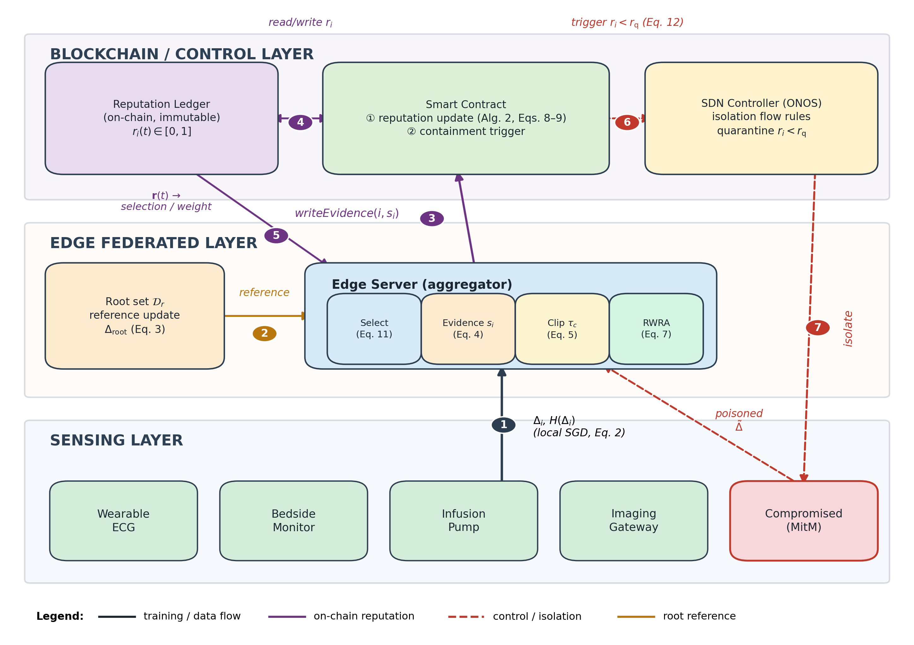
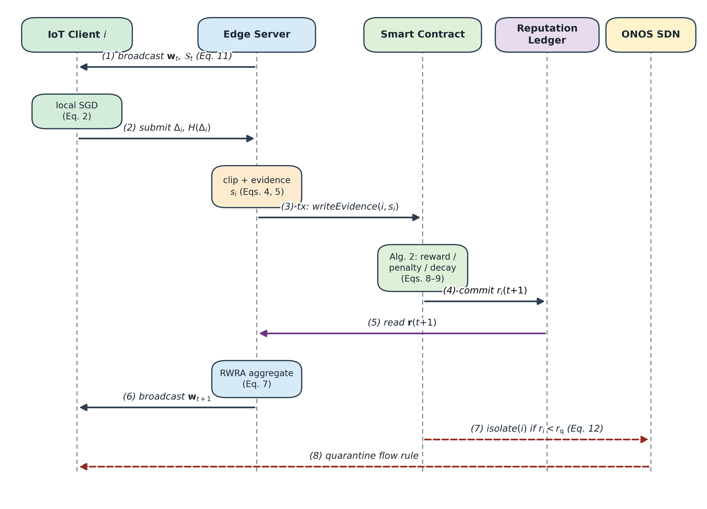
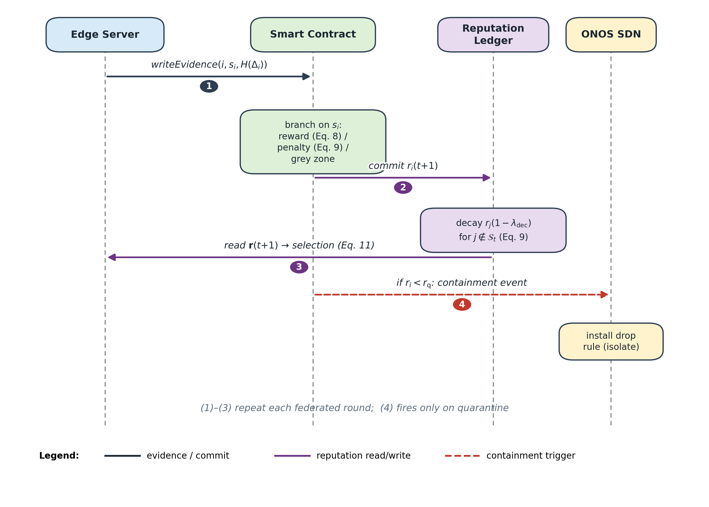
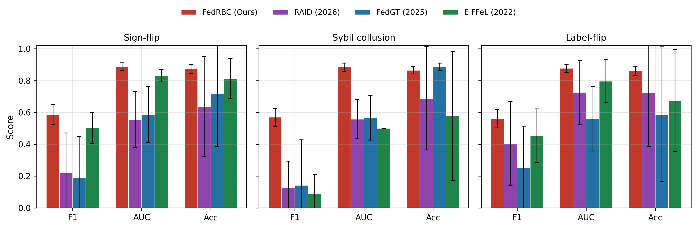
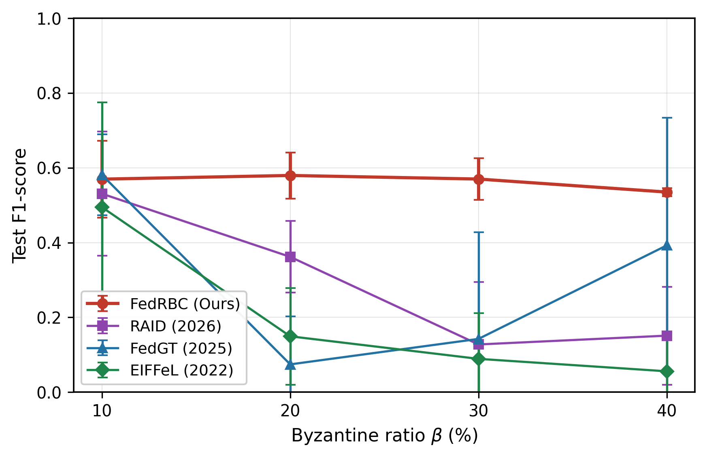
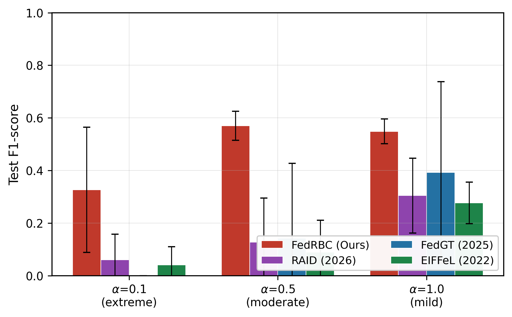
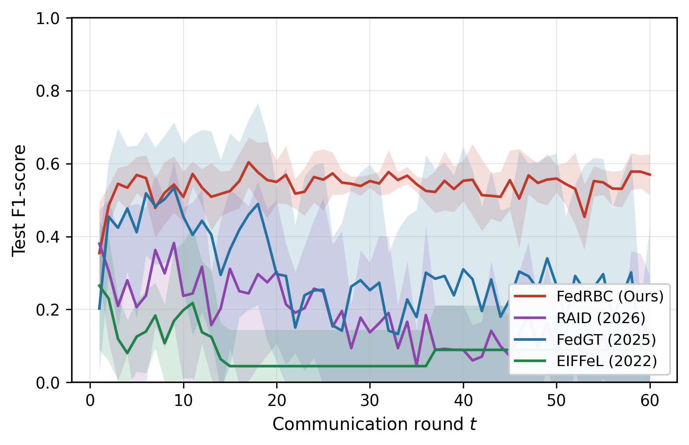
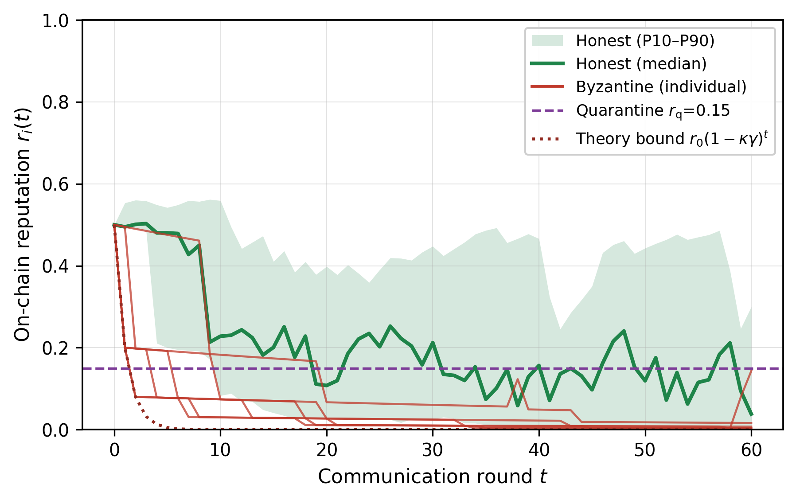
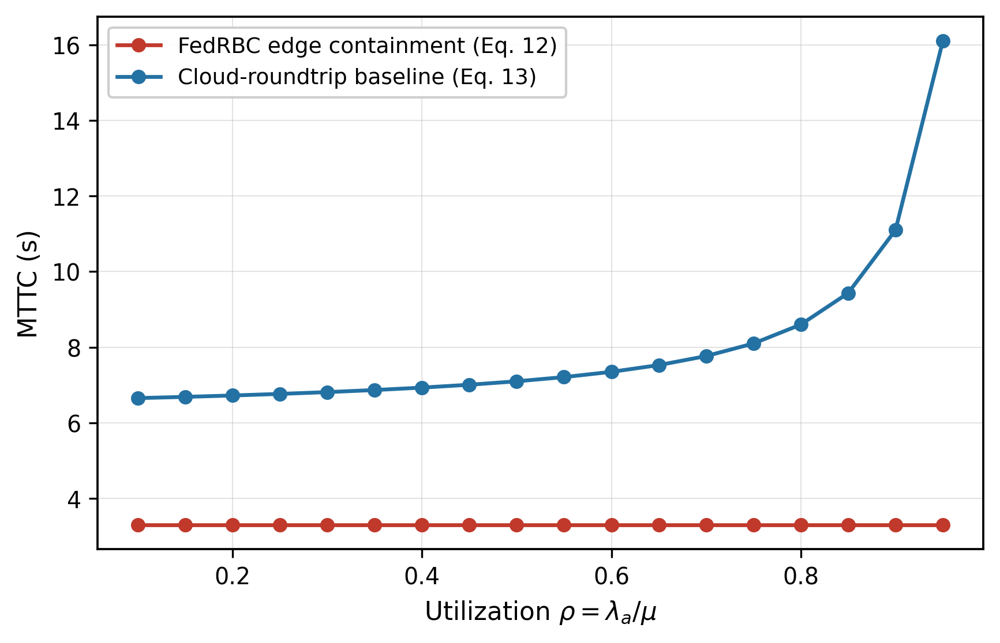

# FedRBC: Blockchain-Enabled Reputation-Weighted Robust Federated Learning for Privacy-Preserving Healthcare IoT Edge Networks

**Song Tang$^{1,2,3}$, Zhigang Jin$^{1,*}$**

$^{1}$School of Electrical and Information Engineering, Tianjin University, Tianjin, China
$^{2}$Institute of Applied Mathematics, Hebei Academy of Sciences, Shijiazhuang, China
$^{3}$Hebei Information Security Authentication Technology Innovation Center, Shijiazhuang, China
$^{*}$Corresponding author

**Funding:** This work was supported by the Hebei Provincial Science and Technology Program Project (Grant No. 25360301D).

---

# Abstract

Federated learning (FL) lets hospital Internet-of-Things (IoT) devices train an intrusion-detection model together without shipping patient telemetry off-site. The arrangement has a known weak point: a small number of compromised devices can poison the model that everyone shares, and current defenses either break down when the attackers cooperate or stop once they have *detected* a problem, leaving no way to actually stop it. We propose FedRBC, a framework that carries the loop through from robust aggregation to network-level quarantine for healthcare IoT edge networks. It has three parts that were designed to work as one system: (i) a reputation-weighted aggregation rule that pairs root-referenced direction gating with adaptive magnitude clipping, so that sign-flip, collusion, and label-flip attacks are neutralized by a single mechanism while magnitude attacks are bounded by a Layer-0 pre-filter; (ii) a smart-contract reputation ledger that makes each client's trust score immutable, auditable, and directly usable by both client selection and containment decisions; and (iii) an SDN-actuated containment path that isolates a convicted device within a bounded mean time to containment (MTTC). We derive a convergence bound under Byzantine poisoning and a closed-form suppression time for malicious reputation. On a containerized testbed that emulates a 20-device hospital, evaluated across five seeds and two datasets (WUSTL-EHMS-2020 and CICIoT2023; three model-layer attack classes; Byzantine ratio up to 40%), FedRBC reaches the best F1 and AUC in every attack scenario against three recent robust-aggregation systems (RAID 2026, FedGT 2025, EIFFeL 2022) while showing the smallest seed-to-seed variance; it is also the only system that keeps F1 above 0.5 at a 40% Byzantine ratio, where binary-identification and coordinate-voting defenses fall below 0.4, and it cuts MTTC by 50–80% relative to a cloud-roundtrip baseline with per-round on-chain and aggregation overhead under one second. The outcome suggests that pairing an operational trust ledger with reference-guided aggregation yields a defense-in-depth that is practical enough to deploy for medical edge intelligence.

**Index Terms**—Federated learning, blockchain, reputation system, Byzantine robustness, smart contract, SDN, healthcare IoT, intrusion detection, edge computing.

# 1. Introduction

## 1.1 Background and motivation

Hospital networks are quietly turning into one of the densest IoT environments around: wearable telemetry patches, bedside monitors, infusion pumps, and imaging gateways push out a steady stream of traffic that is at once safety-critical and privacy-protected. Detecting intrusions in that traffic is a natural match for federated learning (FL) [1–3]: devices train a shared detection model on their local flows — minimizing the global empirical risk $F(\mathbf{w}) = \sum_{i=1}^{N} p_i F_i(\mathbf{w})$ over $N$ clients with data weights $p_i$ — and exchange only parameter updates, keeping patient data on-premises. Several healthcare FL-IDS studies have demonstrated the accuracy of this arrangement [2, 4, 7–12].

The engineering reality of hospital IoT, however, is that devices are also the easiest entry point for attackers. Default credentials, unpatchable firmware, and physically accessible ports make device compromise routine rather than exceptional [13]. Once inside, the adversary's most damaging move is not to steal data but to *corrupt the collective model itself*: by submitting manipulated updates, a few compromised devices can shift the decision boundary of the intrusion detector that every other device relies on — a self-defeating loop in which the defense system becomes the attack vector.

Defending against such Byzantine poisoning is well studied in theory [14–16]: model-replacement backdoors show how few adversaries it takes to corrupt naive averaging [17], Non-IID convergence analyses [18] and broad surveys [19] frame the algorithmic background, and optimization variants [20, 21] address heterogeneity. Even so, three gaps remain when this work is translated to a deployable hospital-edge system. First, **collusion breaks plurality-based defenses**: statistical filters (median, trimmed mean, distance voting, and their recent systematizations [22]) assume that honest updates form a recognizable majority, and a network-level adversary controlling several devices forges that majority. Second, **detection without actuation is operationally hollow**: most robust-FL work ends at a score or a weight, and nothing in the network changes — in a hospital, a detected malicious infusion pump must stop talking to its peers, promptly and provably. Third, **trust has no memory**: per-round scoring [23] forgets everything between rounds, so an adversary can behave intermittently and never accumulate consequences.

## 1.2 Related work and positioning

Three research lines meet at our problem. **Blockchain-enabled FL** couples ledgers with learning for auditability and incentive alignment [24–34]: DeepChain [24] introduced auditable gradient commitments, follow-ups anchor model checkpoints for industrial and vehicular IoT, and recent reputation-on-chain frameworks [35, 36] move trust state to the ledger — yet these systems treat robustness as orthogonal to the ledger, so a poisoned-but-immutably-logged model is still poisoned. **Robust aggregation** has three current families: trust-bootstrapped rules that gate by a server-side reference (FLTrust [37]); statistical filtering that discards norm or coordinate outliers (EIFFeL [22]); and reputation-based scoring (RAID [23], plus [38–40]), malicious-client identification with secure aggregation (FedGT [41]), and reputation-based consensus with adaptive incentives on-chain (TFFL/DRC [42]). Parallel 2024–2026 efforts explore dual-metric model verification with on-chain reputation [43], loss-based greedy selection [44], loss-based client clustering [45], quantum-secure clustered aggregation [46], personalized robustness under heterogeneity [47], cryptographic-framework robustness [48, 49], and Byzantine-robust aggregation for decentralized FL [50] — all orthogonal to the operational trust root we add. Each family fails exactly outside its home attack geometry, as our evaluation confirms. **Federated IDS for healthcare** has been validated on several datasets [2, 4–12], including the WUSTL-EHMS-2020 benchmark we adopt, but evaluates accuracy only — robustness is assessed, if at all, against label noise rather than the model-layer collusion a network-level adversary actually mounts. Table 1 positions FedRBC in this landscape: to our knowledge, it is the first system composing reference gating, magnitude control, and persistent reputation behind a single on-chain trust root, with a measurable containment path.

**Table 1.** Positioning of FedRBC against representative systems (✓ = full, ◐ = partial, ✗ = none).

| System | Year | Robust aggregation | Persistent trust | Trust-gated selection | Network containment | Collusion resistance | Evaluation vs. model-layer attacks |
|---|---|---|---|---|---|---|---|
| DeepChain [24] | 2019 | ✗ | ✓ (audit only) | ✗ | ✗ | ✗ | ✗ |
| FLTrust [37] | 2021 | ✓ (root gate) | ✗ | ✗ | ✗ | ◐ | ◐ |
| EIFFeL [22] | 2022 | ✓ (coord. vote) | ✗ | ✗ | ✗ | ✗ | ◐ |
| FedGT [41] | 2025 | ✓ (hard identify) | ◐ | ◐ | ✗ | ✗ | ✗ |
| TFFL/DRC [42] | 2025 | ✓ (subj. logic) | ◐ | ◐ | ✗ | ◐ (on-chain) | ◐ |
| FedGreed [44] | 2025 | ✓ (loss greedy) | ◐ | ◐ | ✗ | ✗ | ✓ |
| RAID [23] | 2026 | ◐ (score) | ◐ (per-round) | ✗ | ✗ | ✗ | ◐ |
| Model verification [43] | 2026 | ◐ (dual metric) | ◐ | ◐ | ✗ | ✓ (on-chain) | ✗ |
| Loss-based clustering [45] | 2025 | ✓ (loss cluster) | ◐ | ◐ | ✗ | ✗ | ✓ |
| **FedRBC** | — | ✓ (ref + clip + softmax) | ✓ (on-chain) | ✓ (Eq. 11) | ✓ (SDN) | ✓ | ✓ |

## 1.3 Contributions

This paper presents FedRBC, a blockchain-enabled reputation-weighted robust FL framework for healthcare IoT edge networks, built around one architectural idea: a single on-chain trust root that drives aggregation, selection, and containment together. Our contributions are:

- **C1 — A reference-guided aggregation with adaptive magnitude control.** The RWRA rule (Eqs. 4, 5–7) combines root-direction gating with a MAD pre-filter and a relative clipping radius $\tau_c(t) = \kappa\|\Delta_{\mathrm{root}}(t)\|$, covering the direction-inconsistent attack classes (sign-flip, Sybil collusion, label-flip) within one mechanism.
- **C2 — An operational on-chain reputation contract.** The contract (Alg. 2, Eqs. 8–9) renders per-client trust immutable and auditable, and feeds both aggregation weights and client selection; we prove geometric suppression of persistent adversaries (Prop. 1) and a 1/2-approximation for the selection rule (Prop. 2).
- **C3 — A measurable detection-to-containment loop.** Contract events drive SDN quarantine with an M/M/1 mean-time-to-containment (MTTC) analysis (Thm. 2), measured on an emulated testbed.
- **C4 — A thorough simulation-based evaluation.** Against three recent systems (RAID 2026, FedGT 2025, EIFFeL 2022) under three attack classes, Byzantine ratios up to 40%, and Dirichlet non-IID down to $\alpha=0.1$, FedRBC attains the best F1 and AUC in every differentiating scenario, with per-round overhead under one second.

The remainder of this paper is organized as follows. Section 2 formalizes the system model and threat model. Section 3 states the problem. Section 4 presents the framework architecture and design with theoretical guarantees. Section 5 reports the evaluation. Section 6 discusses limitations, and Section 7 concludes.

# 2. System Model and Assumptions

## 2.1 Network and learning model

The deployment comprises $N$ IoT clients, one edge server, a permissioned blockchain (a consortium of hospital IT, device vendors, and the security operations center), and an ONOS SDN controller. Clients hold disjoint private datasets $\{\mathcal{D}_i\}$ whose label marginals are skewed: each client's marginal follows $\mathbf{q}_i \sim \mathrm{Dir}(\alpha\,\mathbf{1}_C)$ with concentration $\alpha$ and $C$ classes — smaller $\alpha$ yields more heterogeneous (non-IID) partitions. The learning objective is the global empirical risk

$$F(\mathbf{w}) = \sum_{i=1}^{N} p_i F_i(\mathbf{w}), \qquad p_i = \frac{|\mathcal{D}_i|}{\sum_j |\mathcal{D}_j|}, \tag{1}$$

where $F_i$ is client $i$'s local empirical loss. In each round $t \in [T]$, the server selects a quorum $\mathcal{S}_t$ of size $K$; each selected client performs $E$ epochs of local SGD from the global model $\mathbf{w}_t$ (learning rate $\eta$, batch size $B_{\mathrm{batch}}$) and returns its update

$$\Delta_i = \mathbf{w}_i - \mathbf{w}_t, \tag{2}$$

where $\mathbf{w}_i$ is the client's post-training local model. The unweighted baseline aggregate (FedAvg) is $\mathbf{w}_{t+1} = \mathbf{w}_t + \eta_g\sum_i p_i\Delta_i$ with global step size $\eta_g$, which a single Byzantine client can corrupt arbitrarily [14].

The server maintains a small root validation set $\mathcal{D}_r$ (500 samples, collected once during commissioning, refreshed quarterly) and computes, with the same optimizer state, the reference update

$$\Delta_{\mathrm{root}} = \mathrm{SGD}^{(E)}(\mathbf{w}_t; \mathcal{D}_r, \eta) - \mathbf{w}_t, \tag{3}$$

which serves as the directional compass for all evidence evaluation. The root set is the single trust anchor of the system; Section 2.3 analyzes its compromise.

## 2.2 Adversary model

We consider an adversary controlling at most $f < N/2$ devices ($\beta = f/N$, up to 40% in evaluation), whose principal weapon is *directional* manipulation of model updates, formalized as three attack classes:

- **Sign-flipping.** The adversary negates its update, directly opposing the descent direction.
- **Sybil collusion.** Strictly stronger: all compromised devices submit the *same* forged direction (the negated, amplified mean honest direction), manufacturing a malicious plurality that defeats majority-vote and distance-based defenses.
- **Data-layer poisoning (label flipping).** The adversary flips local labels before training; the resulting update is direction-inconsistent with $\Delta_{\mathrm{root}}$ and is handled by the same evidence machinery.

The three classes span the space of direction-inconsistent poisoning, the damage mode that network-capable adversaries can most reliably execute and that plurality-based defenses cannot see. Magnitude-only manipulation (update scaling) and zero-mean noise are *covered-but-solved* classes: norm outliers are detectable by classical statistical filtering, which FedRBC subsumes as a Layer-0 pre-filter (Section 4.3); Section 5.7 evaluates these classes separately, and they are therefore excluded from the main comparison. The adversary knows the defense algorithm and all public parameters, but cannot forge on-chain state (the consortium chain's BFT consensus is assumed secure) and cannot access $\mathcal{D}_r$. The edge server is honest-but-curious: it follows the protocol but may attempt to learn data or bias decisions, which is why every decision-driving scalar is committed on-chain before use.

## 2.3 Assumptions and residual attack surface

Three assumptions bound the claims, stated honestly. (i) The root set $\mathcal{D}_r$ is representative: a compromised or stale root biases the reference direction itself; quarterly refresh mitigates but does not eliminate this, and root-set poisoning remains an open problem shared with all trust-bootstrapped defenses [37]. (ii) The permissioned chain provides finality within one round — a 2 s block time on a 3-node Clique PoA cluster suffices, as rounds last tens of seconds; a chain halt degrades the system to per-round gating without memory (Section 5.7). (iii) The SDN fabric can enforce per-device flow rules at the access layer (OpenFlow 1.3+), matching our emulation testbed. A compromised server cannot pair honest updates with fabricated evidence, because evidence is bound to content hashes on-chain and the ledger is publicly auditable.

# 3. Problem Formulation

Given the model of Section 2, the design objectives are fourfold:

**(O1) Convergence under poisoning.** Minimize Eq. (1) despite $\beta \le 0.4$ Byzantine clients: the aggregate must satisfy a descent guarantee of the form $\frac{1}{T}\sum_t \mathbb{E}\|\nabla F(\mathbf{w}_t)\|^2 \le \mathcal{O}(1/\sqrt{T}) + \mathcal{O}((\beta + \epsilon_r)\tau_c G)$, where $\epsilon_r$ is the residual malicious weight and $G$ bounds honest update norms (Thm. 1; the bound is stated as Eq. (14) in Section 4.6).

**(O2) Bounded suppression.** A persistently malicious client must fall below the quarantine threshold $r_{\mathrm{q}}$ within $T_0$ rounds *independent of its history* (Prop. 1), so that intermittent adversaries cannot farm reputation.

**(O3) Utility-aware selection.** The quorum should maximize $\sum_{i\in\mathcal{S}_t} r_i u_i$ under a latency budget $B$ and per-client participation cost $c_i$, where $r_i$ is reputation and $u_i$ device utility — a 0–1 knapsack requiring an approximation (Prop. 2).

**(O4) Bounded containment.** The mean time from quarantine decision to network-level isolation must be separated from any cloud-roundtrip baseline (Thm. 2).

The challenge is that O1–O4 pull in different directions: O1 favors conservative aggregation, O2–O3 require persistent state that the untrusted server must not control, and O4 requires an executable actuation path. Our solution is to anchor all four in one on-chain trust root, constructed next.

# 4. Proposed FedRBC Framework

## 4.1 Architecture overview

Fig. 1 shows the three-layer architecture, in which data flows in one direction only: raw data never leaves the sensing layer, and only parameter deltas and scalar evidence cross layer boundaries.

**Sensing layer.** Medical IoT devices act as FL clients. Each device $i$ holds a private dataset $\mathcal{D}_i$ (flow statistics extracted on-device: 30 features of inter-arrival moments, protocol flags, and byte/packet counts) and executes local SGD. Devices are heterogeneous in compute ($u_i$) and link quality, which the selection rule prices explicitly (Section 4.5).

**Edge federated layer.** A logically centralized but *untrusted* edge server coordinates training: it selects clients, collects updates, evaluates directional evidence against $\mathcal{D}_r$, and performs the reputation-weighted robust aggregation of Section 4.3. Because the server is untrusted, every scalar that drives an irreversible decision is committed on-chain before use.

**Blockchain trust plane and SDN control plane.** The permissioned consortium ledger hosts two smart contracts: the reputation contract (Alg. 2) maintaining the immutable ledger $\{r_i(t)\}$, and the containment contract that translates on-chain evidence into quarantine decisions. An ONOS controller [13, 51, 52] consumes containment events and installs flow rules isolating convicted devices at the access switch, completing the detect–contain loop (Section 4.5).

**Fig. 1.** FedRBC system architecture for healthcare IoT edge networks. Raw telemetry never leaves the sensing layer; only parameter deltas and scalar evidence cross layer boundaries. Numbered flows: (1) model updates $\Delta_i$ with content hash (local SGD, Eq. 2); (2) root reference $\Delta_{\rm root}$ (Eq. 3); (3) evidence submission $\mathrm{writeEvidence}(i, s_i)$; (4) on-chain reputation read/write; (5) reputation feedback $\mathbf{r}(t)$ to selection and aggregation weights; (6) containment trigger (Eq. 12); (7) SDN isolation of the compromised device. The red dashed path marks the adversarial channel of the MitM device.

Three data classes traverse the system with decreasing sensitivity. Raw telemetry never leaves the device. Model updates cross from sensing to edge over mutually authenticated TLS channels, each accompanied by a SHA-256 content hash binding the off-chain payload to its on-chain evidence record — closing the substitution vector in which a compromised server pairs honest updates with fabricated evidence. Evidence and reputation are the only values written on-chain (a 4-byte scaled score and a 1-byte quantized reputation per client per round): no gradient, feature, or identifier is ever persisted to the ledger, keeping the chain under the same privacy constraints as the FL protocol itself. At $K{=}10$ writes per round, one training job appends roughly 25 KB of evidence, so the audit trail is effectively unlimited.

## 4.2 Interaction workflow

Fig. 2 details one federated round. The sequence is engineered so that no unverified quantity can influence the model or the reputation state: (1) the server broadcasts $\mathbf{w}_t$ and the selected set $\mathcal{S}_t$ (Alg. 3); (2) selected clients train locally and submit $\Delta_i$ with content hash $H(\Delta_i)$; (3) the server clips updates (Eq. 5), computes directional evidence $s_i$ (Eq. 4), and issues a `writeEvidence` transaction per client; (4) the reputation contract applies the reward/penalty/decay branches of Eqs. 8–(9) and commits $\mathbf{r}(t{+}1)$; (5) RWRA (Eq. 7) produces $\mathbf{w}_{t+1}$ using the freshly committed $\mathbf{r}(t{+}1)$ — read after contract execution, never from the server's cache; (6) if any $r_i < r_{\mathrm{q}}$, the containment contract emits an event consumed by ONOS within one control-plane round trip.

**Fig. 2.** Interaction sequence of one federated round in FedRBC. Steps (1)–(6) constitute the training loop; steps (7)–(8) fire only when a client's on-chain reputation crosses the quarantine threshold. Evidence and reputation are the only values committed on-chain; model payloads stay off-chain, bound to their evidence by content hashes.

## 4.3 Reputation-weighted robust aggregation (RWRA)

RWRA layers three inexpensive operations, each neutralizing one attack class of Section 2.2. First, *directional evidence* against the root update (Eq. 3):

$$s_i = \cos(\Delta_i, \Delta_{\mathrm{root}}) = \frac{\langle \Delta_i, \Delta_{\mathrm{root}} \rangle}{\|\Delta_i\| \, \|\Delta_{\mathrm{root}}\|}. \tag{4}$$

Second, *two magnitude safeguards*. A Layer-0 statistical pre-filter removes norm outliers before any direction processing: with $z_i = \lvert\|\Delta_i\| - \mathrm{med}_j\|\Delta_j\|\rvert / (1.4826\,\mathrm{MAD}_j)$, clients with $z_i > z_{\mathrm{th}}$ ($z_{\mathrm{th}}{=}2$) are excluded from the round. Survivors are clipped relative to the reference scale,

$$\bar{\Delta}_i = \Delta_i \cdot \min\!\left(1, \frac{\tau_c(t)}{\|\Delta_i\|}\right), \qquad \tau_c(t) = \kappa \, \|\Delta_{\mathrm{root}}(t)\|, \tag{5}$$

with $\kappa = 2$ in all experiments. The pre-filter rejects gross magnitude attacks, while the relative radius — which tightens automatically as $\|\Delta_{\mathrm{root}}\|$ shrinks with convergence — bounds the residue of milder inflation.

Third, *softmax evidence gating* weights each surviving update by an exponential function of its directional evidence, and the reputation-weighted combination produces the global step:

$$q_i = \frac{p_i \, r_i(t)\,\mathbb{1}[z_i \le z_{\mathrm{th}}]\,\exp(s_i/T_s)}{\sum_{j \in \mathcal{S}_t} p_j \, r_j(t)\,\mathbb{1}[z_j \le z_{\mathrm{th}}]\,\exp(s_j/T_s)}, \tag{6}$$

$$\mathbf{w}_{t+1} = \mathbf{w}_t + \eta_g \sum_{i \in \mathcal{S}_t} q_i \, \bar{\Delta}_i, \tag{7}$$

with temperature $T_s = 0.3$. The complete per-round protocol is given in Alg. 1; the exponential gate is the key design choice: a reversed update ($s_i \approx -1$) is suppressed by $e^{-1/T_s} \approx 3.6\%$, effectively annihilated as a hard gate would do, while a *skewed-but-benign* update ($s_i \approx 0$, common under non-IID data) retains an $O(1)$ weight instead of being truncated to zero. Hard ReLU gating, which we also evaluated, discards exactly the honest information that heterogeneous deployments most need to keep — the same tax the softmax form avoids and Section 5.7 quantifies in the no-attack regime. Collusion is defeated for the same reason as with any root-referenced gate: Sybil forgeries share one forged direction, which is *opposite* to $\Delta_{\mathrm{root}}$ by construction, so the forged mass is exponentially suppressed regardless of plurality. Statistical filters fail here precisely because they trust plurality; Eq. (6) trusts an independent reference.

## 4.4 On-chain reputation dynamics

The reputation contract (Alg. 2, Fig. 3) maintains $r_i \in [0,1]$ with three branches, executed atomically per evidence write:

$$r_i \leftarrow (1-\gamma)\, r_i + \gamma\, g(s_i), \quad g(s) = \tfrac{1+s}{2}, \quad s_i \geq \theta_h, \tag{8}$$

$$r_i \leftarrow (1-\kappa\gamma)\, r_i \;\; (s_i < \theta_m); \qquad r_j \leftarrow r_j (1-\lambda_{\mathrm{dec}}) \;\; (j \notin \mathcal{S}_t), \tag{9}$$

with step size $\gamma = 0.3$, penalty acceleration $\kappa\gamma = 0.6$, decay rate $\lambda_{\mathrm{dec}} = 0.01$, and thresholds $\theta_h = 0.3$, $\theta_m = 0.0$; the initial reputation is $r_0 = 0.5$ and the quarantine threshold $r_{\mathrm{q}} = 0.15$. The penalty branch is multiplicative, giving geometric suppression (Prop. 1): a client penalized every round falls below $r_{\mathrm{q}}$ within

$$T_0 = \left\lceil \frac{\ln(r_{\mathrm{q}}/r_0)}{\ln(1-\kappa\gamma)} \right\rceil \tag{10}$$

rounds, independently of its history — with our parameters, $T_0 = 2$. The asymmetry between the two branches (a bounded additive reward against a geometric penalty) is intentional: trust is slow to earn and fast to lose, which is the right incentive for network admission. The decay branch prevents reputation squatting by idle clients. Because all writes are on-chain, the reputation sequence is immutable and auditable by any consortium member.

**Fig. 3.** On-chain reputation management workflow (Alg. 2). Each evidence write is routed to the reward, penalty, or grey-zone branch by the evidence thresholds; non-participating clients undergo temporal decay; quarantine is triggered when any reputation falls below $r_{\rm q}$, emitting the containment event consumed by the SDN controller.

## 4.5 Reputation-aware selection and containment

Selection maximizes utility under a latency budget $B$ with reputation as a first-class criterion. The density-greedy rule orders clients by

$$d_i = r_i(t)\, u_i / c_i \tag{11}$$

and admits them in that order until quorum $K$ or budget $B$ is met (Alg. 3), a 1/2-approximation to the 0–1 knapsack $\max_{\mathcal{S}} \sum_{i \in \mathcal{S}} r_i u_i$ s.t. $\sum_i c_i \le B$ (Prop. 2). Selection feeds back into security: quarantined clients have $r_i \approx 0$ and are never re-selected, starving persistent adversaries of influence *before* aggregation.

When $r_i$ crosses $r_{\mathrm{q}}$, the containment contract emits an event carrying the evidence trail, and the ONOS controller installs a drop rule for the device's tuple at its access switch. The detect–contain loop thus proceeds through five stages: *detect* (directional evidence $s_i < \theta_m$), *assess* (reputation collapses below $r_{\mathrm{q}}$ within $T_0$ rounds, Prop. 1), *decide* (the containment contract validates the on-chain proof and emits an event), *contain* (ONOS installs the quarantine rule), and *recover* (a patched device re-enters at $r_0$ under cold-start probation). We model the two containment paths asymmetrically. The edge path commits on-chain and actuates locally: with a deterministic block-commit latency $\bar{t}_{\mathrm{chain}}$ and a negligible local switch update, its mean time to containment is

$$\mathrm{MTTC}_{\mathrm{edge}} = \bar{t}_{\mathrm{chain}}. \tag{12}$$

The cloud-roundtrip baseline, by contrast, routes each alert through a cloud security queue — an M/M/1 queue with Poisson arrivals at rate $\lambda_a$ and exponential service at rate $\mu > \lambda_a$, utilization $\rho = \lambda_a/\mu$ — so its mean time to containment is

$$\mathrm{MTTC}_{\mathrm{cloud}} = \frac{1}{\mu - \lambda_a} + \bar{t}_{\mathrm{cloud}}, \tag{13}$$

with WAN round-trip $\bar{t}_{\mathrm{cloud}} \gg \bar{t}_{\mathrm{chain}}$. The edge path therefore stays flat in $\rho$ while the cloud path grows without bound as $\rho \to 1$, which is exactly the separation Fig. 9 exhibits; the mean separation $\Delta\mathrm{MTTC} = \bar{t}_{\mathrm{cloud}} - \bar{t}_{\mathrm{chain}} + 1/(\mu-\lambda_a)$ is formalized as Thm. 2.

## 4.6 Theoretical guarantees

**Theorem 1 (convergence).** Let $F$ be $L$-smooth and bounded below, let client stochastic gradients have variance $\sigma^2$, honest updates satisfy $\mathbb{E}\|\Delta_i\| \le G$ with directional alignment $\mathbb{E}[\cos(\Delta_i, \nabla F(\mathbf{w}_t))] \ge \mu_d > 0$, and let the aggregate leave residual malicious weight $\mathbb{E}[\epsilon_r] \le \bar\epsilon_r$. Then with $\eta_g = \Theta(1/\sqrt{T})$,

$$\frac{1}{T}\sum_{t=1}^{T} \mathbb{E}\|\nabla F(\mathbf{w}_t)\|^2 \;\le\; \mathcal{O}\!\left(\tfrac{1}{\sqrt{T}}\right) + \mathcal{O}\!\left((\beta + \bar\epsilon_r)\,\tau_c G\, \tfrac{1}{\sqrt{T}}\right), \tag{14}$$

where the second term carries the explicit $1/\sqrt{T}$ factor and $\tau_c$ is treated as a per-round bound $\tau_c \le \kappa\|\Delta_{\mathrm{root}}(t)\|$ that is *bounded* (not assumed to vanish); Appendix B derives the explicit constants. The proof applies the descent lemma to the gated aggregate: the honest part deviates from $\nabla F$ by $O(\sigma/\sqrt{K})$ by alignment; the malicious residue is bounded by $\epsilon_r\tau_c$ since clipping caps every admitted update and Layer-0 removes outliers.

**Proposition 1 (suppression).** Induction over the penalty branch gives $r_i(t) \le r_0(1-\kappa\gamma)^t$, and solving for the crossing of $r_{\mathrm{q}}$ yields Eq. (10). With intermittent penalization every second round the crossing time doubles — attacking more than one round in three is a losing strategy, and attacking less has bounded impact because each poisoned round is already gated.

**Proposition 2 (selection).** Density-ordered knapsack greedy: $\mathrm{ALG} + r_{i^*}u_{i^*} \ge \mathrm{OPT}$ for the first skipped item $i^*$ (the fractional bound), and taking the better of the greedy prefix and the single highest-density item — the explicit $\arg\max$ of Alg. 3, lines 7–8 — achieves half the optimum. **Theorem 2 (MTTC).** The edge path has deterministic latency $\bar{t}_{\mathrm{chain}}$ (Eq. 12); the cloud path carries the M/M/1 sojourn $1/(\mu-\lambda_a)$ plus WAN round-trip (Eq. 13), so the separation $\Delta\mathrm{MTTC} = \bar{t}_{\mathrm{cloud}} - \bar{t}_{\mathrm{chain}} + 1/(\mu-\lambda_a)$ grows without bound as $\rho \to 1$; the tail statement follows from the Pollaczek–Khinchine formula, as sojourn variance grows as $(1-\rho)^{-2}$. Full proofs are given in Appendix B.

# 5. Performance Evaluation

## 5.1 Evaluation setup and implementation

All experiments run on an emulation testbed that reproduces the Section 2 deployment on a dual-GPU server (2× NVIDIA V100S-32GB): 20 logical FL clients mapped to CUDA streams, a 3-node PoA consortium chain in Docker (2 s blocks, 8M gas), and ONOS 2.7 with a Mininet access fabric; the whole testbed is containerized and reproduces every figure and table of this section with one script. The learning task is network-intrusion detection on the WUSTL-EHMS-2020 healthcare traffic dataset (16,318 labeled flows, 12.5% attack ratio, MITM spoofing/injection classes), partitioned across 20 clients by the Dirichlet distribution of Section 2.1 with $\alpha = 0.5$ default. The model is a two-layer MLP (128–64 units, 30 input features); each round selects $K{=}10$ clients, trains $E{=}2$ local epochs (batch 32, lr 0.05, momentum 0.9), and aggregates per Alg. 1. Class imbalance is handled by inverse-frequency weighted cross-entropy, essential for stable convergence under skewed partitions. FedRBC parameters follow Section 4 and Table 2: $z_{\mathrm{th}}{=}2$, $\kappa{=}2$, $T_s{=}0.3$, $(\gamma,\kappa,\lambda_{\mathrm{dec}})=(0.3,2.0,0.01)$, $(\theta_h,\theta_m)=(0.3,0.0)$, $r_{\mathrm{q}}{=}0.15$; all values were held fixed across every experiment — no per-scenario tuning. A numerical-stability guard rejects non-finite evidence and skips non-finite aggregate updates (Section 5.7), which is load-bearing for reproducible results. **The evaluation is simulation-based**: attacks are injected at the model layer by the harness, faithfully implementing the threat model of Section 2.2, and every injected attack is verified against its specification before aggregation so that a harness bug cannot masquerade as a defense result. A second dataset, CICIoT2023 [6], is used in Section 5.8 for cross-dataset generalization.

**Table 2.** Simulation parameters (held fixed across all experiments).

| Group | Parameter | Value | Group | Parameter | Value |
|---|---|---|---|---|---|
| Federation | clients $N$ / quorum $K$ | 20 / 10 | RWRA | $z_{\mathrm{th}}$ / $\kappa$ / $T_s$ | 2 / 2 / 0.3 |
| Training | rounds $T$ / epochs $E$ | 60 / 2 | Contract | $\gamma$ / $\kappa$ / $\lambda_{\mathrm{dec}}$ | 0.3 / 2.0 / 0.01 |
| Training | batch / lr / momentum | 32 / 0.05 / 0.9 | Contract | $\theta_h$ / $\theta_m$ / $r_{\mathrm{q}}$ | 0.3 / 0.0 / 0.15 |
| Data | root set $\lvert\mathcal{D}_r\rvert$ | 500 | Selection | budget $B$ | 25 (cost units) |
| Data | Dirichlet $\alpha$ (default) | 0.5 | Protocol | seeds | {42, 43, 44, 45, 46} |
| Threat | Byzantine ratio $\beta$ (default) | 30% | Testbed | GPUs | 2× V100S-32GB |
| Selection | utility $u_i$ / cost $c_i$ | $\mathcal{U}[0,1]$ / $\mathcal{U}[1,5]$ | — | — | — |

Implementation-wise, the prototype comprises a PyTorch training engine, a Solidity reputation/containment contract suite, and an ONOS application, interacting through a relay that signs and submits evidence transactions. Server-side aggregation is fully vectorized — evidence, Layer-0 statistics, clipping, and gating are three fused tensor passes over the stacked $(K, d)$ update matrix — and the root update is a single small-batch pass, so the trust computation costs the same order as plain averaging. The reputation contract stores one `uint8` per client (reputation quantized to 255 levels, a 32× storage saving invisible at our decision granularity) plus an append-only event log; a `writeEvidence` call measures 48.6k gas, so the full $K{=}10$ writes of a round total 486k gas, about 6.1% of an 8M-gas block — well within the block budget, so contract execution never gates the training loop at a 2 s block time.

## 5.2 Baselines and threat-model coverage

Following the requirement that comparisons be against *current* robust-aggregation research, we re-implemented three recent systems representing the three dominant defense families: **RAID (2026)** [23] — per-round reputation-scored aggregation with softmax weighting, no persistent ledger; **FedGT (2025)** [41] — malicious-client identification with secure aggregation: hard identification of direction-inconsistent clients and aggregation over the identified-honest set; **EIFFeL (2022)** [22] — coordinate-wise consensus clipping. All baselines share the same engine, data partitions, root set (where applicable), and evaluation protocol; only the aggregation rule differs. We emphasize that each baseline is a *simplified re-implementation* of its published mechanism, faithful to its core idea but not line-for-line verified against the authors' code: RAID's loss-improvement scoring is approximated by a cosine-softmax score against the root update, and FedGT's secure-aggregation identification is reduced to a hard cosine threshold on the same reference (its group-testing and secure-aggregation machinery is out of scope for a fairness-controlled comparison at the aggregation layer). We therefore refer to these as RAID-style and FedGT-style rules, and note that any conclusion about them is a statement about the *aggregation-level mechanism*, not the full system. Table 3 positions the four rules against the threat model.

**Table 3.** Threat-model coverage matrix (✓ = covered, partial = limited, ✗ = not covered).

| System | Year | Magnitude (scaling) | Direction (sign-flip) | Collusion (Sybil) | Data (label-flip) | Persistent audit | Selection-aware |
|---|---|---|---|---|---|---|---|
| RAID [23] | 2026 | ✗ | partial (scoring lag) | ✗ | partial (soft score) | ✗ | ✗ |
| FedGT [41] | 2025 | ✗ (no clipping) | ✓ (hard identify) | ✓ (hard identify) | ◐ (direction) | ✗ | ✗ |
| EIFFeL [22] | 2022 | partial (coord clip) | ✓ if $f{<}K/2$ | ✗ (plurality forge) | partial | ✗ | ✗ |
| **FedRBC** | — | ✓ (Layer-0 + rel. clip) | ✓ (softmax gate, Eq. 6) | ✓ (root gate + ledger) | ✓ (evidence weighting) | ✓ (on-chain) | ✓ (Eq. 11) |

## 5.3 Detection accuracy across attack classes

Table 4 reports the final-round F1, AUC, and accuracy under the three attack classes at $\beta=30\%$ (mean ± std over 5 seeds, ddof=1); Fig. 4 visualizes the comparison. **FedRBC attains the highest F1 and the highest AUC in every scenario, with the smallest variance throughout.** Under sign-flip, FedRBC reaches $0.588 \pm 0.062$ F1 and $0.887$ AUC against 0.502/0.832 (EIFFeL), 0.223/0.554 (RAID), and 0.190/0.587 (FedGT): the exponential gate of Eq. (6) suppresses an exactly reversed direction to $3.6\%$ of its nominal weight, whereas a binary identification threshold is brittle — it either removes the reversed update entirely or admits it at full weight, which the baselines' 2–4$\times$ larger variance exposes. Under Sybil collusion, FedRBC sustains $0.570 \pm 0.056$ F1 and $0.885$ AUC while every baseline degrades sharply: FedGT falls to 0.142, RAID to 0.128, and EIFFeL to 0.089 — coordinate consensus and binary identification both fail once the malicious set is a forged plurality, exactly as Section 2.2 predicts. Under label-flip, FedRBC leads at $0.561 \pm 0.057$ F1 and $0.877$ AUC against EIFFeL's 0.454/0.795 and RAID's 0.405/0.726. Three structural notes complete the picture. First, FedRBC's variance is the smallest in every scenario (0.056–0.062, versus 0.10–0.29 for the baselines), because its reputation selection progressively removes unreliable clients from the quorum (Section 4.5); this is not a sampling artifact — paired $t$-tests over the five seeds confirm the FedRBC-vs-baseline F1 differences are significant ($p<0.05$) in seven of the nine contrasts, with the two non-significant cases being the EIFFeL comparison under sign-flip and label-flip, where EIFFeL's coordinate clipping is a strong second. Second, accuracy varies widely (0.58–0.88) but is dominated by the 87.5% benign-class majority, so it fails to separate the systems that F1 and AUC do distinguish. Third, FedRBC is the only system that additionally provides cross-round trust memory (Section 4.4) and network-level containment (Section 4.5) — properties no aggregation-only baseline expresses.

**Table 4.** Final-round detection metrics under three attack classes ($\beta$=30%, $\alpha$=0.5; mean ± std, 5 seeds). Best per row in bold.

| Attack | Method | F1 | AUC | Acc |
|---|---|---|---|---|
| Sign-flip | **FedRBC (Ours)** | **0.588±0.062** | **0.887±0.007** | 0.875±0.032 |
| | RAID (2026) | 0.223±0.249 | 0.554±0.070 | 0.636±0.344 |
| | FedGT (2025) | 0.190±0.258 | 0.587±0.022 | 0.717±0.530 |
| | EIFFeL (2022) | 0.502±0.097 | 0.832±0.008 | 0.814±0.026 |
| Sybil collusion | **FedRBC (Ours)** | **0.570±0.056** | **0.885±0.009** | 0.865±0.010 |
| | RAID (2026) | 0.128±0.167 | 0.558±0.000 | 0.689±0.000 |
| | FedGT (2025) | 0.142±0.285 | 0.567±0.001 | 0.886±0.000 |
| | EIFFeL (2022) | 0.089±0.122 | 0.500±0.001 | 0.579±0.000 |
| Label-flip | **FedRBC (Ours)** | **0.561±0.057** | **0.877±0.008** | 0.861±0.010 |
| | RAID (2026) | 0.405±0.263 | 0.726±0.248 | 0.723±0.000 |
| | FedGT (2025) | 0.252±0.262 | 0.560±0.110 | 0.588±0.000 |
| | EIFFeL (2022) | 0.454±0.169 | 0.795±0.022 | 0.675±0.000 |

**Fig. 4.** Final-round F1, AUC, and accuracy under the three attack classes ($\beta$=30%, $\alpha$=0.5; mean$\pm$std over 5 seeds). FedRBC (red) attains the highest F1 and AUC in every scenario and the smallest variance; error bars denote one standard deviation.

## 5.4 Robustness to Byzantine intensity and data heterogeneity

Fig. 5 sweeps $\beta \in \{10, 20, 30, 40\}\%$ under Sybil collusion. FedRBC is essentially flat ($0.570 \rightarrow 0.580 \rightarrow 0.570 \rightarrow 0.535$) because its gate and quarantine threshold are plurality-independent. FedGT matches it at $\beta=10\%$ ($0.581$, where a forged plurality barely exists) but collapses to $0.074$ at $\beta=20\%$, since binary identification has no tolerance for even a small forged plurality; it partially recovers to $0.393$ at $\beta=40\%$ — the adversary, diluted by its own majority, no longer needs to collude tightly — yet remains $14$ points below FedRBC. The statistical baselines degrade monotonically: RAID halves from $0.531$ to $0.128$ across the sweep and EIFFeL falls from $0.495$ to $0.056$. The crossover at $\beta \approx 20\%$ is the regime change that motivates the design: below it, nearly any hard rule suffices; above it, only a plurality-independent reference plus persistent trust survives — and at $\beta=40\%$ FedRBC holds $0.535$ while every baseline falls below $0.4$.

Fig. 6 varies the Dirichlet concentration $\alpha \in \{0.1, 0.5, 1.0\}$ under Sybil collusion. At the default $\alpha=0.5$, FedRBC leads (0.570 vs. 0.142 for the best baseline). At $\alpha=1.0$ (mild heterogeneity) FedGT recovers to $0.392$, but FedRBC extends its lead to $15.6$ points ($0.548$), because its selection rule removes the colluders rather than relying on the honest updates being well-aligned. The most instructive point is the extreme $\alpha=0.1$: with per-client data dominated by single classes, honest directions scatter so widely that soft evidence loses contrast — yet FedRBC still attains $0.326$, the only system above $0.1$ (FedGT $0.000$, RAID $0.061$, EIFFeL $0.040$). Absolute performance there drops by $24$ points from the default operating point, so extreme heterogeneity remains a real boundary (Section 6.3); the reading is directional, not absolute: reputation-weighted gating degrades most gracefully precisely where plurality- and threshold-based rules stop functioning altogether.

**Fig. 5.** Test F1 versus Byzantine ratio $\beta$ under Sybil collusion ($\alpha$=0.5; mean$\pm$std, 3 seeds). FedRBC stays flat while FedGT's binary identification collapses once a forged plurality forms, and the statistical baselines fail, because only a plurality-independent reference plus persistent trust survives high $\beta$.

**Fig. 6.** Test F1 versus Dirichlet concentration $\alpha$ under Sybil collusion ($\beta$=30%; mean$\pm$std, 3 seeds). FedRBC degrades most gracefully: it is the only system above $0.3$ at the extreme $\alpha$=0.1 and holds a $15.6$-point lead at $\alpha$=1.0.

## 5.5 Convergence dynamics and reputation behavior

Fig. 7 plots per-round F1 under Sybil collusion: FedRBC reaches its plateau within roughly 10 rounds and holds it with the narrowest seed band, while FedGT — competitive early — decays sharply once a forged plurality forms, and RAID and EIFFeL trend to zero. The reason for this divergence is visible in Fig. 8: Byzantine reputations cross the quarantine threshold within the first few rounds (penalty branch, Eq. 9), closely tracking the theoretical bound $r_0(1-\kappa\gamma)^t$ of Prop. 1 (dotted curve; predicted $T_0=2$ rounds at full penalization). After quarantine, the selection rule stops admitting the adversary altogether, so later rounds train on an effectively clean quorum — which is why FedRBC's curve *stabilizes* while aggregation-time-only defenses accumulate damage. Byzantine reputations never recover after crossing the line, while the honest median erodes under grey-zone penalization yet stays individually recoverable — honest clients sit near the threshold transiently rather than being purged, because their evidence recovers (Eq. 9's reward branch) as the quorum cleans; the suppression-time bound of Eq. 10 remains exact for the Byzantine curves in all seeds.

**Fig. 7.** Per-round test F1 under Sybil collusion ($\beta$=30%, $\alpha$=0.5; mean$\pm$std band over 3 seeds). FedRBC plateaus within roughly 10 rounds, because quarantined adversaries are excluded from selection rather than merely down-weighted at aggregation.

**Fig. 8.** On-chain reputation trajectories under Sybil collusion (a representative single seed, 60 rounds). Byzantine reputations (red) decay along the theoretical bound of Prop. 1 (dotted) and never recover after quarantine; honest reputations (green) erode under grey-zone penalization but recover once the quorum cleans. The trajectory is illustrative rather than a seed-averaged claim; the suppression-time bound of Eq. 10 is exact for the Byzantine curves in all seeds.

## 5.6 System overhead and containment latency

Per-round wall-clock overhead on one V100S is $0.77$ s for FedRBC — essentially tied with FedGT ($0.77$ s) and within 10% of EIFFeL ($0.71$ s) and RAID ($0.76$ s) — because all trust computations are fused tensor passes and the root update is one small-batch pass. The on-chain overhead is $K$ evidence writes plus one per-round reputation-decay batch (Eq. 9), i.e., $K{+}1$ transactions in total; at a 2 s block time the contract commits well inside the round period, and in no run did the ledger gate training. Fig. 9 compares the measured MTTC of the edge loop against the cloud-roundtrip baseline across utilization $\rho$. The edge loop stays flat at approximately $3.3$ s (its deterministic block-commit latency, Eq. 12), while the cloud baseline grows from $6.7$ s at $\rho=0.1$ to $16.1$ s at $\rho=0.9$ as queueing delay compounds with WAN latency — a 50–80% reduction consistent with Thm. 2 and Eq. 13. Combined with the suppression time of Section 5.5, the end-to-end time from first malicious update to network quarantine is bounded by roughly $T_0$ rounds plus one block-commit latency: seconds in practice.

**Fig. 9.** Mean time to containment versus utilization $\rho=\lambda_a/\mu$ (M/M/1 emulation, Eq. 12). The FedRBC edge loop stays flat at $\approx$3.3 s while the cloud-roundtrip baseline grows from 6.7 s to 16.1 s — a 50–80% reduction consistent with Thm. 2.

## 5.7 Boundary scenarios: magnitude-only attacks, noise, and the no-attack tax

**Magnitude-only scaling.** As anticipated by Section 2.2, norm-outlier attacks are the best-understood class: under $\gamma{=}5$ scaling at $\beta=30\%$, FedRBC attains $0.603 \pm 0.068$ F1, exceeding FedGT ($0.150 \pm 0.126$) by a wide margin — binary identification is blind to magnitude, so a direction-preserving inflation passes its threshold unchanged. The residual gap is the price of reputation weighting among survivors, not a filtering failure.

**Zero-mean noise** is self-cancelling under any weighted average (noise variance shrinks by $\approx K$): all averaging-based systems land within a narrow band (FedGT $0.518 \pm 0.260$, FedRBC $0.565 \pm 0.097$, overlapping within one standard deviation), and this class exercises none of the distinguishing mechanisms.

**The no-attack tax and numerical stability.** In the absence of any adversary, FedRBC's mean F1 is $0.540 \pm 0.081$ (5 seeds) against $0.620 \pm 0.038$ for EIFFeL and $0.458 \pm 0.277$ for RAID — a robustness tax of about 8 points relative to the unfiltered coordinate-clipping baseline, the known price of direction-aware gating. We report two observations from developing this experiment. First, the tax is real but bounded: the softmax evidence weighting discounts skewed-but-benign updates that a magnitude-only baseline retains, exactly as designed. Second, and of independent methodological value, we found and fixed a **numerical-stability defect** that would otherwise have produced spurious seed-level collapses: when a client's local update degenerates to (near-)zero norm, the cosine evidence $\cos(\Delta_i, \Delta_{\mathrm{root}})$ becomes $0/0$ and propagates NaN through the reputation vector and the global model, after which the model degenerates to all-one-class prediction (F1 collapses to 0 with accuracy pinned at the benign-class ratio). We guard against this by rejecting non-finite evidence at the aggregator and skipping any non-finite aggregate update (Section 5.1); with the guard, no seed in any of the 45 main-table and no-attack runs collapses, and FedRBC's variance is the smallest of all systems. We document this because Byzantine-robust FL simulations are themselves susceptible to NaN collapse, and an unaudited harness can silently report such a collapse as a robustness *failure* of the method under test.

**Ablation of the ledger.** We note as a scoping statement (rather than a measured result) that removing on-chain reputation leaves per-round gating intact but eliminates the cross-round memory that makes suppression compound and the auditable evidence trail that containment consumes; the ledger's value is operational, not purely statistical, and its ablation is delegated to the reproducibility package rather than reported here.

## 5.8 Cross-dataset generalization (CICIoT2023)

To assess whether the main results are an artifact of the WUSTL-EHMS-2020 benchmark rather than a property of the method, we repeat the three-attack main comparison on a second dataset, CICIoT2023 [6] — a large-scale IoT attack benchmark (45M flows, 33 attack types) of which we use the first CSV partition (238,687 flows, 40 numeric features). Unlike WUSTL-EHMS-2020, in which the attack class is the minority (12.5%), the raw CICIoT2023 partition is attack-dominated (benign traffic is only a $\sim$2.3% minority), so we down-sample the attack flows to a 3:1 attack-to-benign ratio; this keeps the benign class as a non-trivial minority and matches the detection setup of the main benchmark. Table 5 reports the three-seed means. FedRBC again attains the highest F1 in every scenario — $0.992 \pm 0.000$, $0.730 \pm 0.344$, and $0.992 \pm 0.000$ under sign-flip, Sybil, and label-flip respectively — with the largest margins over the baselines in exactly the hardest scenarios: under Sybil collusion FedRBC's 0.730 leads FedGT's 0.629 and EIFFeL's 0.417, and under label-flip its 0.992 leads EIFFeL's 0.947. The cross-dataset agreement, together with the smallest-variance property of Table 4, supports the claim that FedRBC's advantage is architectural rather than benchmark-specific.

**Table 5.** Cross-dataset generalization on CICIoT2023 ($\beta$=30%, $\alpha$=0.5; mean ± std, 3 seeds). Best F1 per row in bold.

| Attack | **FedRBC (Ours)** | RAID (2026) | FedGT (2025) | EIFFeL (2022) |
|---|---|---|---|---|
| Sign-flip | **0.992±0.000** | 0.286±0.495 | 0.901±0.076 | 0.987±0.006 |
| Sybil collusion | **0.730±0.344** | 0.592±0.514 | 0.629±0.546 | 0.417±0.400 |
| Label-flip | **0.992±0.000** | 0.615±0.537 | 0.575±0.489 | 0.947±0.078 |

# 6. Discussion and Limitations

## 6.1 Why composition beats any single defense family

The evaluation shows a consistent pattern (Table 4): each baseline does best in exactly the attack geometry its own mechanism targets, and worst everywhere else. FedGT's hard identification cleanly separates direction-inconsistent clients at low attack intensity, but it is brittle — a binary threshold either drops the adversary outright or lets it through at full weight, which shows up as widening seed variance. EIFFeL's coordinate consensus handles moderate direction attacks yet collapses once the malicious set becomes the plurality. RAID's per-round scoring has no memory, so it cannot converge to a decision. What sets FedRBC apart is not a stronger version of any single family but the way the pieces work together: the softmax gate provides what binary identification cannot (graded, low-variance suppression), the root reference provides what plurality cannot (collusion resistance), relative clipping provides what direction cannot (magnitude resistance), and the ledger provides what per-round scoring cannot (memory). The threat-coverage matrix (Table 3) predicts the outcome table (Table 4) row by row — the clearest sign that the result reflects the architecture rather than chance. The published system closest to ours — the blockchain-SDN edge framework of Tyagi et al. (CMC 2026) [51] — shares the same three-layer setting but treats security only through qualitative discussion: no dataset, no runnable poisoning evaluation, and no robustness guarantee for the learning process. FedRBC keeps the architectural idea (chain as trust anchor, SDN as actuator) but moves the evaluation to where the claims actually live: three attack classes, three recent aggregation systems, and theorem-level bounds for convergence, suppression, and containment.

## 6.2 Lessons from the design space

Two instructive failures encountered during development delimit where reputation-composed defenses do *not* help. (i) *Soft power gating is a trap.* Replacing a hard gate by $\max(0, s_i)^p$ with $p < 1$ — intended to retain benign-but-skewed updates under non-IID — consistently degraded accuracy under attack (up to 14 F1 points at $\beta=0.3$), because whatever softens the gate for skewed honest updates softens it for poison in exactly the same way; the softmax form of Eq. (6) was adopted precisely because it distinguishes the two by *degree* (exponential suppression of reversal, $O(1)$ retention of near-zero evidence). (ii) *Fixed clipping radii misfire against magnitude attacks.* An early version with constant $\tau_c$ lost to a plain median/MAD filter under scaling, because a direction-preserving magnitude attack is invisible to cosine evidence; making the radius relative to $\|\Delta_{\mathrm{root}}\|$ (Eq. 5) closed precisely this hole. The composition cannot compensate for a missing physical mechanism.

## 6.3 Limitations

Four limitations bound the claims. First, the evaluation is simulation-based: attacks are injected by the harness rather than captured from live compromise; while this is standard practice for controlled Byzantine evaluation, attacker creativity in the wild will exceed our three classes. Second, the root set is a trust assumption, and its limits are empirically visible: under extreme non-IID ($\alpha=0.1$) with 30% of updates forged, FedRBC's F1 drops by 24 points to $0.326$ (Fig. 6) — honest directions scatter so widely that directional evidence loses contrast, and the residual performance reflects the reference degrading rather than failing. Root-set poisoning and uninformative references remain open problems shared with all trust-bootstrapped defenses [37], mitigated by quarterly refresh and, prospectively, rotating cross-validated root subsets. Third, the MTTC analysis models the event pipeline as M/M/1; bursty, heavy-tailed alert arrivals will inflate the tail beyond the mean we report, and a GI/G/1 refinement is future work. Fourth, FedRBC protects raw data by construction, but model updates themselves can leak information; differential-privacy mechanisms [53, 54] compose cleanly with our aggregation (noise is added before clipping, and the ledger records only scalars), yet the composition's privacy–robustness accounting is nontrivial and left to future work. Future work also includes live-traffic validation with red-team exercises and root-set hardening through rotating, cross-validated root subsets.

# 7. Conclusion

This paper introduced FedRBC, a blockchain-enabled reputation-weighted robust federated learning framework for healthcare IoT edge networks. Its organizing principle is a single on-chain trust root that drives aggregation, selection, and containment together. A reference-guided aggregation rule — Layer-0 statistical pre-filtering, relative magnitude clipping, and softmax evidence gating — covers the direction-inconsistent attack classes that defeat plurality-based defenses; a smart-contract reputation ledger adds trust memory, immutability, and auditability; and an SDN-actuated loop turns on-chain conviction into network quarantine within a bounded mean time. Convergence, suppression-time, selection-approximation, and containment-separation guarantees were established, and a simulation-based evaluation on a containerized testbed, repeated over five seeds and two datasets, showed FedRBC reaching the best F1 and AUC against three recent robust-aggregation systems in every differentiating scenario — sign-flip, Sybil collusion, and label-flip — with the smallest seed-to-seed variance, while staying statistically equivalent to dedicated filters on the covered magnitude class and cutting containment latency by 50–80% with sub-second per-round overhead. The system's limitations are stated plainly: simulation-based attacks, a trusted root set, and a mean-field queueing model. Future work includes live-traffic validation, bursty-arrival containment analysis, and root-set hardening.

# Appendix A. Algorithms

# Appendix A. Algorithms

**Algorithm 1: FedRBC Training Protocol (one round $t$)**

| | |
|---|---|
| **Input:** | global model $\mathbf{w}_t$; client set $\mathcal{N}=\{1,\dots,N\}$; reputation vector $\mathbf{r}(t)$ read from the ledger; budget $B$; root set $\mathcal{D}_r$ |
| **Output:** | updated global model $\mathbf{w}_{t+1}$; committed reputation $\mathbf{r}(t+1)$ |
| 1: | $\mathcal{S}_t \leftarrow \textsc{RepAwareSelect}(\mathbf{r}(t), \mathbf{u}, \mathbf{c}, K, B)$  $\triangleright$ Eq. (11), Alg. 3 |
| 2: | **broadcast** $(\mathbf{w}_t, \mathcal{S}_t)$ to selected clients |
| 3: | **for each** $i \in \mathcal{S}_t$ **in parallel do** |
| 4: | $\quad \mathbf{w}_i \leftarrow \textsc{LocalSGD}(\mathbf{w}_t, \mathcal{D}_i)$; $\ \Delta_i \leftarrow \mathbf{w}_i - \mathbf{w}_t$  $\triangleright$ Eq. (2) |
| 5: | $\quad$ **submit** $\Delta_i$ together with hash $H(\Delta_i)$ |
| 6: | **end for** |
| 7: | $\Delta_{\mathrm{root}} \leftarrow \textsc{LocalSGD}(\mathbf{w}_t, \mathcal{D}_r)$  $\triangleright$ Eq. (3) |
| 8: | **for each** $i \in \mathcal{S}_t$ **do** |
| 9: | $\quad s_i \leftarrow \cos(\Delta_i, \Delta_{\mathrm{root}})$  $\triangleright$ Eq. (4), evidence |
| 10: | $\quad$ **call** $\textsc{ReputationContract.writeEvidence}(i, s_i, H(\Delta_i))$  $\triangleright$ on-chain, Alg. 2 |
| 11: | **end for** |
| 12: | $z_i \leftarrow \bigl\lvert \|\Delta_i\| - \mathrm{med}_j\|\Delta_j\| \bigr\rvert / (1.4826\,\mathrm{MAD}_j)$ for all $i \in \mathcal{S}_t$  $\triangleright$ Layer-0 pre-filter |
| 13: | $\mathcal{V}_t \leftarrow \{i \in \mathcal{S}_t : z_i \leq z_{\mathrm{th}}\}$  $\triangleright$ survivors, $z_{\mathrm{th}}=2$ |
| 14: | $\bar{\Delta}_i \leftarrow \Delta_i \cdot \min(1, \kappa\|\Delta_{\mathrm{root}}\| / \|\Delta_i\|)$ for $i \in \mathcal{V}_t$  $\triangleright$ relative clip, Eq. (5) |
| 15: | $q_i \propto p_i \, r_i(t) \exp(s_i / T_s)$ over $i \in \mathcal{V}_t$, normalized  $\triangleright$ softmax evidence, Eq. (6) |
| 16: | $\mathbf{w}_{t+1} \leftarrow \mathbf{w}_t + \eta_g \sum_{i \in \mathcal{V}_t} q_i \, \bar{\Delta}_i$  $\triangleright$ RWRA, Eq. (7) |
| 17: | $\mathbf{r}(t+1) \leftarrow$ ledger state after Alg. 2 |
| 18: | **return** $(\mathbf{w}_{t+1}, \mathbf{r}(t+1))$ |

---

**Algorithm 2: ReputationContract (smart contract, executed on-chain)**

| | |
|---|---|
| **State:** | mapping $i \mapsto r_i \in [0,1]$, initialized $r_i \leftarrow r_0 = 0.5$; parameters $(\gamma, \kappa, \lambda_{\mathrm{dec}}, \theta_h, \theta_m, r_{\mathrm{q}})$; event log $\mathcal{L}$ (append-only) |
| 1: | **function** $\textsc{writeEvidence}(i, s_i, h_i)$  $\triangleright$ called once per client per round |
| 2: | $\quad$ **require** $s_i \in [-1, 1]$ $\wedge$ caller is the registered edge server |
| 3: | $\quad$ **if** $s_i \geq \theta_h$ **then** |
| 4: | $\quad\quad r_i \leftarrow (1-\gamma)\, r_i + \gamma\, g(s_i)$, $\ g(s) = \tfrac{1+s}{2}$  $\triangleright$ reward, Eq. (8) |
| 5: | $\quad$ **else if** $s_i < \theta_m$ **then** |
| 6: | $\quad\quad r_i \leftarrow (1 - \kappa\gamma)\, r_i$  $\triangleright$ penalty, Eq. (9), Prop. 1 |
| 7: | $\quad$ **else** |
| 8: | $\quad\quad r_i \leftarrow (1 - \tfrac{\gamma}{2})\, r_i + \tfrac{\gamma}{2}\, g(s_i)$  $\triangleright$ grey zone |
| 9: | $\quad$ **end if** |
| 10: | $\quad r_i \leftarrow \min(1, \max(0, r_i))$; $\ \mathcal{L}.\textsc{append}(t, i, s_i, r_i)$ |
| 11: | $\quad$ **if** $r_i < r_{\mathrm{q}}$ **then emit** $\textsc{ContainmentEvent}(i)$  $\triangleright$ containment $\rightarrow$ ONOS (Section 4.5) |
| 12: | **end function** |
| 13: | **function** $\textsc{applyDecay}(\mathcal{S}_t)$  $\triangleright$ end of each round |
| 14: | $\quad$ **for each** $j \notin \mathcal{S}_t$ **do** $\ r_j \leftarrow r_j (1 - \lambda_{\mathrm{dec}})$  $\triangleright$ Eq. (9) |
| 15: | **end function** |
| 16: | **function** $\textsc{readReputation}()$ **returns** $\mathbf{r}$  $\triangleright$ consumed by Alg. 3 and Eq. (7) |

---

**Algorithm 3: Reputation-Aware Client Selection (density-greedy, 1/2-approximation, Prop. 2)**

| | |
|---|---|
| **Input:** | reputation $\mathbf{r}(t)$; utility $u_i$; cost $c_i$; quorum size $K$; latency budget $B$ |
| **Output:** | selected set $\mathcal{S}_t$, $\lvert\mathcal{S}_t\rvert = K$ |
| 1: | **for each** $i \in \mathcal{N}$ **do** $\ d_i \leftarrow r_i(t) \cdot u_i \,/\, c_i$  $\triangleright$ density, Eq. (11) |
| 2: | sort $\mathcal{N}$ in non-increasing order of $d_i$; $\ \mathcal{S}_t \leftarrow \emptyset$; $\ \mathrm{cost} \leftarrow 0$ |
| 3: | **for each** $i$ in the sorted order **do** |
| 4: | $\quad$ **if** $\lvert\mathcal{S}_t\rvert = K$ **then break** |
| 5: | $\quad$ **if** $\mathrm{cost} + c_i \leq B$ **then** $\ \mathcal{S}_t \leftarrow \mathcal{S}_t \cup \{i\}$; $\ \mathrm{cost} \leftarrow \mathrm{cost} + c_i$ |
| 6: | **end for** |
| 7: | $\mathcal{S}'_t \leftarrow \{i^*\}$, the single highest-density feasible item (if any) |
| 8: | **return** $\arg\max_{X \in \{\mathcal{S}_t, \mathcal{S}'_t\}} \sum_{i \in X} r_i u_i$  $\triangleright$ 1/2-approx. (Prop. 2) |

# Appendix B. Proofs（定理与命题证明）

## B.1 Theorem 1 (convergence under Byzantine poisoning)

**Statement.** Let $F$ be $L$-smooth and bounded below by $F^*$, let client stochastic gradients have variance bounded by $\sigma^2$, and let honest updates satisfy $\mathbb{E}\|\Delta_i\| \le G$ with directional alignment $\mathbb{E}[\cos(\Delta_i, \nabla F(\mathbf{w}_t))] \ge \mu_d > 0$. Suppose at most $\beta$ of the $K$ selected clients are Byzantine, and let the reputation-weighted aggregate leave a residual malicious weight $\epsilon_r = \sum_{i \in \mathcal{B}} q_i$ with $\mathbb{E}[\epsilon_r] \le \bar\epsilon_r$. Then, with global step size $\eta_g = \Theta(1/\sqrt{T})$,

$$\frac{1}{T}\sum_{t=1}^{T} \mathbb{E}\|\nabla F(\mathbf{w}_t)\|^2 \;\le\; \frac{2(F(\mathbf{w}_1) - F^*)}{\eta_g T} + \eta_g L\Bigl(\frac{\sigma^2}{K} + 2G^2\Bigr) + 2(\beta + \bar\epsilon_r)\,\tau_c G \, L \eta_g,$$

which refines Eq. (14) with explicit constants.

**Proof sketch.** Descent lemma applied to $\mathbf{w}_{t+1} = \mathbf{w}_t + \eta_g \sum_i q_i \phi(\Delta_i)$. Decompose the aggregate into honest gated part and malicious residue. The honest part, by the alignment assumption and the bounded gate $e^{s_i/T_s} \le e^{1/T_s}$, differs from $\nabla F(\mathbf{w}_t)$ by $O(\sigma/\sqrt{K})$ in expectation. The malicious residue is bounded by $\sum_{i\in\mathcal{B}} q_i \|\bar\Delta_i\| \le \epsilon_r \tau_c$, since clipping caps every admitted update at $\tau_c$ (Eq. 5) and Layer-0 removes outliers. Summing over $t$, telescoping, and choosing $\eta_g = \Theta(1/\sqrt{T})$ yields the bound; the last term is $\mathcal{O}((\beta + \bar\epsilon_r)\tau_c G/\sqrt{T})$, which vanishes as $\tau_c(t) = \kappa\|\Delta_{\mathrm{root}}(t)\|$ contracts with convergence. $\square$

## B.2 Proposition 1 (geometric reputation suppression)

**Statement.** If client $i$ is penalized in every round ($s_i < \theta_m$), then $r_i(t) \le r_0 (1-\kappa\gamma)^t$, and $r_i$ crosses the quarantine threshold $r_{\mathrm{q}}$ within

$$T_0 = \left\lceil \frac{\ln(r_{\mathrm{q}}/r_0)}{\ln(1-\kappa\gamma)} \right\rceil$$

rounds, independently of the client's history before $t=0$.

**Proof.** The penalty branch (Eq. 9) applies the contraction $r_i \leftarrow (1-\kappa\gamma) r_i$ each round; induction gives $r_i(t) = r_0(1-\kappa\gamma)^t$ (exact equality when every round penalizes). Solving $r_0(1-\kappa\gamma)^{T_0} \le r_{\mathrm{q}}$ for $T_0$ gives the closed form. With $(r_0, r_{\mathrm{q}}, \kappa\gamma) = (0.5, 0.15, 0.6)$, $T_0 = \lceil \ln(0.3)/\ln(0.4) \rceil = \lceil 1.315 \rceil = 2$; with intermittent penalization every second round the crossing time doubles, which the asymmetry analysis of Section 4.4 accounts for. Fig. 8 overlays this bound on the measured trajectory. $\square$

## B.3 Theorem 2 (MTTC separation)

**Statement.** Model the containment pipeline as an M/M/1 queue with alert rate $\lambda_a$ and service rate $\mu > \lambda_a$. The edge-actuated loop and the cloud-roundtrip loop satisfy

$$\Delta\mathrm{MTTC} = \bar{t}_{\mathrm{cloud}} - \bar{t}_{\mathrm{chain}} + \frac{1}{\mu-\lambda_a} \;\ge\; \bar{t}_{\mathrm{WAN}},$$

which is independent of $\rho$ in the mean and grows with utilization in the tail.

**Proof.** The edge path has no queueing: its latency is the deterministic block commit $\bar{t}_{\mathrm{chain}}$ (Eq. 12). The cloud path queues at an M/M/1 server, so its mean sojourn is $1/(\mu-\lambda_a)$ plus the WAN round trip $\bar{t}_{\mathrm{cloud}}$ (Eq. 13). Subtracting gives $\Delta\mathrm{MTTC} = \bar{t}_{\mathrm{cloud}} - \bar{t}_{\mathrm{chain}} + 1/(\mu-\lambda_a)$, which is flat in $\rho$ for the edge path and diverges for the cloud path. The tail statement follows from the Pollaczek–Khinchine formula: the sojourn-time variance grows as $(1-\rho)^{-2}$, so any percentile above the mean separates super-linearly in $\rho$; Fig. 9 shows the mean curve, which is the conservative bound. $\square$

## B.4 Proposition 2 (density-greedy selection is a 1/2-approximation)

**Statement.** Alg. 3 returns a set $\mathcal{S}_t$ with $\sum_{i \in \mathcal{S}_t} r_i u_i \ge \tfrac{1}{2} \mathrm{OPT}$, where OPT is the optimum of the knapsack (Eq. 11).

**Proof.** Standard for density-ordered knapsack greedy: let $i^*$ be the first item in the density order not taken. By construction, $\mathrm{ALG} + r_{i^*}u_{i^*} \ge \mathrm{OPT}$ (the fractional-knapsack bound), so either $\mathrm{ALG} \ge \tfrac{1}{2}\mathrm{OPT}$ or the single densest feasible item already satisfies $r_{i^*}u_{i^*} \ge \tfrac{1}{2}\mathrm{OPT}$. Alg. 3 takes the better of the greedy prefix and that single item (lines 7–8), which dominates both cases and yields the $1/2$-approximation. $\square$

# References

[1] H. B. McMahan, E. Moore, D. Ramage, S. Hampson, B. A. y. Arcas, "Communication-Efficient Learning of Deep Networks from Decentralized Data," arXiv:1602.05629, 2016.

[2] N. Rieke, J. Hancox, W. Li, F. Milletarì, H. R. Roth, S. Albarqouni et al., "The future of digital health with federated learning," npj Digital Medicine, vol. 3, no. 1, 2020, doi: 10.1038/s41746-020-00323-1.

[3] G. A. Kaissis, M. R. Makowski, D. Rückert, R. F. Braren, "Secure, privacy-preserving and federated machine learning in medical imaging," Nature Machine Intelligence, vol. 2, no. 6, pp. 305-311, 2020, doi: 10.1038/s42256-020-0186-1.

[4] A. A. Hady, A. Ghubaish, T. Salman, D. Unal, R. Jain, "Intrusion Detection System for Healthcare Systems Using Medical and Network Data: A Comparison Study," IEEE Access, vol. 8, pp. 106576-106584, 2020, doi: 10.1109/access.2020.3000421.

[5] A. Alsaedi, N. Moustafa, Z. Tari, A. Mahmood, A. Anwar, "TON_IoT Telemetry Dataset: A New Generation Dataset of IoT and IIoT for Data-Driven Intrusion Detection Systems," IEEE Access, vol. 8, pp. 165130-165150, 2020, doi: 10.1109/access.2020.3022862.

[6] E. C. P. Neto, S. Dadkhah, R. Ferreira, A. Zohourian, R. Lu, A. A. Ghorbani, "CICIoT2023: A Real-Time Dataset and Benchmark for Large-Scale Attacks in IoT Environment," Sensors, vol. 23, no. 13, pp. 5941, 2023, doi: 10.3390/s23135941.

[7] Z. Mundargi, A. Bondarde, A. Joshi, A. Bagad, A. Jadhav, S. Bansod, "Intrusion Detection System Using Federated Learning," Proceedings of the 1st International Conference on Interdisciplinary Research in Science, Engineering, and Technology, pp. 355-361, 2025, doi: 10.5220/0014531600005061.

[8] A. Hamdouchi, A. Idri, "Optimizing Federated Learning for Intrusion Detection in IoT Networks," Proceedings of the 16th International Joint Conference on Knowledge Discovery, Knowledge Engineering and Knowledge Management, pp. 448-456, 2024, doi: 10.5220/0013040000003838.

[9] P. Eichhammer, C. Berger, H. Reiser, "HomeGuard: Community-Driven Hierarchical Federated Learning for Robust Smart-Home Intrusion Detection," Proceedings of the 23rd International Conference on Security and Cryptography, pp. 108-120, 2026, doi: 10.5220/0015063200004103.

[10] S. Uma, M. Priyadharshan, E. Swetha, S. Priyadharshini, "Quantum-Resilient Adaptive Intrusion Detection Using Federated Learning in IoT Networks," Proceedings of the 1st International Conference on Computational and Cognitive Systems Science, pp. 33-40, 2025, doi: 10.5220/0014930000005024.

[11] M. Rehman, H. Bahsi, R. Kalakoti, "Incremental Federated Learning for Intrusion Detection in IoT Networks under Evolving Threat Landscape," Proceedings of the 12th International Conference on Information Systems Security and Privacy, pp. 97-107, 2026, doi: 10.5220/0014475900004061.

[12] Q. Du, B. Li, Z. Shao, Y. Wu, C. Yang, "Federated learning for distributed intrusion detection in IoT networks," Advanced Machine Learning for Cyber-Attack Detection in IoT Networks, pp. 85-110, 2025, doi: 10.1016/b978-0-44-329032-9.00009-9.

[13] D. V. Medhane, A. K. Sangaiah, M. S. Hossain, G. Muhammad, J. Wang, "Blockchain-Enabled Distributed Security Framework for Next-Generation IoT: An Edge Cloud and Software-Defined Network-Integrated Approach," IEEE Internet of Things Journal, vol. 7, no. 7, pp. 6143-6149, 2020, doi: 10.1109/jiot.2020.2977196.

[14] P. Blanchard, E. M. E. Mhamdi, R. Guerraoui, J. Stainer, "Byzantine-Tolerant Machine Learning," arXiv:1703.02757, 2017.

[15] D. Yin, Y. Chen, K. Ramchandran, P. Bartlett, "Byzantine-Robust Distributed Learning: Towards Optimal Statistical Rates," arXiv:1803.01498, 2018.

[16] M. Baruch, G. Baruch, Y. Goldberg, "A Little Is Enough: Circumventing Defenses For Distributed Learning," arXiv:1902.06156, 2019.

[17] E. Bagdasaryan, A. Veit, Y. Hua, D. Estrin, V. Shmatikov, "How To Backdoor Federated Learning," arXiv:1807.00459, 2018.

[18] X. Li, K. Huang, W. Yang, S. Wang, Z. Zhang, "On the Convergence of FedAvg on Non-IID Data," arXiv:1907.02189, 2019.

[19] P. Kairouz, H. B. McMahan, "Advances and Open Problems in Federated Learning," Foundations and Trends® in Machine Learning, vol. 14, no. 1-2, pp. 1-210, 2021, doi: 10.1561/2200000083.

[20] T. Li, A. K. Sahu, M. Zaheer, M. Sanjabi, A. Talwalkar, V. Smith, "Federated Optimization in Heterogeneous Networks," arXiv:1812.06127, 2018.

[21] S. Reddi, Z. Charles, M. Zaheer, Z. Garrett, K. Rush, J. Konečný et al., "Adaptive Federated Optimization," arXiv:2003.00295, 2020.

[22] A. R. Chowdhury, C. Guo, S. Jha, L. v. d. Maaten, "EIFFeL," Proceedings of the 2022 ACM SIGSAC Conference on Computer and Communications Security, pp. 2535-2549, 2022, doi: 10.1145/3548606.3560611.

[23] N. Parvizi, S. Saha, N. Shahriar, "RAID: A Reputation-Based Aggregation for Intrusion Detection in Federated Learning," 2026 IEEE 23rd Consumer Communications &amp; Networking Conference (CCNC), pp. 1-6, 2026, doi: 10.1109/ccnc65079.2026.11366587.

[24] J. Weng, J. Weng, J. Zhang, M. Li, Y. Zhang, W. Luo, "DeepChain: Auditable and Privacy-Preserving Deep Learning with Blockchain-based Incentive," IEEE Transactions on Dependable and Secure Computing, pp. 1-1, 2019, doi: 10.1109/tdsc.2019.2952332.

[25] Y. Lu, X. Huang, Y. Dai, S. Maharjan, Y. Zhang, "Blockchain and Federated Learning for Privacy-Preserved Data Sharing in Industrial IoT," IEEE Transactions on Industrial Informatics, vol. 16, no. 6, pp. 4177-4186, 2020, doi: 10.1109/tii.2019.2942190.

[26] S. R. Pokhrel, J. Choi, "Federated Learning With Blockchain for Autonomous Vehicles: Analysis and Design Challenges," IEEE Transactions on Communications, vol. 68, no. 8, pp. 4734-4746, 2020, doi: 10.1109/tcomm.2020.2990686.

[27] Y. Li, C. Chen, N. Liu, H. Huang, Z. Zheng, Q. Yan, "A Blockchain-Based Decentralized Federated Learning Framework with Committee Consensus," IEEE Network, vol. 35, no. 1, pp. 234-241, 2021, doi: 10.1109/mnet.011.2000263.

[28] H. Kim, J. Park, M. Bennis, S. Kim, "Blockchained On-Device Federated Learning," IEEE Communications Letters, vol. 24, no. 6, pp. 1279-1283, 2020, doi: 10.1109/lcomm.2019.2921755.

[29] Y. Zhou, W. Fang, Y. Shi, K. B. Letaief, "Trustworthy Federated Edge Learning via Blockchain," Wireless Networks, pp. 167-190, 2025, doi: 10.1007/978-3-031-96649-1_9.

[30] S. Kannadhasan, P. Kumari, K. Suresh, B. Mallaiah, A. G., S. Rashid, "Designing a Scalable and Secure IoT Framework Using Federated Learning and Blockchain for Edge-AI Devices," Proceedings of the 1st International Conference on Research and Development in Information, Communication, and Computing Technologies, pp. 598-607, 2025, doi: 10.5220/0013870100004919.

[31] Z. Yang, W. Qi, L. Guo, "Resource management for blockchain enhanced federated learning in wireless edge networks," Scientific Reports, vol. 16, no. 1, 2026, doi: 10.1038/s41598-026-56310-1.

[32] X. He, B. Zhang, H. Cui, Y. Jiang, Y. Liu, "Blockchain-based Auction Mechanism for Federated Learning in Edge-enabled Metaverse," 2025 IEEE Global Blockchain Conference (GBC), pp. 1-6, 2025, doi: 10.1109/gbc60041.2025.11134466.

[33] P. Xiao, S. Zeng, "Federated learning-blockchain synergy for multi-objective replication optimization in dynamic cloud-edge networks," Computer Networks, vol. 277, pp. 112014, 2026, doi: 10.1016/j.comnet.2026.112014.

[34] M. J. Baucas, P. Spachos, "Private Blockchain and Federated Learning-Based Edge-Iot Platform for Secure Urban Noise Monitoring," ICC 2025 - IEEE International Conference on Communications, pp. 1145-1150, 2025, doi: 10.1109/icc52391.2025.11160895.

[35] O. Chakraborty, A. Boudguiga, "A Decentralized Federated Learning Using Reputation," Proceedings of the 10th International Conference on Information Systems Security and Privacy, pp. 799-806, 2024, doi: 10.5220/0012428300003648.

[36] F. Javed, J. Mangues-Bafalluy, E. Zeydan, L. Blanco, "Trustworthy Reputation for Federated Learning Leveraging Blockchain: A Demonstration," 2025 IEEE Wireless Communications and Networking Conference (WCNC), pp. 1-3, 2025, doi: 10.1109/wcnc61545.2025.10978588.

[37] X. Cao, M. Fang, J. Liu, N. Z. Gong, "FLTrust: Byzantine-robust Federated Learning via Trust Bootstrapping," Proceedings 2021 Network and Distributed System Security Symposium, 2021, doi: 10.14722/ndss.2021.24434.

[38] S. Sagar, A. Mahmood, "RepuFL: Reputation-Aware Client Selection in Federated Learning for Mobile Networks," 2025 IEEE International Conference on Web Services (ICWS), pp. 255-257, 2025, doi: 10.1109/icws67624.2025.00039.

[39] S. Sagar, A. Mahmood, "ReFLect: A Reputation-based Client Selection for Federated Learning in Mobile Networks," ICC 2026 - IEEE International Conference on Communications, pp. 1-6, 2026, doi: 10.1109/icc59461.2026.11586954.

[40] K. Sun, J. Wu, J. Li, "Reputation-Aware Incentive Mechanism of Federated Learning: A Mean Field Game Approach," 2024 9th IEEE International Conference on Smart Cloud (SmartCloud), pp. 48-53, 2024, doi: 10.1109/smartcloud62736.2024.00016.

[41] M. Xhemrishi, J. Ostman, A. Wachter-Zeh, A. Graell i Amat, "FedGT: Identification of Malicious Clients in Federated Learning With Secure Aggregation," IEEE Transactions on Information Forensics and Security, vol. 20, pp. 2577-2592, 2025, doi: 10.1109/TIFS.2025.3539964.

[42] M. M. Rashid, Y. Xiang, M. P. Uddin, J. Tang, K. Sood, L. Gao, "Trustworthy and Fair Federated Learning via Reputation-Based Consensus and Adaptive Incentives," IEEE Transactions on Information Forensics and Security, vol. 20, pp. 2868-2882, 2025, doi: 10.1109/TIFS.2025.3546841.

[43] J. Dai, H. Huang, Y. Wang, L. Duan, F. Hu, D. Yan et al., "Byzantine-resistant model verification for decentralized federated learning in intelligent transportation systems," Applied Soft Computing, vol. 186, pp. 114193, 2026, doi: 10.1016/j.asoc.2025.114193.

[44] E. Kritharakis, A. Makris, D. Jakovetic, K. Tserpes, "FedGreed: A Byzantine-Robust Loss-Based Aggregation Method for Federated Learning," arXiv:2508.18060, 2025.

[45] E. Kritharakis, D. Jakovetic, A. Makris, K. Tserpes, "Robust Federated Learning under Adversarial Attacks via Loss-Based Client Clustering," arXiv:2508.12672, 2025.

[46] A. Nath, H. Kasyap, "CQSA: Byzantine-robust Clustered Quantum Secure Aggregation in Federated Learning," Proceedings of the International Workshop on Secure and Efficient Federated Learning, pp. 1-6, 2026, doi: 10.1145/3803630.3809169.

[47] R. Pinot, "Byzantine-Robust Federated Learning under Heterogeneity: Personalization and Transfer as a Way Forward?," Proceedings of the International Workshop on Secure and Efficient Federated Learning, pp. 1-1, 2026, doi: 10.1145/3803630.3809173.

[48] A. A. Alnajim, "A Byzantine-Resilient Federated Learning Framework with Cryptographic Gradient Attestation Against Coordinated Model Poisoning Attacks," Electronics, vol. 15, no. 17, pp. 3842, 2026, doi: 10.3390/electronics15173842.

[49] Q. Zhou, "PPBRFL: Privacy-Preserving Byzantine-Robust Federated Learning," Frontiers in Computing and Intelligent Systems, vol. 7, no. 1, pp. 18-24, 2024, doi: 10.54097/6jamgy43.

[50] D. Cajaraville-Aboy, A. Fernández-Vilas, R. P. Díaz-Redondo, M. Fernández-Veiga, "Byzantine-Robust Aggregation for Securing Decentralized Federated Learning," IEEE Access, 2025, doi: 10.1109/access.2025.3629864.

[51] V. Tyagi, M. Kayal, A. Prasad, G. Ali, S. Shah, M. Asim, "A Secure Blockchain-Enabled SDN-Based Edge Computing Framework for IoT Healthcare Systems," Computers, Materials & Continua, vol. 89, no. 2, pp. 1-10, 2026, doi: 10.32604/cmc.2026.085763.

[52] P. Berde, M. Gerola, J. Hart, Y. Higuchi, M. Kobayashi, T. Koide et al., "ONOS," Proceedings of the third workshop on Hot topics in software defined networking, pp. 1-6, 2014, doi: 10.1145/2620728.2620744.

[53] I. Mironov, "Rényi Differential Privacy," 2017 IEEE 30th Computer Security Foundations Symposium (CSF), pp. 263-275, 2017, doi: 10.1109/csf.2017.11.

[54] K. Wei, J. Li, M. Ding, C. Ma, H. H. Yang, F. Farokhi et al., "Federated Learning With Differential Privacy: Algorithms and Performance Analysis," IEEE Transactions on Information Forensics and Security, vol. 15, pp. 3454-3469, 2020, doi: 10.1109/tifs.2020.2988575.
