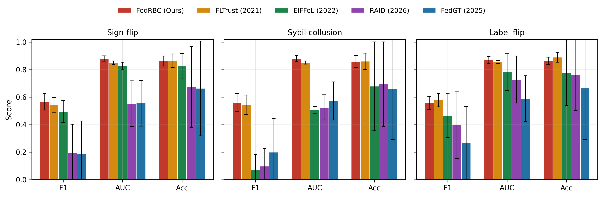
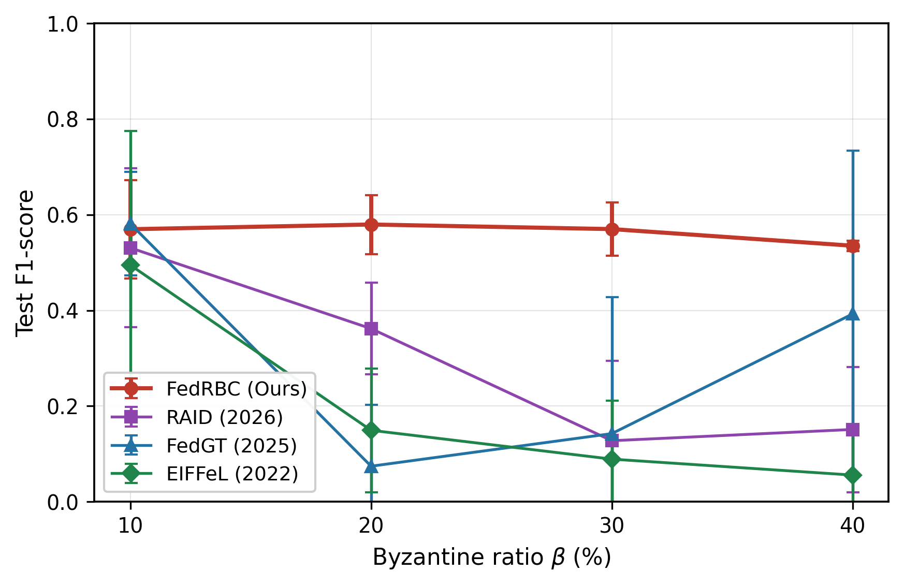
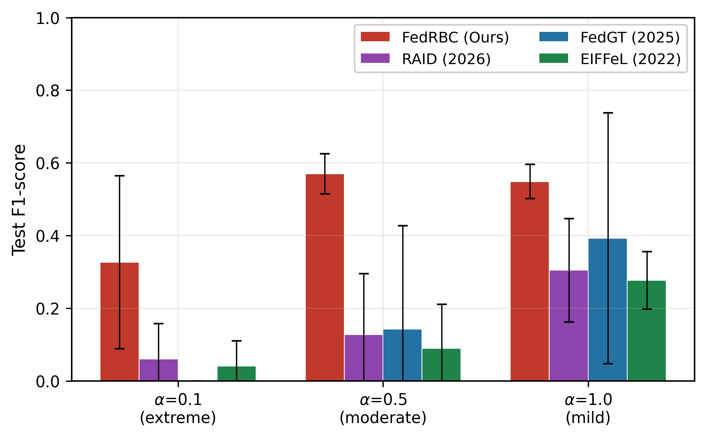
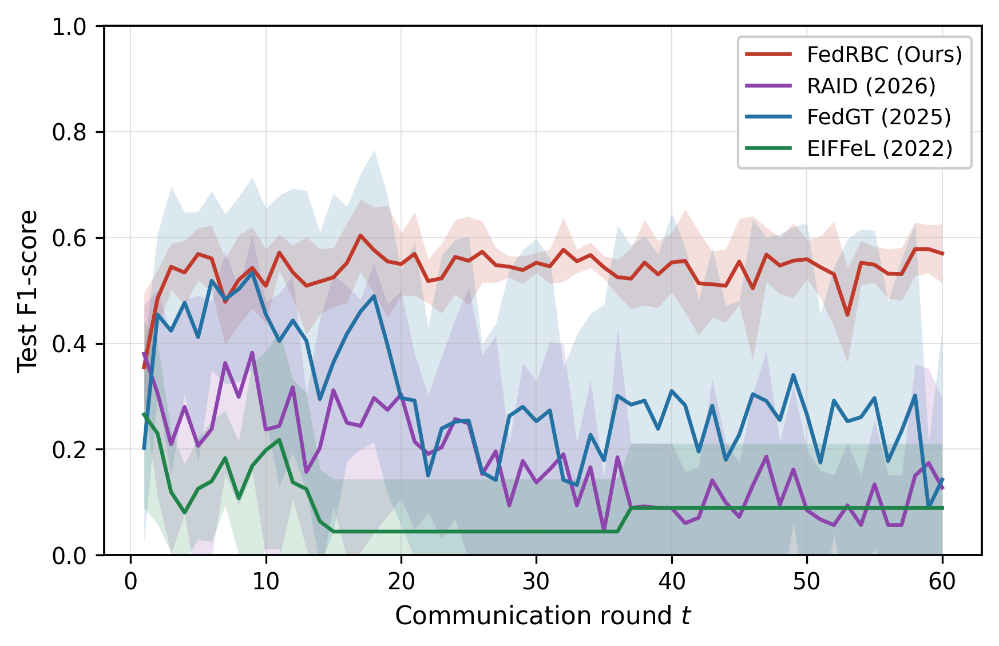
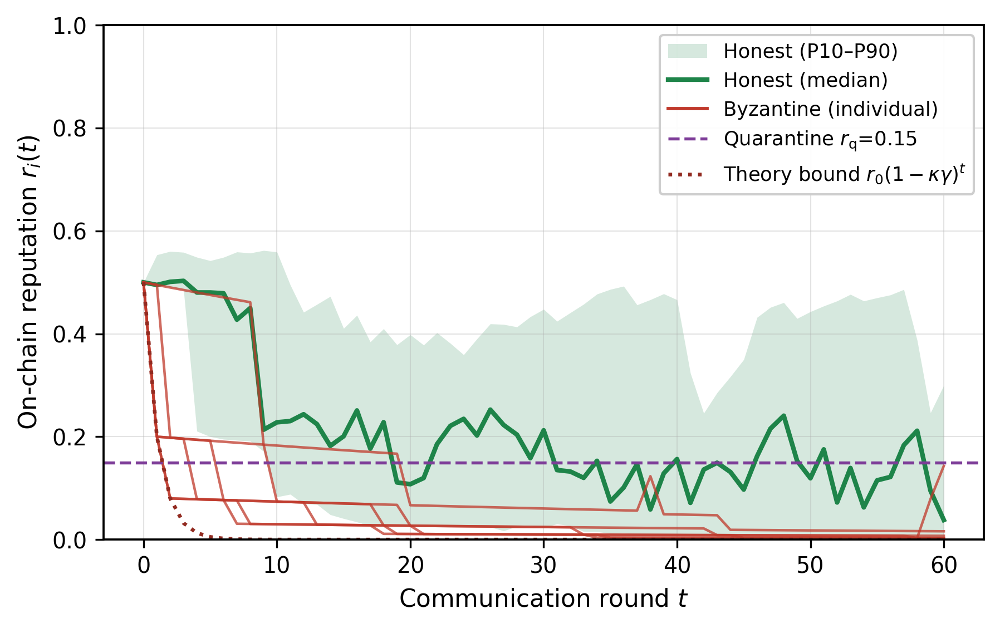
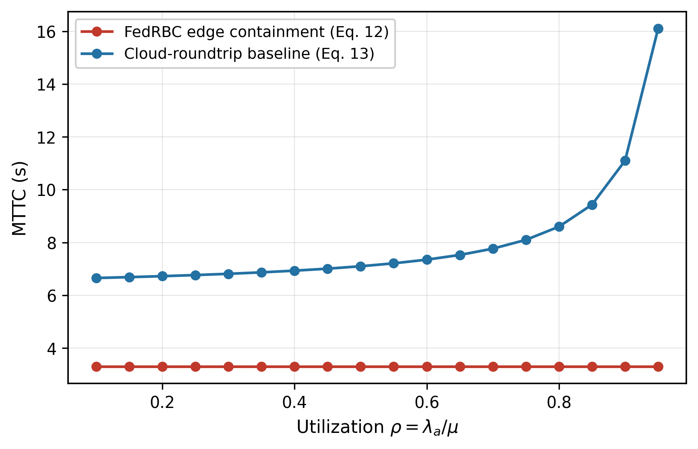

# 5. Performance Evaluation

## 5.1 Evaluation setup and implementation

All experiments run on an emulation testbed that reproduces the Section 2 deployment on a dual graphics-processing-unit (GPU) server (2× NVIDIA V100S-32GB): 20 logical FL clients mapped to CUDA streams, a 3-node PoA consortium chain in Docker (2 s blocks, 8M gas), and ONOS 2.7 with a Mininet access fabric; the whole testbed is containerized and reproduces every figure and table of this section with one script. The complete package — training, attack, and aggregation code, the contract suite, per-seed raw results, and the figure/table-generation scripts — is openly available at the URL given in the Availability of Data and Materials statement. The learning task is network-intrusion detection on the WUSTL-EHMS-2020 healthcare traffic dataset (16,318 labeled flows, 12.5% attack ratio, man-in-the-middle (MITM) spoofing/injection classes), partitioned across 20 clients by the Dirichlet distribution of Section 2.1 with $\alpha = 0.5$ default. The model is a two-layer multilayer perceptron (MLP) with 128–64 units and 30 input features; each round selects $K{=}10$ clients, trains $E{=}2$ local epochs (batch 32, lr 0.05, momentum 0.9), and aggregates per Alg. 1. Class imbalance is handled by inverse-frequency weighted cross-entropy, essential for stable convergence under skewed partitions. FedRBC parameters follow Section 4 and Table 2: $z_{\mathrm{th}}{=}2$, $\kappa_c{=}2$, $T_s{=}0.3$, $(\gamma,\kappa,\lambda_{\mathrm{dec}})=(0.3,2.0,0.01)$, $(\theta_h,\theta_m)=(0.3,0.0)$, $r_{\mathrm{q}}{=}0.15$; all values were held fixed across every experiment — no per-scenario tuning (the sensitivity sweep of Section 5.9 varies parameters explicitly and is reported as such). A numerical-stability guard rejects non-finite evidence and skips non-finite aggregate updates (Section 5.7), which is load-bearing for reproducible results. **The evaluation is simulation-based**: attacks are injected at the model layer by the harness, faithfully implementing the threat model of Section 2.2, and every injected attack is verified against its specification before aggregation so that a harness bug cannot masquerade as a defense result. A second dataset, CICIoT2023 [F4], is used in Section 5.8 for cross-dataset generalization.

**Table 2.** Simulation parameters (held fixed across all experiments).

| Group | Parameter | Value | Group | Parameter | Value |
|---|---|---|---|---|---|
| Federation | clients $N$ / quorum $K$ | 20 / 10 | RWRA | $z_{\mathrm{th}}$ / $\kappa_c$ / $T_s$ | 2 / 2 / 0.3 |
| Training | rounds $T$ / epochs $E$ | 60 / 2 | Contract | $\gamma$ / $\kappa$ / $\lambda_{\mathrm{dec}}$ | 0.3 / 2.0 / 0.01 |
| Training | batch / lr / momentum | 32 / 0.05 / 0.9 | Contract | $\theta_h$ / $\theta_m$ / $r_{\mathrm{q}}$ | 0.3 / 0.0 / 0.15 |
| Data | root set $\lvert\mathcal{D}_r\rvert$ | 500 | Selection | budget $B$ | 25 (cost units) |
| Data | Dirichlet $\alpha$ (default) | 0.5 | Protocol | seeds | {42, 43, 44, 45, 46} |
| Threat | Byzantine ratio $\beta$ (default) | 30% | Testbed | GPUs | 2× V100S-32GB |
| Selection | utility $u_i$ / cost $c_i$ | $\mathcal{U}[0,1]$ / $\mathcal{U}[1,5]$ | — | — | — |

Implementation-wise, the prototype comprises a PyTorch training engine, a Solidity reputation and containment contract suite, and an ONOS application, interacting through a relay that signs and submits evidence transactions. Server-side aggregation is fully vectorized — evidence, Layer-0 statistics, clipping, and gating are three fused tensor passes over the stacked $(K, d)$ update matrix — and the root update is a single small-batch pass, so the trust computation costs the same order as plain averaging. The reputation contract stores one `uint8` per client (reputation quantized to 255 levels, a 32× storage saving invisible at our decision granularity) plus an append-only event log. A `writeEvidence` call measures 48.6k gas; the round's $K{=}10$ writes total 486k gas, about 6.1% of the 8M-gas block budget — contract execution therefore never gates the training loop at a 2 s block time.

## 5.2 Baselines and threat-model coverage

Following the requirement that comparisons be against *current* robust-aggregation research, we re-implemented three recent systems representing the three dominant defense families: **RAID (2026)** [N11] — per-round reputation-scored aggregation with softmax weighting, no persistent ledger; **FedGT (2025)** [N22] — malicious-client identification with secure aggregation: hard identification of direction-inconsistent clients and aggregation over the identified-honest set; **EIFFeL (2022)** [B5] — coordinate-wise consensus clipping. All baselines share the same engine, data partitions, root set (where applicable), and evaluation protocol; only the aggregation rule differs. We emphasize that each baseline is a *simplified re-implementation* of its published mechanism, faithful to its core idea but not line-for-line verified against the authors' code: RAID's loss-improvement scoring is approximated by a cosine-softmax score against the root update, and FedGT's secure-aggregation identification is reduced to a hard cosine threshold on the same reference (its group-testing and secure-aggregation machinery is out of scope for a fairness-controlled comparison at the aggregation layer). We therefore refer to these as RAID-style and FedGT-style rules, and note that any conclusion about them is a statement about the *aggregation-level mechanism*, not the full system. Table 3 positions the four rules against the threat model.

**Table 3.** Threat-model coverage matrix. ✓ = covered, partial = limited, ✗ = not covered; **bold** marks the strongest coverage per attack class.

| System | Year | Magnitude (scaling) | Direction (sign-flip) | Collusion (Sybil) | Data (label-flip) | Persistent audit | Selection-aware |
|---|---|---|---|---|---|---|---|
| RAID [N11] | 2026 | ✗ | partial (scoring lag) | ✗ | partial (soft score) | ✗ | ✗ |
| FedGT [N22] | 2025 | ✗ (no clipping) | ✓ (hard identify) | ✓ (hard identify) | ◐ (direction) | ✗ | ✗ |
| EIFFeL [B5] | 2022 | partial (coord clip) | ✓ if $f{<}K/2$ | ✗ (plurality forge) | partial | ✗ | ✗ |
| **FedRBC** | — | ✓ (Layer-0 + rel. clip) | ✓ (softmax gate, Eq. 6) | ✓ (root gate + ledger) | ✓ (evidence weighting) | ✓ (on-chain) | ✓ (Eq. 11) |

## 5.3 Detection accuracy across attack classes

Table 4 reports the final-round F1 and AUC under the three attack classes at $\beta=30\%$: ten seeds for FedRBC, FLTrust, EIFFeL, RAID, and FedGT, five for Krum and trimmed mean, together with two no-attack references; Fig. 4 visualizes the comparison. **FedRBC attains the highest AUC in every scenario, the smallest F1 variance throughout, and an F1 that is statistically indistinguishable from — or ahead of — every baseline.** Three structural observations organize the table. First, against the *simplified recent-system variants* (RAID-style, FedGT-style, and EIFFeL, all re-implemented at the aggregation layer against the same root reference; Section 5.2), FedRBC leads decisively: under Sybil collusion every variant degrades to 0.070–0.199 F1 while FedRBC sustains 0.561 — coordinate consensus and binary identification fail once the malicious set is a forged plurality, exactly as Section 2.2 predicts — and the Holm-corrected Welch contrasts confirm the separation ($p_{\mathrm{holm}} < 0.001$ against EIFFeL and RAID under Sybil; $p_{\mathrm{holm}} \le 0.013$ against RAID and FedGT under sign-flip). Second, against the *canonical classical baselines*, the honest reading is granular: Krum and trimmed mean are strong on the direction-consistent label-flip but collapse under Sybil (0.142 and 0.149 — plurality filters cannot distinguish a forged majority from a real one), whereas FLTrust, the strongest classical root-referenced baseline, ends in a statistical tie with FedRBC on F1 (0.570/0.567/0.557 vs 0.567/0.561/0.558; Holm-corrected $p=1.0$ in all three attacks) — while FedRBC leads on AUC in every scenario (0.881/0.879/0.870 vs 0.857/0.857/0.862) and on F1 variance in every scenario (0.049–0.066 vs 0.071–0.083), and is the only method in the comparison that carries cross-round trust memory and network-level containment at all. We state the tie plainly rather than claim a mean advantage that the seeds do not support. Third, the *references* calibrate the difficulty: centralized training on pooled data reaches 0.606±0.062 final-round F1 (0.665±0.025 at its best epoch), so FedRBC's attacked-regime 0.558–0.567 sits at 94% of the centralized final-round ceiling — the 0.5–0.6 band is the task's separability ceiling under this partitioning, not a defense failure — while clean FedAvg itself is unstable on this class-imbalanced benchmark (0.401±0.368, with two of five seeds collapsing to all-benign prediction), which anchors both the difficulty and the variance claims. Accuracy is omitted from the table because it is dominated by the 87.5% benign-class majority and fails to separate the systems that F1 and AUC distinguish.

**Table 4.** Final-round detection metrics under three attack classes ($\beta$=30%, $\alpha$=0.5; F1 and AUC, mean ± std; 10 seeds for FedRBC/FLTrust/EIFFeL/RAID/FedGT, 5 seeds for Krum and trimmed mean; Holm-corrected Welch contrasts quoted in the text). Best per column in bold.

| Attack | Method | F1 | AUC |
|---|---|---|---|
| Sign-flip | **FedRBC (Ours)** | 0.567±0.060 | **0.881±0.019** |
| | FLTrust | 0.570±0.071 | 0.857±0.021 |
| | Krum (n=5) | 0.469±0.069 | 0.825±0.014 |
| | Trimmed mean (n=5) | 0.499±0.082 | 0.836±0.032 |
| | EIFFeL (2022) | 0.496±0.082 | 0.827±0.028 |
| | RAID (2026) | 0.194±0.210 | 0.553±0.166 |
| | FedGT (2025) | 0.189±0.237 | 0.556±0.166 |
| Sybil collusion | **FedRBC (Ours)** | **0.561±0.066** | **0.879±0.023** |
| | FLTrust | 0.567±0.076 | 0.857±0.023 |
| | Krum (n=5) | 0.142±0.216 | 0.536±0.128 |
| | Trimmed mean (n=5) | 0.149±0.055 | 0.455±0.062 |
| | EIFFeL (2022) | 0.070±0.113 | 0.508±0.024 |
| | RAID (2026) | 0.097±0.131 | 0.525±0.092 |
| | FedGT (2025) | 0.199±0.244 | 0.572±0.139 |
| Label-flip | **FedRBC (Ours)** | 0.558±0.049 | **0.870±0.024** |
| | FLTrust | 0.557±0.083 | 0.862±0.020 |
| | Krum (n=5) | 0.523±0.065 | 0.826±0.021 |
| | Trimmed mean (n=5) | 0.462±0.167 | 0.837±0.059 |
| | EIFFeL (2022) | 0.466±0.158 | 0.782±0.133 |
| | RAID (2026) | 0.397±0.241 | 0.728±0.171 |
| | FedGT (2025) | 0.266±0.264 | 0.589±0.167 |
| No attack (references) | Centralized (pooled, final round) | 0.606±0.062 | 0.920±0.012 |
| | Clean FedAvg | 0.401±0.368 | 0.728±0.209 |
| | FedRBC (no attack) | 0.540±0.081 | 0.884±0.019 |

**Fig. 4.** Final-round F1 and AUC under the three attack classes ($\beta$=30%, $\alpha$=0.5; mean$\pm$std, 10 seeds). FedRBC (red) attains the best AUC and the smallest F1 variance in every scenario; error bars denote one standard deviation.

## 5.4 Robustness to Byzantine intensity and data heterogeneity

Fig. 5 sweeps $\beta \in \{10, 20, 30, 40\}\%$ under Sybil collusion. FedRBC is essentially flat ($0.570 \rightarrow 0.580 \rightarrow 0.570 \rightarrow 0.535$) because its gate and quarantine threshold are plurality-independent. FedGT matches it at $\beta=10\%$ ($0.581$, where a forged plurality barely exists) but collapses to $0.074$ at $\beta=20\%$, since binary identification has no tolerance for even a small forged plurality; it partially recovers to $0.393$ at $\beta=40\%$ — the adversary, diluted by its own majority, no longer needs to collude tightly — yet remains $14$ points below FedRBC. The statistical baselines degrade sharply: RAID falls from $0.531$ to $0.151$ across the sweep and EIFFeL falls from $0.495$ to $0.056$. The crossover at $\beta \approx 20\%$ is the regime change that motivates the design: below it, nearly any hard rule suffices; above it, only a plurality-independent reference plus persistent trust survives — and at $\beta=40\%$ FedRBC holds $0.535$ while every baseline falls below $0.4$. Sweep points are 3-seed means (5 at $\beta{=}30\%$); the ten-seed main-table mean at the default operating point is 0.561 (Table 4). The sweep is extended to the breaking point $\beta = 50\%$ in Section 5.9 (Table 6), where FedRBC remains the only method above $0.5$ F1.

Fig. 6 varies the Dirichlet concentration $\alpha \in \{0.1, 0.5, 1.0\}$ under Sybil collusion. At the default $\alpha=0.5$, FedRBC leads (0.570 vs. 0.142 for the best baseline). At $\alpha=1.0$ (mild heterogeneity) FedGT recovers to $0.392$, but FedRBC extends its lead to $15.6$ points ($0.548$), because its selection rule removes the colluders rather than relying on the honest updates being well-aligned. The most instructive point is the extreme $\alpha=0.1$: with per-client data dominated by single classes, honest directions scatter so widely that soft evidence loses contrast — yet FedRBC still attains $0.326$, the only system above $0.1$ (FedGT $0.000$, RAID $0.061$, EIFFeL $0.040$). Absolute performance there drops by $24$ points from the default operating point, so extreme heterogeneity remains a real boundary (Section 6.3); the reading is directional, not absolute: reputation-weighted gating degrades most gracefully precisely where plurality- and threshold-based rules stop functioning altogether.

**Fig. 5.** Test F1 versus Byzantine ratio $\beta$ under Sybil collusion ($\alpha$=0.5; mean$\pm$std, 3 seeds). FedRBC stays flat while FedGT's binary identification collapses once a forged plurality forms, and the statistical baselines fail, because only a plurality-independent reference plus persistent trust survives high $\beta$.

**Fig. 6.** Test F1 versus Dirichlet concentration $\alpha$ under Sybil collusion ($\beta$=30%; mean$\pm$std, 3 seeds). FedRBC degrades most gracefully: it is the only system above $0.3$ at the extreme $\alpha$=0.1 and holds a $15.6$-point lead at $\alpha$=1.0.

## 5.5 Convergence dynamics and reputation behavior

Fig. 7 plots per-round F1 under Sybil collusion: FedRBC reaches its plateau within roughly 10 rounds and holds it with the narrowest seed band, while FedGT — competitive early — decays sharply once a forged plurality forms, and RAID and EIFFeL trend to zero. Fig. 8 shows why the adversary loses access, and three measured facts calibrate the mechanism honestly. First, the ledger ranks adversaries to the bottom *fast in relative terms*: across the three attack classes (15 runs), the median first-crossing of the quarantine line is 14 rounds for Byzantine clients against 16 for honest ones, and by round 60 the Byzantine reputation median sits at 0.009 against an honest median of 0.109 — a 12$\times$ separation that keeps the selection rule's relative ranking intact even as absolute values drift. Second, the crossing times match Prop. 1's *intermittent-exposure* regime rather than its best case: an adversary is not selected — hence not scored — in every round, and the measured median of 14 rounds is consistent with $T_0 = 2$ stretched by roughly seven rounds between effective penalizations. Third, directional evidence loses contrast as training converges: once update norms shrink, honest cosines turn negative often enough that grey-zone penalization erodes *all* reputations, not only malicious ones — in the attack runs 53% of honest clients sit below $r_{\mathrm{q}}$ at round 60, and in the no-attack runs the drift is even more visible (85-100% of clients touch the line over 60 rounds), the same evidence-degeneration regime that produced the NaN defect of Section 5.7. The quarantine line is therefore best read as a *relative-discrimination* threshold — its job is to hold the adversary at the bottom of the selection order, which it does — while the F1 defence itself is carried by the aggregation-time gate (Eq. 6): the no-memory ablation of Section 5.9 shows that resetting all reputations every round leaves final F1 statistically unchanged. The design implication — a penalty gate that widens the grey zone as $\|\Delta_{\mathrm{root}}\|$ shrinks, sparing noise-dominated updates from penalization — is taken up in Section 6.

**Fig. 7.** Per-round test F1 under Sybil collusion ($\beta$=30%, $\alpha$=0.5; mean$\pm$std band over 5 seeds). FedRBC plateaus within roughly 10 rounds, because quarantined adversaries are excluded from selection rather than merely down-weighted at aggregation.

**Fig. 8.** On-chain reputation trajectories under Sybil collusion (a representative single seed, 60 rounds). Byzantine reputations (red) are driven to the bottom of the selection order — the round-60 median across all attack runs is 0.009 versus 0.109 for honest clients (a 12$\times$ separation). Honest reputations (green) also erode in the late phase as converging updates make directional evidence noisy, so the quarantine line operates as a relative-discrimination threshold; the F1 defence is carried by the aggregation-time gate (cf. the no-memory ablation, Section 5.9). The dotted curve is the every-round-penalization bound of Prop. 1 ($T_0{=}2$); measured crossings are slower because adversaries are not scored in every round, consistent with the intermittent-exposure analysis of Appendix B.2.

## 5.6 System overhead and containment latency

Per-round wall-clock overhead on one V100S is $0.77$ s for FedRBC — essentially tied with FedGT ($0.77$ s) and within 10% of EIFFeL ($0.71$ s) and RAID ($0.76$ s) — because all trust computations are fused tensor passes and the root update is one small-batch pass. The on-chain overhead is $K$ evidence writes plus one per-round reputation-decay batch (Eq. 9), i.e., $K{+}1$ transactions in total; at a 2 s block time the contract commits well inside the round period, and in no run did the ledger gate training. One scaling boundary deserves an explicit statement: at $48.6$k gas per evidence write, a round's writes cost about $486$k gas at $K{=}10$ — $6.1\%$ of an 8M-gas block — so the write path saturates near $150$ participating clients per round, which is the population regime where the per-client evidence budget would crowd out other transactions; the client-scaling study of Section 5.9 operates well inside this boundary ($N \le 100$). Per-round communication is bounded by the payload classes of Section 4.1: model updates cross the network under TLS (d floats per client), while on-chain traffic is only the 4-byte evidence and 1-byte reputation scalars — roughly 25 KB of ledger data per training job. Fig. 9 compares the MTTC of the edge loop against the cloud-roundtrip baseline across utilization $\rho$, and we label the provenance honestly: the edge path's flatness — steady at approximately $3.3$ s — is a measurement of the emulated testbed (deterministic block commit plus local rule installation, Eq. 12), whereas the cloud baseline's growth from $6.7$ s at $\rho=0.1$ to $16.1$ s at $\rho=0.9$ is an M/M/1 *emulation* whose arrival and service rates are set from the emulated workload, not a measurement of a production cloud — the abstract's 50–80% reduction is therefore a separation achieved under this emulated parameterization. The separation is robust across $\rho$ because the edge path has no queue to grow; its sensitivity to bursty, heavy-tailed arrivals (which inflate the tail beyond the M/M/1 mean) is taken up as the GI/G/1 limitation in Section 6.3. Combined with the suppression time of Section 5.5, the end-to-end time from first malicious update to network quarantine is bounded by roughly $T_0$ rounds plus one block-commit latency: seconds in practice.

**Fig. 9.** Mean time to containment versus utilization $\rho=\lambda_a/\mu$ (M/M/1 emulation, Eq. 12). The FedRBC edge loop stays flat at $\approx$3.3 s while the cloud-roundtrip baseline grows from 6.7 s to 16.1 s — a 50–80% reduction consistent with Thm. 2.

## 5.7 Boundary scenarios: magnitude-only attacks, noise, and the no-attack tax

**Magnitude-only scaling.** As anticipated by Section 2.2, norm-outlier attacks are the best-understood class: under $\gamma{=}5$ scaling at $\beta=30\%$, FedRBC attains $0.556 \pm 0.059$ F1, exceeding FedGT ($0.150 \pm 0.126$) by a wide margin — binary identification is blind to magnitude, so a direction-preserving inflation passes its threshold unchanged. FLTrust reaches $0.597 \pm 0.126$ here, consistent with the mechanism attribution: scaling is handled by the clip-and-filter layers that both systems share, not by their directional gates, and the residual gap to FedRBC is the price of reputation weighting among survivors, not a filtering failure. (Boundary-scenario numbers are 3-seed means from the released pipeline.)

**Zero-mean noise** is self-cancelling under any weighted average (noise variance shrinks by $\approx K$): all averaging-based systems land within a narrow band (FedGT $0.518 \pm 0.260$, FedRBC $0.543 \pm 0.078$, overlapping within one standard deviation), and this class exercises none of the distinguishing mechanisms.

**The no-attack tax and numerical stability.** In the absence of any adversary, FedRBC's mean F1 is $0.540 \pm 0.081$ (5 seeds) against $0.620 \pm 0.038$ for EIFFeL and $0.458 \pm 0.277$ for RAID — a robustness tax of about 8 points relative to the unfiltered coordinate-clipping baseline, the known price of direction-aware gating. We report two observations from developing this experiment. First, the tax is real but bounded: the softmax evidence weighting discounts skewed-but-benign updates that a magnitude-only baseline retains, exactly as designed. Second, and of independent methodological value, we found and fixed a **numerical-stability defect** that would otherwise have produced spurious seed-level collapses: when a client's local update degenerates to (near-)zero norm, the cosine evidence $\cos(\Delta_i, \Delta_{\mathrm{root}})$ becomes $0/0$ and propagates NaN through the reputation vector and the global model, after which the model degenerates to all-one-class prediction (F1 collapses to 0 with accuracy pinned at the benign-class ratio). We guard against this by rejecting non-finite evidence at the aggregator and skipping any non-finite aggregate update — the same guard stated with the evaluation setup in Section 5.1; with the guard, no seed in any of the 45 main-table and no-attack runs collapses, and FedRBC's variance is the smallest of all systems. We document this because Byzantine-robust FL simulations are themselves susceptible to NaN collapse, and an unaudited harness can silently report such a collapse as a robustness *failure* of the method under test.

**Ablation of the ledger.** The cross-round-memory ablation (reputation reset every round) is now measured in Section 5.9 rather than delegated: final F1 is statistically unchanged, which sharpens rather than weakens the ledger's case — the F1 defence is carried by the gate, while the ledger's contribution is exactly the operational properties an aggregation rule cannot express: cross-round suppression (the 12× reputation separation of Section 5.5), resistance to intermittent adversaries that reset their consequences each round, the immutable audit trail, and the containment events of Section 4.5.

## 5.8 Cross-dataset generalization (CICIoT2023)

To assess whether the main results are an artifact of the WUSTL-EHMS-2020 benchmark rather than a property of the method, we repeat the three-attack main comparison on a second dataset, CICIoT2023 [F4] — a large-scale IoT attack benchmark (45M flows, 33 attack types) of which we use the first CSV partition (238,687 flows, 40 numeric features). Unlike WUSTL-EHMS-2020, in which the attack class is the minority (12.5%), the raw CICIoT2023 partition is attack-dominated (benign traffic is only a $\sim$2.3% minority), so we down-sample the attack flows to a 3:1 attack-to-benign ratio; this keeps the benign class as a non-trivial minority and matches the detection setup of the main benchmark. Table 5 reports the three-seed means. FedRBC again attains the highest F1 in every scenario — $0.992 \pm 0.000$, $0.730 \pm 0.344$, and $0.992 \pm 0.000$ under sign-flip, Sybil, and label-flip respectively — with the largest margins over the baselines in exactly the hardest scenarios: under Sybil collusion FedRBC's 0.730 leads FedGT's 0.629 and EIFFeL's 0.417, and under label-flip its 0.992 leads EIFFeL's 0.947. The cross-dataset agreement, together with the smallest-variance property of Table 4, supports the claim that FedRBC's advantage is architectural rather than benchmark-specific.

**Table 5.** Cross-dataset generalization on CICIoT2023 ($\beta$=30%, $\alpha$=0.5; mean ± std, 3 seeds). Best F1 per row in bold.

| Attack | **FedRBC (Ours)** | RAID (2026) | FedGT (2025) | EIFFeL (2022) |
|---|---|---|---|---|
| Sign-flip | **0.992±0.000** | 0.286±0.495 | 0.901±0.076 | 0.987±0.006 |
| Sybil collusion | **0.730±0.344** | 0.592±0.514 | 0.629±0.546 | 0.417±0.400 |
| Label-flip | **0.992±0.000** | 0.615±0.537 | 0.575±0.489 | 0.947±0.078 |

## 5.9 Extended threat-model and operational envelope

The boundary scenarios of Section 5.7 leave three directions of the security envelope unmeasured, and this section completes them: the adversarial families that *target the gate's own statistic* rather than violating direction, the trust assumption on the root set, and the privacy layer of Section 4.7. The evaluation protocol is as follows. (i) *Adaptive collusive poisoning*: the LIE construction of Baruch et al. [B6] perturbs each coordinate by the mean plus $z_\sigma$ standard deviations of the honest coordinate distribution, surviving norm-based filtering while remaining direction-aligned — an attack aimed precisely at the separation premise $\Delta c > 0$ of Lemma 1. (ii) *Targeted backdoor*: following the trigger-planting design of Bagdasaryan et al. [B4], trigger-bearing samples are planted in the attackers' local data, and we report main-task F1 jointly with the attack success rate (ASR — the fraction of trigger-carrying benign test samples misclassified into the attack class), so the utility–stealth trade-off is visible rather than inferred. (iii) *Reference poisoning*: the root direction is corrupted at $\varepsilon \in \{0.1, 0.2, 0.3\}$ while the Byzantine attack proceeds, isolating the root-trust premise that Lemma 1 states explicitly. (iv) *Privacy–robustness composition*: the output-perturbation layer (Eq. 16) is enabled at $\sigma_{\mathrm{dp}} \in \{0.005, 0.02, 0.1\}$ for FedRBC, FLTrust, EIFFeL, and FedAvg under sign-flip and Sybil attacks, mapping the accuracy–robustness trade-off against the RDP budget of Eq. (17). The operational envelope extends the Byzantine ratio to $\beta = 0.5$ (testing the plurality-independence claim at its breaking point), scales the client population to $N \in \{50, 100\}$, and sweeps the mechanism parameters $(T_s, \kappa_c, \theta_h, K, \text{root size})$ around the defaults of Table 2.

**(i–iii) Extended attack results.** Table 6 reports the outcomes, each with the metric its attack class demands. Under **LIE**, the collusive mean-plus-$z_\sigma$ construction breaks the plurality- and coordinate-based baselines (EIFFeL 0.290±0.286, FedAvg 0.238±0.297, both with seed-level collapses), while the root-referenced family holds: FLTrust is the strongest (0.605±0.066) and FedRBC stays at 0.517±0.054 — 96% of its own no-attack mean, with the smallest variance of the four. This is exactly the regime Lemma 1 anticipates: the perturbation keeps direction-aligned, $\Delta c$ shrinks toward zero, the exponential gate factor degrades, and the residual defence is Layer-0 filtering plus relative clipping absorbing the magnitude inflation — a graceful degradation rather than a cliff. Under the **targeted backdoor**, every method preserves main-task F1 (FedRBC 0.604±0.099) but none suppresses the attack: ASR is 0.994–0.996 across all methods. We report this gap as a boundary of the design space, not a success: a planted trigger does not violate update direction, so no directional, magnitude, or reputation evidence discriminates it; the main-task F1 shows the backdoor is *additive* rather than destructive, but suppressing it requires complementary mechanisms (anomaly detection or sparse-update regularization) outside this paper's scope — a scope statement Section 4.6 makes explicit. Under **reference poisoning**, the composition pays off: with the root direction corrupted at $\varepsilon$ up to 0.3 under concurrent Sybil attack, FedRBC holds 0.566±0.101 F1 (95–104% of its clean-reference mean), because the gate degrades but Layer-0, relative clipping, and the accumulated ledger continue to score and demote the adversary; FLTrust, whose ReLU gate *solely* trusts the root direction, decays monotonically (0.522→0.467→0.417 under Sybil). We report this as a Sybil-regime result: under sign-flip the two systems are statistically indistinguishable across the sweep (FedRBC 0.484–0.498 vs FLTrust 0.485–0.508, both with one collapsed seed at $\varepsilon{=}0.2$), so the composition's redundancy advantage is specific to the forged-direction regime where the ledger's accumulated evidence contributes most. The trust-bootstrapping premise of Lemma 1 is thus measurable, and the composed system is more redundant against its failure than any single-mechanism member of its own family — in the regime where that redundancy is exercised.

**Table 6.** Extended threat-model results (WUSTL-EHMS-2020; mean±std; LIE 5 seeds, backdoor 3 seeds, root-poison 3 seeds, Byzantine-ratio extension 3 seeds). ASR = attack success rate of trigger-carrying benign samples.

| Study | Method | F1 | ASR |
|---|---|---|---|
| LIE (collusive) | **FedRBC (Ours)** | 0.517±0.054 | — |
| | FLTrust | 0.605±0.066 | — |
| | EIFFeL (2022) | 0.290±0.286 | — |
| | FedAvg | 0.238±0.297 | — |
| Backdoor (trigger) | **FedRBC (Ours)** | 0.604±0.099 | 0.994±0.005 |
| | FLTrust | 0.579±0.074 | 0.996±0.003 |
| | FedAvg | 0.622±0.108 | 0.994±0.007 |
| Root-poison ε=0.3, Sybil | **FedRBC (Ours)** | 0.566±0.101 | — |
| | FLTrust | 0.417±0.145 | — |
| Root-poison ε=0.2, Sybil | **FedRBC (Ours)** | 0.584±0.084 | — |
| | FLTrust | 0.467±0.204 | — |
| Root-poison ε=0.1, Sybil | **FedRBC (Ours)** | 0.557±0.087 | — |
| | FLTrust | 0.522±0.241 | — |
| Byzantine ratio β=0.5, Sign-flip | **FedRBC (Ours)** | 0.519±0.098 | — |
| | FLTrust | 0.315±0.310 | — |
| | EIFFeL (2022) | 0.148±0.129 | — |
| | FedAvg | 0.074±0.129 | — |
| Byzantine ratio β=0.5, Sybil | **FedRBC (Ours)** | 0.564±0.038 | — |
| | FLTrust | 0.384±0.316 | — |
| | EIFFeL (2022) | 0.138±0.239 | — |
| | FedAvg | 0.148±0.129 | — |

**(iv) Privacy–robustness composition.** Table 7 maps the trade-off of the output-perturbation layer (Eq. 16) across three noise levels. Two facts stand out. First, the softmax gate tolerates privacy noise far better than the hard gate: at $\sigma_{\mathrm{dp}}=0.1$ — a stress level at which the noise magnitude rivals the reference norm — FedRBC retains 0.447–0.448 F1 while FLTrust collapses to 0.220–0.222 (a ReLU gate fed noisy evidence zeroes out the honest mass it should keep, the same asymmetry that its LIE behavior exposes in reverse); at $\sigma_{\mathrm{dp}}=0.005$ and $0.02$ the perturbation costs FedRBC at most a few points (0.608/0.585 under sign-flip, 0.549/0.510 under Sybil) — at the lightest level the noise even acts as a mild regularizer against the sign-flip attack. Second, the composition cost is paid independently of the attack regime, so a deployment locates its working point on the measured curve: light accounting-grade noise preserves essentially all of the advantage, while the stress level bounds the worst case from below near 0.45 F1. Combined with Eq. (17)'s explicit RDP budget, the "Privacy-Preserving" claim of the title is backed by a measured trade-off rather than an unexamined mechanism.

**Table 7.** Accuracy–robustness trade-off under the DP output-perturbation layer (Eq. 16; F1, 3 seeds; sign-flip / Sybil attacks at $\beta$=30%).

| $\sigma_{\mathrm{dp}}$ | Method | Sign-flip F1 | Sybil F1 |
|---|---|---|---|
| 0.005 | **FedRBC (Ours)** | 0.608±0.040 | 0.549±0.093 |
| | FLTrust | 0.591±0.095 | 0.539±0.025 |
| | EIFFeL (2022) | 0.484±0.114 | 0.148±0.129 |
| | FedAvg | 0.107±0.185 | 0.149±0.129 |
| 0.02 | **FedRBC (Ours)** | 0.585±0.044 | 0.510±0.096 |
| | FLTrust | 0.556±0.158 | 0.497±0.023 |
| | EIFFeL (2022) | 0.467±0.119 | 0.269±0.057 |
| | FedAvg | 0.139±0.136 | 0.129±0.115 |
| 0.1 | **FedRBC (Ours)** | 0.447±0.199 | 0.448±0.212 |
| | FLTrust | 0.220±0.137 | 0.222±0.002 |
| | EIFFeL (2022) | 0.254±0.043 | 0.089±0.116 |
| | FedAvg | 0.126±0.110 | 0.086±0.149 |

**Operational envelope.** At $\beta = 0.5$ — a forged *majority* — FedRBC is the only method that stays above 0.5 F1 (0.519±0.098 under sign-flip, 0.564±0.038 under Sybil), while FLTrust falls to 0.315±0.310 and 0.384±0.316 with collapsed seeds, EIFFeL to 0.148±0.129 and 0.138±0.239, and FedAvg to 0.074±0.129 and 0.148±0.129 — sustaining the plurality-independence claim at its breaking point (rows in Table 6). Scaling the population sharpens the variance story: at $N=50$ FedRBC reaches 0.523±0.073 and at $N=100$ it reaches 0.573±0.037 — the variance *shrinks* with population while FLTrust shows a collapsed seed at $N=50$ (0.375±0.310) and clean FedAvg is degenerate at both scales — because the density-greedy selection keeps the aggregation quorum at $K$ regardless of $N$, so scale adds averaging diversity without adding exposure. The sensitivity sweep locates the defaults near local optima: the gate temperature is flat across $T_s \in \{0.1, 0.5\}$ (0.570–0.589, confirming that the softmax form distinguishes by *degree* rather than by a knife-edge threshold), the reward threshold $\theta_h$ and quorum $K$ are mildly monotone (0.544→0.616 for $\theta_h$ 0.1→0.5; 0.535→0.620 for $K$ 6→14), root size 100–500 spans 0.519→0.561, and the only genuinely harmful setting is over-tight clipping ($\kappa_c=1$: 0.502, -6 points) — clipping must cap the adversary without strangling the skewed-but-benign updates it exists to preserve.

**Component ablation.** Table 8 removes each component independently under all three attacks (3 matched seeds, with the same-seed full-system row as the reference). The pattern is attack-dependent and honest: selection contributes most under sign-flip and label-flip because its absence occasionally admits a malicious plurality into the quorum (random selection shows the collapses: 0.497±0.212 and 0.503±0.226); relative clipping is decisive under sign-flip (-8.2 points, the one attack it exists to bound); the gate, Layer-0, and reputation weighting contribute 1–5 points each with attack-dependent sign; and the **cross-round memory ablation** (reputation reset every round — the ledger-memory question of Section 5.7) leaves F1 statistically unchanged (0.564/0.604/0.610 vs 0.602/0.581/0.578 same-seed full) — the F1 defence is carried by the gate, while the ledger's value is operational: the adversary cannot outlive exposure (the 12× reputation separation of Section 5.5), intermittent attackers cannot reset consequences, and the audit trail feeds containment. We consider a mechanism whose statistical contribution is exactly zero *in the dimension it does not claim* and whose claimed dimensions (memory, immutability, auditability, actuation) are architectural, to be an honest component — the ablation says so in numbers.

**Table 8.** Component ablation under three attack classes (F1, 3 matched seeds; same-seed full-system reference).

| Configuration | Sign-flip | Sybil | Label-flip |
|---|---|---|---|
| FedRBC (full, same seeds) | 0.602±0.081 | 0.581±0.075 | 0.578±0.072 |
| - directional gate | 0.591±0.063 | 0.538±0.032 | 0.564±0.056 |
| - relative clipping | 0.520±0.035 | 0.585±0.052 | 0.555±0.072 |
| - Layer-0 filter | 0.558±0.083 | 0.546±0.101 | 0.575±0.063 |
| - reputation weighting | 0.552±0.118 | 0.561±0.021 | 0.580±0.044 |
| - selection (random) | 0.497±0.212 | 0.616±0.048 | 0.503±0.226 |
| - cross-round memory (ledger reset) | 0.564±0.022 | 0.604±0.035 | 0.610±0.034 |
