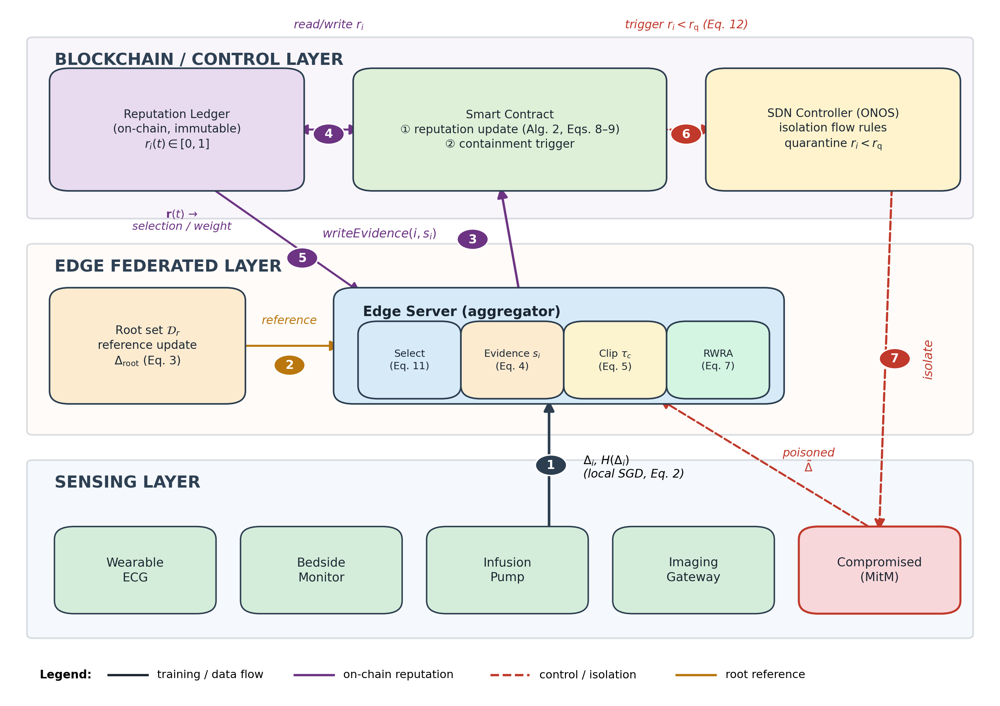
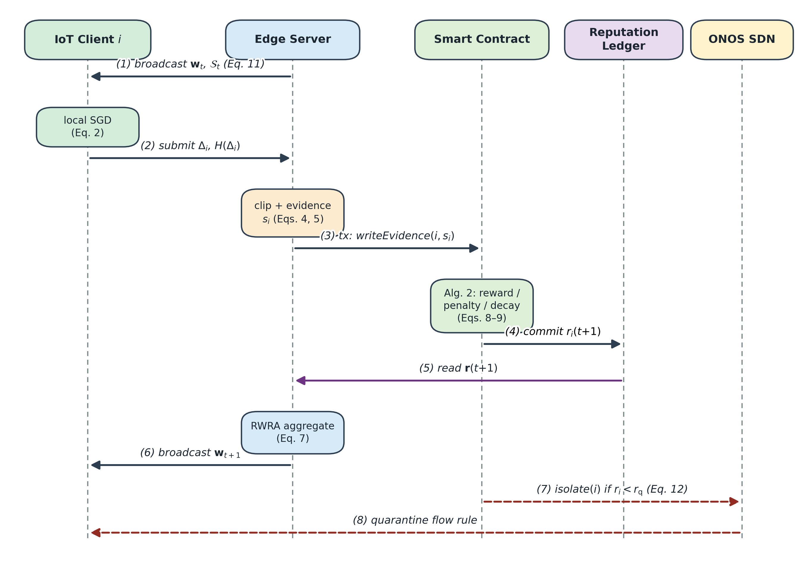
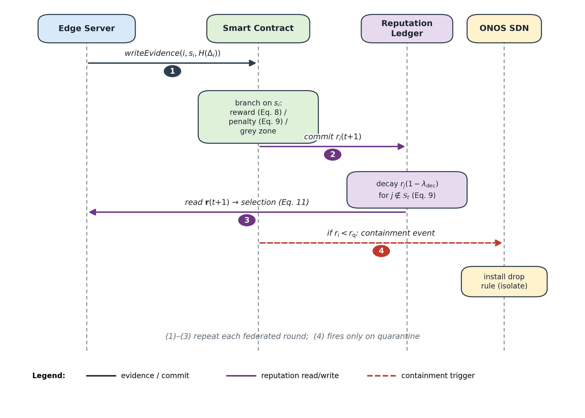

# 4. Proposed FedRBC Framework

## 4.1 Architecture overview

Fig. 1 shows the three-layer architecture, in which data flows in one direction only: raw data never leaves the sensing layer, and only parameter deltas and scalar evidence cross layer boundaries. The full system executes one federated round per Alg. 1, the training protocol given in Appendix A together with the reputation contract (Alg. 2) and the selection rule (Alg. 3); the algorithms are cited in that order throughout.

**Sensing layer.** Medical IoT devices act as FL clients. Each device $i$ holds a private dataset $\mathcal{D}_i$ (flow statistics extracted on-device: 30 features of inter-arrival moments, protocol flags, and byte/packet counts) and executes local SGD. Devices are heterogeneous in compute ($u_i$) and link quality, which the selection rule prices explicitly (Section 4.5).

**Edge federated layer.** A logically centralized but *untrusted* edge server coordinates training: it selects clients, collects updates, evaluates directional evidence against $\mathcal{D}_r$, and performs the reputation-weighted robust aggregation of Section 4.3. Because the server is untrusted, every scalar that drives an irreversible decision is committed on-chain before use.

**Blockchain trust plane and SDN control plane.** The permissioned consortium ledger hosts two smart contracts: the reputation contract (Alg. 2) maintaining the immutable ledger $\{r_i(t)\}$, and the containment contract that translates on-chain evidence into quarantine decisions. Pairing SDN control with distributed security has direct precedent — the blockchain-enabled security framework of [G1] foreshadows the combination for next-generation IoT, and the blockchain-SDN edge-computing framework of [G2] instantiates it for IoT healthcare systems specifically — but neither closes the loop from *learning-time* evidence to enforcement. Our containment plane does, on the ONOS controller platform [G3], which consumes containment events through its northbound API and installs flow rules isolating convicted devices at the access switch, completing the detect–contain loop (Section 4.5).

**Fig. 1.** FedRBC system architecture for healthcare IoT edge networks. Raw telemetry never leaves the sensing layer; only parameter deltas and scalar evidence cross layer boundaries. Numbered flows: (1) model updates $\Delta_i$ with content hash (local SGD, Eq. 2); (2) root reference $\Delta_{\rm root}$ (Eq. 3); (3) evidence submission $\mathrm{writeEvidence}(i, s_i)$; (4) on-chain reputation read/write; (5) reputation feedback $\mathbf{r}(t)$ to selection and aggregation weights; (6) containment trigger (Eq. 12); (7) SDN isolation of the compromised device. The red dashed path marks the adversarial channel of the MitM device.

Three data classes traverse the system with decreasing sensitivity. Raw telemetry never leaves the device. Model updates cross from sensing to edge over mutually authenticated TLS channels, each accompanied by a SHA-256 content hash binding the off-chain payload to its on-chain evidence record — closing the substitution vector in which a compromised server pairs honest updates with fabricated evidence. Evidence and reputation are the only values written on-chain (a 4-byte scaled score and a 1-byte quantized reputation per client per round): no gradient, feature, or identifier is ever persisted to the ledger, keeping the chain under the same privacy constraints as the FL protocol itself. At $K{=}10$ writes per round, one training job appends roughly 25 KB of evidence, so the audit trail is effectively unlimited.

## 4.2 Interaction workflow

Fig. 2 details one federated round. The sequence is engineered so that no unverified quantity can influence the model or the reputation state: (1) the server broadcasts $\mathbf{w}_t$ and the selected set $\mathcal{S}_t$ (Alg. 3); (2) selected clients train locally and submit $\Delta_i$ with content hash $H(\Delta_i)$; (3) the server clips updates (Eq. 5), computes directional evidence $s_i$ (Eq. 4), and issues a `writeEvidence` transaction per client; (4) the reputation contract applies the reward/penalty/decay branches of Eqs. 8–(9) and commits $\mathbf{r}(t{+}1)$; (5) RWRA (Eq. 7) produces $\mathbf{w}_{t+1}$ using the freshly committed $\mathbf{r}(t{+}1)$ — read after contract execution, never from the server's cache; (6) if any $r_i < r_{\mathrm{q}}$, the containment contract emits an event consumed by ONOS within one control-plane round trip.

**Fig. 2.** Interaction sequence of one federated round in FedRBC. Steps (1)–(6) constitute the training loop; steps (7)–(8) fire only when a client's on-chain reputation crosses the quarantine threshold. Evidence and reputation are the only values committed on-chain; model payloads stay off-chain, bound to their evidence by content hashes.

## 4.3 Reputation-weighted robust aggregation (RWRA)

RWRA layers three inexpensive operations, each neutralizing one attack class of Section 2.2. First, *directional evidence* against the root update (Eq. 3):

$$s_i = \cos(\Delta_i, \Delta_{\mathrm{root}}) = \frac{\langle \Delta_i, \Delta_{\mathrm{root}} \rangle}{\|\Delta_i\| \, \|\Delta_{\mathrm{root}}\|}. \tag{4}$$

Second, *two magnitude safeguards*. A Layer-0 statistical pre-filter removes norm outliers before any direction processing: with $z_i = \lvert\|\Delta_i\| - \mathrm{med}_j\|\Delta_j\|\rvert / (1.4826\,\mathrm{MAD}_j)$, clients with $z_i > z_{\mathrm{th}}$ ($z_{\mathrm{th}}{=}2$) are excluded from the round. Survivors are clipped relative to the reference scale,

$$\bar{\Delta}_i = \Delta_i \cdot \min\!\left(1, \frac{\tau_c(t)}{\|\Delta_i\|}\right), \qquad \tau_c(t) = \kappa_c \, \|\Delta_{\mathrm{root}}(t)\|, \tag{5}$$

with $\kappa_c = 2$ in all experiments. (The clip scaling $\kappa_c$ is deliberately distinct from the penalty acceleration factor $\kappa$ of the reputation contract, Eq. 9 — the two parameters are unrelated and we keep separate symbols for them.) The pre-filter rejects gross magnitude attacks, while the relative radius — which tightens automatically as $\|\Delta_{\mathrm{root}}\|$ shrinks with convergence — bounds the residue of milder inflation.

Third, *softmax evidence gating* weights each surviving update by an exponential function of its directional evidence, and the reputation-weighted combination produces the global step:

$$q_i = \frac{p_i \, r_i(t)\,\mathbb{1}[z_i \le z_{\mathrm{th}}]\,\exp(s_i/T_s)}{\sum_{j \in \mathcal{S}_t} p_j \, r_j(t)\,\mathbb{1}[z_j \le z_{\mathrm{th}}]\,\exp(s_j/T_s)}, \tag{6}$$

$$\mathbf{w}_{t+1} = \mathbf{w}_t + \eta_g \sum_{i \in \mathcal{S}_t} q_i \, \bar{\Delta}_i, \tag{7}$$

with temperature $T_s = 0.3$. The complete per-round protocol is given in Alg. 1; the exponential gate is the key design choice: a reversed update ($s_i \approx -1$) is suppressed by $e^{-1/T_s} \approx 3.6\%$, effectively annihilated as a hard gate would do, while a *skewed-but-benign* update ($s_i \approx 0$, common under non-IID data) retains an $O(1)$ weight instead of being truncated to zero. Hard ReLU gating, which we also evaluated, discards exactly the honest information that heterogeneous deployments most need to keep — the same tax the softmax form avoids and Section 5.7 quantifies in the no-attack regime. Collusion is defeated for the same reason as with any root-referenced gate: Sybil forgeries share one forged direction, which is *opposite* to $\Delta_{\mathrm{root}}$ by construction, so the forged mass is exponentially suppressed regardless of plurality. Statistical filters fail here precisely because they trust plurality; Eq. (6) trusts an independent reference.

## 4.4 On-chain reputation dynamics

The reputation contract (Alg. 2, Fig. 3) maintains $r_i \in [0,1]$ with three branches, executed atomically per evidence write:

$$r_i \leftarrow (1-\gamma)\, r_i + \gamma\, g(s_i), \quad g(s) = \tfrac{1+s}{2}, \quad s_i \geq \theta_h, \tag{8}$$

$$r_i \leftarrow (1-\kappa\gamma)\, r_i \;\; (s_i < \theta_m); \qquad r_j \leftarrow r_j (1-\lambda_{\mathrm{dec}}) \;\; (j \notin \mathcal{S}_t), \tag{9}$$

with step size $\gamma = 0.3$, penalty acceleration $\kappa\gamma = 0.6$, decay rate $\lambda_{\mathrm{dec}} = 0.01$, and thresholds $\theta_h = 0.3$, $\theta_m = 0.0$; the initial reputation is $r_0 = 0.5$ and the quarantine threshold $r_{\mathrm{q}} = 0.15$. The penalty branch is multiplicative, giving geometric suppression (Prop. 1): a client penalized every round falls below $r_{\mathrm{q}}$ within

$$T_0 = \left\lceil \frac{\ln(r_{\mathrm{q}}/r_0)}{\ln(1-\kappa\gamma)} \right\rceil \tag{10}$$

rounds, independently of its history — with our parameters, $T_0 = 2$. The asymmetry between the two branches (a bounded additive reward against a geometric penalty) is intentional: trust is slow to earn and fast to lose, which is the right incentive for network admission. The decay branch prevents reputation squatting by idle clients. Because all writes are on-chain, the reputation sequence is immutable and auditable by any consortium member.

**Fig. 3.** On-chain reputation management workflow (Alg. 2). Each evidence write is routed to the reward, penalty, or grey-zone branch by the evidence thresholds; non-participating clients undergo temporal decay; quarantine is triggered when any reputation falls below $r_{\rm q}$, emitting the containment event consumed by the SDN controller.

## 4.5 Reputation-aware selection and containment

Selection maximizes utility under a latency budget $B$ with reputation as a first-class criterion. The density-greedy rule orders clients by

$$d_i = r_i(t)\, u_i / c_i \tag{11}$$

and admits them in that order until quorum $K$ or budget $B$ is met (Alg. 3), a 1/2-approximation to the 0–1 knapsack $\max_{\mathcal{S}} \sum_{i \in \mathcal{S}} r_i u_i$ s.t. $\sum_i c_i \le B$ (Prop. 2). Selection feeds back into security: quarantined clients have $r_i \approx 0$ and are never re-selected, starving persistent adversaries of influence *before* aggregation.

When $r_i$ crosses $r_{\mathrm{q}}$, the containment contract emits an event carrying the evidence trail, and the ONOS controller installs a drop rule for the device's tuple at its access switch. The detect–contain loop thus proceeds through five stages: *detect* (directional evidence $s_i < \theta_m$), *assess* (reputation collapses below $r_{\mathrm{q}}$ within $T_0$ rounds, Prop. 1), *decide* (the containment contract validates the on-chain proof and emits an event), *contain* (ONOS installs the quarantine rule), and *recover* (a patched device re-enters at $r_0$ under cold-start probation). We model the two containment paths asymmetrically. The edge path commits on-chain and actuates locally: with a deterministic block-commit latency $\bar{t}_{\mathrm{chain}}$ and a negligible local switch update, its mean time to containment is

$$\mathrm{MTTC}_{\mathrm{edge}} = \bar{t}_{\mathrm{chain}}. \tag{12}$$

The cloud-roundtrip baseline, by contrast, routes each alert through a cloud security queue — an M/M/1 queue with Poisson arrivals at rate $\lambda_a$ and exponential service at rate $\mu > \lambda_a$, utilization $\rho = \lambda_a/\mu$ — so its mean time to containment is

$$\mathrm{MTTC}_{\mathrm{cloud}} = \frac{1}{\mu - \lambda_a} + \bar{t}_{\mathrm{cloud}}, \tag{13}$$

with wide-area-network (WAN) round-trip $\bar{t}_{\mathrm{cloud}} \gg \bar{t}_{\mathrm{chain}}$. The edge path therefore stays flat in $\rho$ while the cloud path grows without bound as $\rho \to 1$ — the separation measured in Section 5.6; the mean separation $\Delta\mathrm{MTTC} = \bar{t}_{\mathrm{cloud}} - \bar{t}_{\mathrm{chain}} + 1/(\mu-\lambda_a)$ is formalized as Thm. 2.

## 4.6 Theoretical guarantees

The theory is deliberately mechanistic: nothing is assumed that the gate itself does not produce. The argument proceeds in two steps. Theorem 1 states the convergence bound in terms of the residual malicious weight that the aggregate leaves; Lemma 1 then derives this weight explicitly from the gate (Eq. 6) and the ledger (Eqs. 8–9), so the bound rests on measurable mechanism quantities rather than a circular assumption.

**Theorem 1 (convergence).** Let $F$ be $L$-smooth and bounded below, let client stochastic gradients have variance $\sigma^2$, and let honest updates satisfy $\mathbb{E}\|\Delta_i\| \le G$ with directional alignment $\mathbb{E}[\cos(\Delta_i, \nabla F(\mathbf{w}_t))] \ge \mu_d > 0$. Under the directional-separation conditions of Lemma 1, the residual malicious weight of the update rule (Eq. 7) is bounded by the explicit gate-induced quantity $\bar\epsilon_r$ of Eq. (15) — a function of the gate and ledger parameters, not a free assumption. Then with $\eta_g = \Theta(1/\sqrt{T})$,

$$\frac{1}{T}\sum_{t=1}^{T} \mathbb{E}\|\nabla F(\mathbf{w}_t)\|^2 \;\le\; \mathcal{O}\!\left(\tfrac{1}{\sqrt{T}}\right) + \mathcal{O}\!\left((\beta + \bar\epsilon_r)\,\tau_c G\, \tfrac{1}{\sqrt{T}}\right), \tag{14}$$

where the second term carries the explicit $1/\sqrt{T}$ factor and $\tau_c$ is treated as a per-round bound $\tau_c \le \kappa_c\|\Delta_{\mathrm{root}}(t)\|$ that is *bounded* (not assumed to vanish); Appendix B derives the explicit constants. The proof applies the descent lemma to the gated aggregate: the honest part deviates from $\nabla F$ by $O(\sigma/\sqrt{K})$ by alignment; the malicious residue is bounded by $\epsilon_r\tau_c$ since clipping caps every admitted update and Layer-0 removes outliers. Because the penalty branch keeps contracting $r_{\max}(t)$ for exposed adversaries, the adversarial term in Eq. (14) *tightens as reputation learning proceeds* rather than remaining a static slab.

**Lemma 1 (gate-induced residual weight).** Fix a round $t$ and assume: (i) *directional separation* — every honest survivor of the Layer-0 filter has root alignment $s_i \ge c_H$ and every Byzantine survivor has $s_i \le c_B$, with gap $\Delta c = c_H - c_B > 0$ (Eq. 4); (ii) the Layer-0 filter removes no honest client, and at most $\beta K$ of the selected clients are Byzantine; (iii) priors $p_i \in [p_{\min}, p_{\max}]$ and reputations $r_i \in [r_{\min}, r_{\max}]$. Then the aggregate weight that Eq. (6) assigns to Byzantine clients obeys

$$\epsilon_r(t) \;=\; \sum_{i \in \mathcal{B} \cap \mathcal{S}_t} q_i(t) \;\le\; \rho_\beta\, \rho_p\, \rho_r\, e^{-\Delta c/T_s}, \tag{15}$$

with $\rho_\beta = \beta/(1-\beta)$, $\rho_p = p_{\max}/p_{\min}$, and $\rho_r = r_{\max}/r_{\min}$. Every factor is a quantity the mechanism controls or the ledger records: $e^{-\Delta c/T_s}$ is the exponential suppression contributed by the gate, sharpened as the temperature anneals; $\rho_r$ is tightened geometrically by the penalty branch, since Prop. 1 contracts $r_{\max}(t) \le r_0(1-\kappa\gamma)^t$ for a persistently exposed adversary, so that Eq. (15) itself decays as $\bar\epsilon_r \cdot (1-\kappa\gamma)^t$ — spatial suppression by the gate and temporal suppression by the ledger compose multiplicatively; and $\rho_p$ reflects the data layout alone, which the near-uniform Dirichlet partition keeps at $O(1)$.

**Scope of the guarantees.** Lemma 1 makes the security envelope of the theory explicit instead of implicit. Directional separation ($\Delta c > 0$) is constructive for the evaluated direction-inconsistent attacks — sign-flipping forces $s_i \approx -1$, Sybil forgeries share one forged direction *opposite* to the root update, and label-flipping degrades alignment below the honest band — and the root-alignment premise itself presumes an untampered root set. Direction-preserving adversaries shrink $\Delta c$ toward zero, degrading the exponential factor; the defence then leans on Layer-0 filtering, relative clipping, and accumulated reputation evidence — the regime measured by the magnitude-only study of Section 5.7. All quantities in Eq. (15) ($\Delta c$, $\rho_r$, $\epsilon_r$) are logged per round, so the premises of the bound are auditable on-chain rather than taken on faith.

**Proposition 1 (suppression).** Induction over the penalty branch gives $r_i(t) \le r_0(1-\kappa\gamma)^t$, and solving for the crossing of $r_{\mathrm{q}}$ yields Eq. (10). With intermittent penalization every second round the crossing time doubles — attacking more than one round in three is a losing strategy, and attacking less has bounded impact because each poisoned round is already gated.

**Proposition 2 (selection).** Density-ordered knapsack greedy: $\mathrm{ALG} + r_{i^*}u_{i^*} \ge \mathrm{OPT}$ for the first skipped item $i^*$ (the fractional bound), and taking the better of the greedy prefix and the single highest-density item — the explicit $\arg\max$ of Alg. 3, lines 7–8 — achieves half the optimum. **Theorem 2 (MTTC).** The edge path has deterministic latency $\bar{t}_{\mathrm{chain}}$ (Eq. 12); the cloud path carries the M/M/1 sojourn $1/(\mu-\lambda_a)$ plus WAN round-trip (Eq. 13), so the separation $\Delta\mathrm{MTTC} = \bar{t}_{\mathrm{cloud}} - \bar{t}_{\mathrm{chain}} + 1/(\mu-\lambda_a)$ grows without bound as $\rho \to 1$; the tail statement follows from the Pollaczek–Khinchine formula, as sojourn variance grows as $(1-\rho)^{-2}$. Full proofs are given in Appendix B.

## 4.7 Privacy option: accounted differential perturbation

The transport and ledger hygiene of Section 4.1 already bound *where* data can flow: raw telemetry never leaves devices, only 5-byte scalar evidence touches the chain, and updates cross the network over mutually authenticated channels. For deployments that additionally treat the *model trajectory itself* as sensitive — the gradient-inversion surface — RWRA admits an accounted output-perturbation layer. Releasing the perturbed aggregate

$$\tilde{\mathbf{g}}_t = \underbrace{\sum_{i \in \mathcal{S}_t} q_i\, \bar\Delta_i}_{\mathbf{g}_t} \;+\; \mathcal{N}\!\Big(0,\; \sigma_{\mathrm{dp}}^2\, \frac{C_t^2}{K}\, I\Big), \qquad C_t = \mathrm{med}_i \|\bar\Delta_i\|, \tag{16}$$

is a Gaussian mechanism whose scale is tied to the per-round reference norm: because every admitted update is already clipped (Eq. 5), the $\ell_2$-sensitivity of the aggregate is bounded, and under uniform weights ($q_i = 1/K$) the per-round Rényi loss at order $\alpha > 1$ is $\varepsilon_{\mathrm{RDP}}(\alpha) = \alpha/(2\sigma_{\mathrm{dp}}^2 K)$; for the gated weights of Eq. (6) the same expression holds with $K$ replaced by $1/q_{\max}$, a conservative calibration. Composing over $T$ rounds and converting yields the accounted budget

$$\varepsilon(T, \delta) \;\le\; \min_{\alpha > 1} \left\{ \frac{\alpha\, T}{2\sigma_{\mathrm{dp}}^2 K} \;+\; \frac{\ln(1/\delta)}{\alpha - 1} \right\}. \tag{17}$$

Three properties make the layer composable with the defence rather than antagonistic to it. First, the noise is added *after* evidence scoring and gating, so the directional statistics $s_i$ and the Layer-0 z-scores are computed on clean updates — the gate's inputs are unaffected, and what the noise protects is exactly the released trajectory. Second, the scale follows the *relative* norm $C_t$ that shrinks with convergence — no fixed clipping constant to re-tune, the same adaptivity the robustness analysis exploits. Third, the composition cost is paid once per round regardless of the attack regime: the accuracy–robustness trade-off at $\sigma_{\mathrm{dp}} \in \{0.005, 0.02, 0.1\}$ for FedRBC, FLTrust, EIFFeL, and FedAvg is measured in Section 5.9, so a deployment locates its working point on a measured curve rather than guessing. The layer's boundary is stated honestly: it protects the *aggregated trajectory*; per-update confidentiality against an honest-but-curious aggregation server additionally requires secure aggregation, which is orthogonal to the Byzantine-resilience machinery of this paper and is discussed in Section 6.
